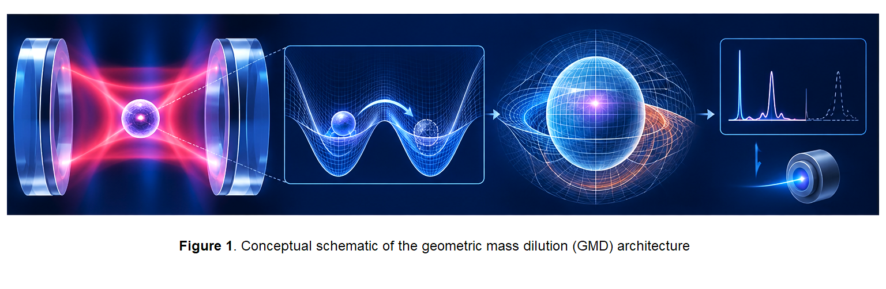

# Geometric Mass Dilution: A Scheme for Observable Quantum Tunneling of Macroscopic Objects via Parity-Degenerate Cavities

**Baoliin (Zaitian) Wu 伍宝林**

*ORCID:* [0009-0003-2051-5247](https://orcid.org/0009-0003-2051-5247)

*Email:* zaitian001@gmail.com

*Affiliation:* People's Government of Guangdong Province, Guangzhou, CN

**October 22, 2026**

**Paper ID: DW58553922**

---

## Abstract

Standard quantum mechanics predicts that the WKB transmission exponent for a rectangular barrier is proportional to the square root of the object's mass when barrier geometry and energy are held fixed. We examine **Geometric Mass Dilution (GMD)** as a phenomenological hypothesis within the author's **MES (Modified Einstein Spherical) cosmological architecture** [4–6]. MES curvature scalings are treated here as model postulates, not as experimentally established laws. GMD introduces a measurement interval $\tau$ and a dimensionless state-complexity proxy into a proposed effective-mass function. The manuscript distinguishes two sub-hypotheses: GMD-A, concerning experimentally controllable coherence and decoherence dynamics, and GMD-B, the stronger claim that an effective inertial mass entering tunneling dynamics changes beyond standard Hamiltonian effects.

A numerical audit gives $S_{\mathrm{WKB}} \approx 6.7\times10^7$ for a silica sphere of radius $75$ nm and mass $3.9\times10^{-18}$ kg crossing a rectangular barrier of width $100$ nm and height above energy of $1$ meV. This yields $T\sim e^{-6.7\times10^7}$ in the leading WKB approximation. The proposed GMD mass law is not derived from a fundamental action, and a finite-resolution regularization removes a divergence and sets a formal reference-state normalization by construction, but does not establish the physical validity of that normalization. Likewise, writing a total Hamiltonian does not by itself prove energy conservation under explicitly time-dependent driving or open-system Lindblad evolution.

We propose a staged research program using levitated optomechanics, parity-controlled double-well potentials, independent coherence measurements, and calibrated tunneling statistics. This paper frames GMD as a **candidate—not established—form of physical manifold programming**: controlled changes in system representation or state-space organization may alter dynamics, but a claim of altered effective inertia requires separate identification. Geometric Pathology and manifold programming are treated as complementary methodological perspectives, not equivalent theories. The proposed architecture is falsifiable in principle, but the present manuscript establishes a research hypothesis and test plan—not a demonstrated mass-dilution effect or experimental feasibility claim. All statements are classified by evidence status, and GMD-A is kept logically separate from GMD-B.

**Keywords:** geometric mass dilution, manifold programming, geometric pathology, macroscopic quantum tunneling, levitated optomechanics, parity degeneracy, decoherence, MES universe model, energy accounting, failure mode analysis, evidence-level classification L1–L4

---

## 0. Evidence-Level Classification (L1–L4)

Throughout this paper, we adopt the four-level evidence hierarchy established in the self-preprint DW58553905 [7]:

| Level | Label | Nature of Evidence | Example in This Paper |
| --- | --- | --- | --- |
| **L1** | Strict mathematical theorem, or reproducible mathematical calculation | A result obtained by direct derivation or calculation from stated inputs and standard mathematics, without reliance on unverified physical assumptions. The theorem branch requires a complete proof chain; the calculation branch requires stated inputs, transparent steps, and reproducibility. | Dimensional consistency of Eq. (4) (deductive); rectangular-barrier WKB exponent $S_{\mathrm{WKB}} \approx 6.7\times10^7$ (numerical) |
| **L2** | Strict mathematical construction, or conditional mathematical derivation | A definitional construction or algebraic consequence that depends on explicitly stated assumptions or construction choices; the derivation does not validate those assumptions physically. | Regularized mass function $f_{\mathrm{reg}}$ (construction); curvature-dependent Planck-time scaling conditional on the MES definitions in Appendix B (conditional derivation) |
| **L3** | Testable modeling hypothesis | Proposed relationship whose complete derivation or empirical validation remains outstanding | MES curvature scaling; GMD dilution function; candidate Lindblad evolution of $\rho$ and derived $D_{\mathrm{PR}}$; total Hamiltonian; candidate manifold-programming interpretation |
| **L4** | Unverified conjecture or engineering blueprint | Exploratory concept or architectural proposal | $\tau$ divergence at parity-degenerate point |

**MES postulates** (inherited from DW58553914, DW58553921) are labeled **P** and treated as the theoretical baseline of this paper.

---

## 1. Introduction

### 1.1 The Macroscopic Tunneling Deadlock

Quantum tunneling is one of the most striking manifestations of quantum mechanics. A particle of mass $M$ incident on a potential barrier $V(x)$ of width $L$ and height $V_0$ has a transmission probability given, in the WKB approximation, by

$$ T \sim \exp\left( -\frac{2}{\hbar} \int_{0}^{L} \sqrt{2M(V(x)-E)} \, dx \right). \quad (1) $$

For a rectangular barrier, the exponent is

$$ S_{\text{WKB}} = \frac{2L}{\hbar} \sqrt{2M(V_0 - E)}. \quad (1\text{a}) $$

For microscopic particles, this probability can be substantial. For macroscopic objects, the exponent grows, and the tunneling probability becomes astronomically small.

**Numerical correction (L1).** For a silica nanoparticle of radius $75$ nm, the mass is

$$ M = \frac{4\pi}{3} \rho R^3 \approx 3.9 \times 10^{-18} \text{ kg} \approx 2.4 \times 10^9 \text{ amu}, \quad (1\text{b}) $$

where $\rho \approx 2.2 \times 10^3$ kg/m$^3$.

For a barrier of height $V_0 - E = 1$ meV and width $L = 100$ nm, the WKB exponent is

$$ S_{\text{WKB}} = \frac{2L}{\hbar}\sqrt{2M(V_0-E)} \approx 6.7\times10^7. \quad (1\text{c}) $$

The corresponding leading-order transmission estimate is $T_{\text{std}}\sim e^{-6.7\times10^7}$. This value follows from the stated rectangular-barrier parameters; it is not a universal threshold for macroscopic tunneling. The standard WKB exponent scales as $\sqrt{M}$ when barrier width and height are fixed, not linearly in $M$.

This suppression follows from the standard WKB expression under the stated assumptions. The distinctive GMD-B claim—that a geometric-control protocol changes the inertial parameter entering the tunneling dynamics beyond standard Hamiltonian and environmental effects—requires a dedicated test and is not established by the baseline calculation.

### 1.2 The MES Cosmological Architecture

The MES (Modified Einstein Spherical) universe model, developed in a series of the author's self-preprints [4,5,6], posits that the universe is a topologically closed $S^3$ manifold equipped with a dynamical scalar curvature field. Physical constants and particle properties emerge from the curvature of this manifold.

The MES architecture adopts the following curvature scaling relations as **testable modeling hypotheses (L3)**:

$$ c(R) = c_0 \left( \frac{R}{R_0} \right)^{1/2}, \quad \hbar(R) = \hbar_0 \left( \frac{R_0}{R} \right)^{1/2}, \quad m(R) = m_0 \left( \frac{R_0}{R} \right)^{1/2}. \quad (\text{MES-1}) $$

[Source: [5], Eq. (3)–(4); [4], Eq. (19)–(21); L3]

These imply two curvature invariants:

$$ \hbar(R) c(R) = \hbar_0 c_0, \quad m(R) c(R) = m_0 c_0. \quad (\text{MES-2}) $$

[Source: [5], Eq. (3)–(4); L3]

The MES architecture also proposes a decoherence rate scaling $\Gamma(R) \propto R^{3/2}$ and redefines effective mass as "the local effective inertia of the open quantum geometric field under the constraint of the universal curvature network" [6]. In the MES architecture, gravity is itself a curvature-driven emergent phenomenon and is therefore not treated as an independent contributor to the measurement interval $\tau$.

**Important status note.** The MES scaling relations (MES-1) are explicitly labeled as "linked hypotheses" in DW58553921 [4], not as derived consequences of the closed $S^3$ geometry. The present paper adopts MES-1 as its theoretical baseline and extends it with the GMD hypothesis.

### 1.3 Geometric Mass Dilution (GMD): The Core Hypothesis

We introduce **Geometric Mass Dilution (GMD)** as a phenomenological extension of the MES architecture. The central hypothesis is that an effective inertial parameter in a reduced description may depend on local curvature $R$, a measurable control or observation interval $\tau$, and a separately defined state-complexity statistic. The physical meaning of $\tau$ must be operationally specified by an independently measurable protocol; it is not assumed that observation alone changes a system merely because it is observed.

The unregularized expression considered in earlier drafts was

$$ f_{\mathrm{raw}}(\tau,R,D)=\left(\frac{\tau_0(R)}{\tau}\right)^2\chi(D). \quad (2) $$

where $\tau_0(R)$ is a curvature-dependent Planck-time scale under the MES assumptions, and $\chi$ is a nonnegative state-complexity factor. The choice $\chi(D)=\sqrt{1-1/D}$ is only one phenomenological option and is not adopted as a verified physical law. The raw expression diverges as $\tau\to0$ for fixed nonzero $\tau_0$ and nonzero $\chi$; it therefore cannot serve as a complete model across the standard limit.

For the quantitative discussion, we adopt the single **candidate regularized function**

$$ f_{\mathrm{reg}}(\tau,R,D)=\frac{\tau_0(R)^2}{\tau^2+\tau_0(R)^2}\frac{\chi(D)}{\chi(D_{\mathrm{ref}})}. \quad (3) $$

Here $D$ denotes whichever state-complexity observable is explicitly selected and measured for a given test; $D_{\mathrm{ref}}$ is a pre-registered reference state with $\chi(D_{\mathrm{ref}})>0$. This form has $f_{\mathrm{reg}}(0,R,D_{\mathrm{ref}})=1$ by construction, and for $\tau\gg\tau_0(R)$ its temporal factor approaches $[\tau_0(R)/\tau]^2$. This normalization is a modeling choice. It does not derive the mass law, establish that $\tau_0$ is the relevant physical crossover scale, or show that the state-complexity factor modifies inertia.

The effective-mass hypothesis is therefore written as

$$ M_{\mathrm{eff}}(R,\tau,D)=M_{\mathrm{bare}}(R)f_{\mathrm{reg}}(\tau,R,D). \quad (4) $$

No unique numerical $M_{\mathrm{eff}}$ is claimed until the observable $D$, function $\chi$, reference state, and crossover scale are independently specified or calibrated. Even after calibration, a measured change in an inferred effective parameter must be distinguished from changes in the potential, drive, environmental coupling, state preparation, and readout.

For a fixed barrier and unchanged $\hbar$, inserting this candidate $M_{\mathrm{eff}}$ into a WKB expression gives a conditional algebraic change in the exponent proportional to $\sqrt{M_{\mathrm{eff}}}$. This substitution is not a derivation of the mass law and does not establish that the physical barrier or Hamiltonian remains unchanged.

**Figure 1. Conceptual schematic of the geometric mass dilution (GMD) architecture.** A macro-object is confined in an optical cavity, where geometric modulation is hypothesized to reduce the effective mass and modify the tunneling dynamics. The right panel illustrates the potential experimental readout. The mechanism is a candidate phenomenological hypothesis requiring independent validation; no mass-dilution effect is demonstrated.

### 1.4 Scope of This Paper

The broader geometric program draws on the author's earlier work on closed-spherical geometry and AGI [1], geometric mass [2], and quantum-measurement coordinates [3]. These works provide conceptual context only; they are not empirical evidence for GMD.

This paper presents a staged research plan to test the GMD hypothesis using a levitated optomechanical platform. It aims to:

1. Calibrate a cavity-controlled double-well and measure parity splitting; the conjectured divergence of $\tau$ near a degeneracy point remains L4.
2. Test whether a pre-registered control protocol changes a declared state-complexity observable, without assuming that a true correlation dimension decreases toward unity.
3. Measure tunneling statistics and compare them with a calibrated standard driven open-system model.
4. Test algebraic identities implied by the MES scaling assumptions, while keeping those assumptions distinct from empirical validation.
5. Analyze failure modes and separate experimental limitations from falsification of a specified model.
6. Formulate a candidate total Hamiltonian and a complete work-and-heat budget; energy conservation is not presumed from a Hamiltonian decomposition alone.

---

## 2. MES Cosmological Foundations and Their Implications for Geometric Mass Dilution

### 2.1 MES Fundamental Postulates (Inherited)

**Postulate 1 (Closed Spherical Geometry).** The universe is modeled as a closed spatial $S^3$ manifold equipped with a dynamical scalar curvature field $R(x,t)$. [Source: [4], Postulate 1; L3]

**Postulate 2 (Curvature-Dependent Physical Constants).** Physical constants scale with local curvature as:

$$ c(R) = c_0 (R/R_0)^{1/2}, \quad \hbar(R) = \hbar_0 (R_0/R)^{1/2}, \quad m(R) = m_0 (R_0/R)^{1/2}, \quad (\text{P-1}) $$

with the algebraic constraints:

$$ \hbar(R) c(R) = \hbar_0 c_0, \quad m(R) c(R) = m_0 c_0. \quad (\text{P-2}) $$

[Source: [5], Eq. (3)–(4); [4], Eq. (19)–(21); L3]

**Postulate 3 (Curvature-Dependent Planck Time).** Under the scaling (P-1), with the gravitational constant derived self-consistently as $G(R) = \hbar(R)c(R)/m_p(R)^2 \propto R$, the Planck time becomes:

$$ \tau_0(R) = \tau_{0,0} \left( \frac{R_0}{R} \right). \quad (\text{P-3}) $$

[Derived from P-1 and the self-consistent definition of $G$; L2; see Appendix B]

**Postulate 4 (Curvature-Dependent Decoherence).** The decoherence rate scales as:

$$ \Gamma(R) = \Gamma_0 (R/R_0)^{3/2}. \quad (\text{P-4}) $$

[Source: [16], Eq. (12); [5], Eq. (7); L3]

**Postulate 5 (Geometric Inertia).** The effective inertial mass of a body is redefined as "the local effective inertia of the open quantum geometric field under the constraint of the universal curvature network." [Source: [6], Section 3; L3]

**Postulate 6 (Gravity as Curvature-Driven Emergence).** In the MES architecture, gravity is itself a curvature-driven emergent phenomenon, treated on the same footing as mass. It is therefore not an independent contributor to the measurement interval $\tau$. [Source: [4]; L3]

### 2.2 From MES Postulates to the GMD Formula: Step-by-Step Derivation

**Step 1: Curvature-dependence of bare mass (L3, inherited from P-1).**

$$ M_{\text{bare}}(R) = M_0 (R_0/R)^{1/2}. \quad (\text{GMD-1}) $$

**Step 2: Curvature-dependence of the Planck time (L2, derived from P-1 and P-3).**

$$ \tau_0(R) = \tau_{0,0} (R_0/R). \quad (\text{GMD-2}) $$

**Step 3: Introduction of the measurement interval $\tau$ (L4, new assumption).**

We hypothesize that the observer's measurement interval $\tau$ is an independent geometric parameter, not fixed by the MES postulates. In standard quantum mechanics, $\tau \to 0$. In the GMD regime, $\tau$ can be extended by the parity-degenerate cavity.

**Step 4: Candidate regularized dilution function (L2/L3, construction plus hypothesis).**

For a single consistent quantitative parametrization, we adopt

$$ f_{\mathrm{reg}}(\tau,R,D)=\frac{\tau_0(R)^2}{\tau^2+\tau_0(R)^2}\frac{\chi(D)}{\chi(D_{\mathrm{ref}})}. \quad (\text{GMD-3}) $$

An unregularized inverse‑square ansatz is presented for comparison in Appendix A. The function $\chi$ and the measured state-complexity variable $D$ must be declared before fitting or predicting data.

**Step 5: Effective mass (L2/L3, conditional inference).**

Substituting the MES bare-mass scaling and conditional Planck-time scaling gives

$$ M_{\mathrm{eff}}=M_0\left(\frac{R_0}{R}\right)^{1/2}\frac{\tau_{0,0}^2(R_0/R)^2}{\tau^2+\tau_{0,0}^2(R_0/R)^2}\frac{\chi(D)}{\chi(D_{\mathrm{ref}})}. \quad (\text{GMD-4}) $$

This is an internally consistent algebraic expression given the stated model choices; it is not a first-principles derivation or evidence that the physical inertial mass changes.

**Step 6: Experimental-regime simplification (L3).**

For the illustrative regime $R\approx R_0$, the candidate function reduces to

$$ M_{\mathrm{eff}}\approx M_0\frac{\tau_{0,0}^2}{\tau^2+\tau_{0,0}^2}\frac{\chi(D)}{\chi(D_{\mathrm{ref}})}. \quad (\text{GMD-5}) $$

**Step 7: Conditional numerical scaling (L3).**

For $\tau\sim10^{-3}$ s and $\tau_{0,0}\sim10^{-44}$ s, the temporal factor is approximately $10^{-82}$ when $R\approx R_0$. This is an algebraic consequence of the candidate function, not a physical mass prediction. No numerical $M_{\mathrm{eff}}$ is reported until $\chi(D)$, $D_{\mathrm{ref}}$, and the measurement protocol are specified. If the selected complexity factor approaches zero, it further suppresses the proposed function; the resulting effect on tunneling must be derived from the full dynamical model rather than inferred from this factor alone.

### 2.3 Inheritance vs. New Inference vs. Hypothesis: Summary Table

| Element | Status | Source |
| --- | --- | --- |
| $S^3$ closed geometry | MES postulate (P), L3 | [4], Postulate 1 |
| $c(R)$, $\hbar(R)$, $m(R)$ scaling | MES postulate (P), L3 | [5], Eq. (3); [4], Eq. (19)–(21) |
| $\tau_0(R)$ scaling | Derived (L2), conditional on $G(R) \propto R$ | This paper, Appendix B |
| $\Gamma(R) \propto R^{3/2}$ | MES postulate (P), L3 | [16], Eq. (12); [5], Eq. (7) |
| Geometric inertia | MES postulate (P), L3 | [6], Section 3 |
| Gravity as emergent | MES postulate (P), L3 | [4] |
| Measurement interval $\tau$ | New assumption (L4) | This paper |
| Regularized dilution function $f_{\mathrm{reg}}$ | Construction (L2) + modeling hypothesis (L3) | This paper, Eq. (GMD-3), Appendix A |
| $M_{\text{eff}}$ formula | Conditional inference (L2/L3) | This paper, Eq. (GMD-4) |
| Total Hamiltonian | New hypothesis (L3) | This paper, Section 2.12 |
| Lindblad evolution of $\rho$ and derived $D_{\mathrm{PR}}$ | Candidate open-system model (L3); does not determine $D_2$ | This paper, Appendix C.2 |

### 2.4 Curvature-Dependent Decoherence

From Postulate 4 (P-4):

$$ \Gamma(R) = \Gamma_0 (R/R_0)^{3/2}. \quad (5) $$

This scaling provides a quantitative basis for the state-complexity control freezing protocol. In the parity-degenerate cavity, the effective curvature $R$ can in principle be tuned by adjusting the optical potential—though we emphasize that the connection between **optical potential curvature** and **spacetime curvature $R$** is not established (L4). We therefore treat the $\Gamma \propto R^{3/2}$ scaling as a theoretical prediction (L3) requiring experimental verification.

### 2.5 Parity Degeneracy and the Measurement Interval

In a standard symmetric double-well potential with finite barrier height, the two lowest energy eigenstates are the symmetric and antisymmetric superpositions, with an energy splitting $\Delta = E_+ - E_- > 0$. Equal well depths do **not** imply $E_+ = E_-$. The splitting vanishes only in the limit of infinite barrier height (zero tunneling coupling).

We define the **parity-degenerate point** as the limit in which the tunneling coupling is negligibly small compared to all other energy scales. In this limit, the measurement interval $\tau$ is hypothesized to diverge (L4). The derivation of this divergence from a microscopic model remains an open problem.

### 2.6 State-Complexity Control and Decoherence

We hypothesize that decoherence is governed by Eq. (5). To freeze decoherence, we propose:

1. Test whether a pre-registered pulse sequence reproducibly changes a declared state-complexity observable; do not assume in advance that a true correlation dimension decreases toward 1.
2. Reduce the environmental coupling by canceling the background curvature through the cavity's optical potential.

The pulse sequence is designed to implement $C_4$ symmetry operations on the phase-space lattice. A candidate Lindblad model and distinct definitions for $D_{\mathrm{PR}}$ and $D_2$ are given in Appendix C.

**Caveat.** Reducing decoherence does not automatically reduce the inertial mass. The connection between decoherence control and mass dilution is a **model assumption (L3)**. We therefore separate GMD into two independently testable sub-hypotheses:

* **GMD-A:** Geometric control can modify the system's effective decoherence and coherence time (L3).
* **GMD-B:** After excluding ordinary control effects, the system exhibits an effective mass or tunneling scaling that cannot be explained by standard Hamiltonians (L4).

### 2.7 Terminology: Three Distinct Time Scales

To avoid conceptual confusion, we explicitly distinguish three time scales used in this paper:

| Symbol | Name | Physical Meaning | Typical Value |
| --- | --- | --- | --- |
| $\tau$ | Measurement interval | Characteristic time over which the observer's coordinate frame projects the system onto a definite spatial basis; controlled by the pulse sequence and cavity modulation | $10^{-5}$–$10^{-3}$ s (GMD regime) |
| $\tau_c$ | Cavity photon lifetime | Decay time of the intracavity field; determined by cavity finesse and mirror losses | $\sim 10^{-6}$ s for $F = 10^5$, $L_{\text{cav}} = 1$ cm |
| $T_2$ | Decoherence time | Coherence time of the particle's center-of-mass motion; determined by environmental coupling and the state-complexity control protocol | $10^{-6}$–$10^{-3}$ s (target) |

The GMD regime requires $\tau \gg \tau_c$ and $\tau \sim T_2$, so that the measurement interval dominates over both the cavity dynamics and the residual decoherence.

### 2.8 Geometric State-Space Reconstruction and Dynamical Identifiability

This section imports a methodological distinction from the author's **Geometric Pathology** architecture [17]: geometry of a state space, dynamics on that state space, and empirical identification of a mechanism are related but non-equivalent questions. This methodological connection does not constitute evidence for GMD, nor does it transfer biological or complex‑adaptive‑system results directly to a quantum optomechanical platform.

$D_2$ in the GMD ansatz is not identified with the density-matrix statistic in Appendix C. A true correlation dimension must be independently defined and estimated; $D_{\mathrm{PR}}$ is an optional, distinct proxy and must not be substituted for $D_2$ without a justified mapping.

#### 2.8.1 Operational state space and metric

Let $\mathbf{x}(t)$ denote a vector of experimentally reconstructed observables, for example particle position and momentum quadratures, cavity quadratures, and calibrated control variables. A state-space metric $g_{ij}(\mathbf{x})$ may be estimated only after specifying the observables, their uncertainties, and the reconstruction procedure. The metric is a statistical or dynamical descriptor of the selected representation; it must not be identified automatically with spacetime curvature $R$ or with the curvature of the optical potential.

A candidate line element is

$$ ds^2 = g_{ij}(\mathbf{x})\,dx^i dx^j. \quad (\text{GP-1}) $$

Equation (GP-1) is a definition once $g_{ij}$ has been operationally specified; it is not a derivation of the GMD mass law.

#### 2.8.2 Dynamics and stability are separate from geometry

A reconstructed state-space geometry does not establish that a state is an attractor. For a deterministic reduced model $\dot{\mathbf{x}}=\mathbf{F}(\mathbf{x},t)$, local stability must be tested using the Jacobian $J_{ij}=\partial F_i/\partial x_j$ and its eigenvalues, while stochastic dynamics require an explicit noise model and appropriate stability or escape-rate analysis. Any claimed reduction in decoherence must be supported by independently measured coherence times or a validated open-system model.

#### 2.8.3 Mechanism identifiability

A change in observed tunneling rate can arise from several mechanisms that must be discriminated: (i) changes in barrier height or width; (ii) ordinary drive-induced transitions or heating; (iii) changes in environmental decoherence; (iv) state preparation and detection bias; or (v) a genuine change in the inertial parameter entering the kinetic term. The fifth interpretation is the distinctive GMD-B claim and cannot be inferred from a rate increase alone. Barrier spectroscopy, independent mass calibration, control-sequence reversals, temperature and pressure scans, and a standard open-system model should be used to test competing explanations.

#### 2.8.4 Falsifiable separation of GMD-A and GMD-B

GMD-A is supported only if the control protocol produces reproducible coherence or decoherence changes beyond calibrated ordinary-control effects. GMD-B requires an additional, independently identifiable deviation in tunneling or inertial dynamics that remains after those effects are modeled. Evidence for GMD-A does not imply GMD-B. A null result constrains only the parameter region actually reached and measured; it falsifies a specified GMD-B model only when its predicted signal and uncertainty are fixed in advance and excluded by the data.

**Geometric caveat.** State-space statistical curvature, optical-potential curvature, and spacetime scalar curvature are different mathematical and physical quantities. Any mapping among them must be defined and experimentally or theoretically justified rather than assumed.

#### 2.8.5 GMD as a Candidate Form of Physical Manifold Programming

Within the MES research architecture, **manifold programming** is used here as a working methodological term for a controlled intervention that reproducibly changes a system's accessible state-space organization, its dynamical law or vector field, or the stability and accessibility of its states. The term does not mean that a physical manifold is literally rewritten, and it does not imply a change in inertial mass. In a quantum-optomechanical implementation, the controlled objects may include cavity parameters, parity splitting, drive protocols, couplings, and the experimentally reconstructed state distribution.

GMD may therefore be investigated as a **candidate physical realization of manifold programming** if a controlled geometric or cavity intervention produces a reproducible, independently characterized change in the system's state-space description and dynamics. This is a research connection, not an established equivalence. In particular, a changed optical potential, a changed state-space metric, or a changed coherence time is not by itself evidence that the inertial mass in the kinetic term has changed.

The proposed causal sequence is:

$$ \text{geometric control} \rightarrow \text{state-space reconstruction} \rightarrow \text{dynamical response} \rightarrow \text{effective-inertia hypothesis} \rightarrow \text{verifiable test}. \quad (\text{GP-2}) $$

Equation (GP-2) is a research logic diagram, not a derived physical law. Each arrow represents a separate claim requiring operational definitions, quantitative modeling, and evidence. A result at an earlier stage does not establish a later stage.

#### 2.8.6 Three Levels of Manifold-Programming Claims

For experimental clarity, the proposed connection is divided into three levels:

| Level | Claim | Minimum evidence required | What it does not establish |
| --- | --- | --- | --- |
| **G1: State-space programming** | Controlled intervention changes the experimentally reconstructed accessible-state distribution, constraints, or operational geometry | A declared reconstruction method, uncertainty estimates, reproducibility, and controls for measurement artefacts | A new dynamical law or a change in inertial mass |
| **G2: Dynamical programming** | The intervention reproducibly changes stability, coherence, transition rates, or state accessibility | Independent dynamical measurements and comparison with a standard driven open-system model | GMD-B or mass dilution |
| **G3: Effective-inertia programming** | An independently identifiable effective inertial parameter entering the kinetic term changes beyond conventional explanations | A self-consistent dynamical model, calibrated barrier and drive, independent mass/inertia constraints, and pre-registered tests that discriminate alternative mechanisms | A universal or fundamental mass law beyond the tested regime |

G1 and G2 are experimentally meaningful outcomes even if G3 fails. Conversely, an apparent tunneling enhancement cannot be assigned to G3 unless changes in barrier geometry, external driving, heating, environmental decoherence, state preparation, and detection efficiency have been constrained. This hierarchy keeps the weaker state-space and coherence claims separate from the stronger GMD-B claim.

#### 2.8.7 Complementarity with Geometric Pathology

The author's Geometric Pathology architecture [17] studies how structural organization and dynamical stability of complex-system state spaces may deteriorate or undergo transitions. Manifold programming, as used in this paper, asks the complementary intervention-oriented question: can controlled changes reproducibly reshape a system's accessible states or dynamics? The two perspectives can inform a common methodological program, but they are not exact opposites, and no one-to-one reversible transformation between them is assumed. A system's geometric descriptor does not by itself establish attraction, pathology, controllability, or physical causation; these require separate dynamical and empirical tests.

For GMD, the practical implication is modest but useful: use the state-space methodology to organize candidate observables and intervention tests, while retaining an independent derivation and falsification burden for the effective-mass hypothesis. The geometric-programming interpretation does not repair the currently missing derivation of the dilution function, prove energy conservation, or demonstrate macroscopic tunneling enhancement.

### 2.9 Effective Mass Dilution: Conditional Numerical Scaling

For the candidate regularized function in Eq. (GMD-3), take $R\approx R_0$, $\tau\sim10^{-3}$ s, and $\tau_{0,0}\sim10^{-44}$ s. The temporal factor is

$$ \frac{\tau_{0,0}^2}{\tau^2+\tau_{0,0}^2}\approx10^{-82}. \quad (6) $$

Thus the model would give

$$ \frac{M_{\mathrm{eff}}}{M_{\mathrm{bare}}}\approx10^{-82}\frac{\chi(D)}{\chi(D_{\mathrm{ref}})}. \quad (6\text{a}) $$

This is a conditional algebraic substitution into a phenomenological function, not a physical prediction. It depends critically on the assumption that $\tau_{0,0}$ is the relevant crossover scale and that the chosen state-complexity ratio is defined and calibrated. No numerical mass or tunneling enhancement is claimed from this expression alone. If $\chi(D)/\chi(D_{\mathrm{ref}})$ is very small, the proposed effective-mass factor becomes smaller still; the full dynamical consequences remain to be derived.

### 2.10 Modified Tunneling Probability

For a double-well potential with barrier height $V_0 - E \sim 1$ meV and width $L \sim 100$ nm, the GMD exponent becomes:

$$ S_{\text{GMD}} = \frac{2L}{\hbar} \sqrt{2M_{\text{eff}}(V_0 - E)}. \quad (7) $$

For a fixed rectangular barrier, the exponent obeys the conditional identity $S_{\mathrm{GMD}}=S_{\mathrm{bare}}\sqrt{M_{\mathrm{eff}}/M_{\mathrm{bare}}}$ if $\hbar$, $L$, and $V_0-E$ remain unchanged. With $S_{\mathrm{bare}}\approx6.7\times10^7$, this relation must be evaluated using a specified, regularized $M_{\mathrm{eff}}$. An extremely small assumed mass can make this algebraic exponent small, but that conditional result is not evidence that such a mass is physically realized.

No observable tunneling rate is predicted here until the regularized mass function, barrier dynamics, preparation probability, decoherence, and detection efficiency are specified. A small WKB exponent alone does not determine an experimental event rate.

### 2.11 Algebraic Self-Consistency Constraints

The scaling relations (P-1) imply two algebraic constraints:

$$ \hbar(R) c(R) = \hbar_0 c_0 = \text{constant}, \quad (8) $$

$$ m(R) c(R) = m_0 c_0 = \text{constant}. \quad (9) $$

Both relations follow algebraically from (P-1) and (P-2) (L2). They provide **verification criteria** for GMD. If the measured tunneling rate enhancement is accompanied by a change in the product $\hbar c$ or $mc$ that violates these constraints, the GMD mechanism is ruled out.

**Caveat.** Measuring a change in the cavity resonance frequency is not sufficient to establish a change in the speed of light $c$, because the resonance frequency also depends on the cavity length, refractive index, and temperature (L4).

### 2.12 Total Hamiltonian and Energy Accounting

Energy accounting is a consistency requirement, but it must be derived from a dynamical model. A useful starting decomposition is

$$ H_{\mathrm{model}}(t)=H_{\mathrm{particle}}(t)+H_{\mathrm{cavity}}(t)+H_{\mathrm{int}}(t). \quad (10) $$

with candidate terms

$$ H_{\mathrm{particle}}(t)=\frac{p^2}{2M_{\mathrm{eff}}(t)}+V(x,t), \quad (11) $$

$$ H_{\mathrm{cavity}}=\hbar\omega_c a^\dagger a, \quad (12) $$

$$ H_{\mathrm{int}}(t)=g(t)a^\dagger a\frac{p^2}{2M_0}. \quad (13) $$

These expressions define a phenomenological ansatz, not a derived interaction. The control pulse, $M_{\mathrm{eff}}(t)$, and $g(t)$ may be explicitly time dependent. For a closed quantum system evolving unitarily under a Hamiltonian $H(t)$, the expectation value obeys

$$ \frac{d}{dt}\langle H\rangle=\left\langle\frac{\partial H}{\partial t}\right\rangle. \quad (14) $$

Consequently, $d\langle H\rangle/dt=0$ does not follow when the Hamiltonian is explicitly time dependent. In an open system with Lindblad evolution, additional dissipative terms enter the energy balance. A conservation statement requires either (i) an autonomous enlarged Hamiltonian that includes the pulse source and relevant reservoirs, or (ii) an explicit work-and-heat balance including drive work, cavity leakage, environmental exchange, and particle-cavity interaction energy.

The equality

$$ \Delta E_{\mathrm{particle}}=-\Delta E_{\mathrm{cavity}} \quad (15) $$

is therefore not imposed as a general identity. It is a testable special-case prediction only if all other energy channels are negligible or independently measured and the interaction model derives that balance. The form of $H_{\mathrm{int}}$ must ultimately be obtained from a microscopic coupling or a stated effective action; it cannot be selected solely to enforce the desired conservation result.

### 2.13 Energy Budget: What Can and Cannot Be Concluded

For $H_{\mathrm{particle}}=p^2/[2M_{\mathrm{eff}}(t)]+V(x,t)$, the explicit time derivative contains

$$ \frac{\partial H_{\mathrm{particle}}}{\partial t}=-\frac{p^2}{2M_{\mathrm{eff}}^2}\frac{dM_{\mathrm{eff}}}{dt}+\frac{\partial V}{\partial t}. \quad (16) $$

This expression identifies work associated with a changing effective-mass parameter and a driven potential. It does not, by itself, identify which subsystem receives that energy. To calculate a transfer, one must solve the coupled equations for the particle, cavity, drive source, and environment using specified initial conditions and coupling parameters.

A future estimate $|\Delta E|$ must calculate the measured output quadrature or photon-number estimator, propagate quantum and technical noise, and distinguish coherent signal accumulation from statistical averaging.

The cavity energy capacity alone cannot establish detectability. For independent repetitions with an unbiased estimator, statistical uncertainty often improves as $N^{-1/2}$, whereas a coherent signal may accumulate linearly only under a specified phase-stable protocol; systematic drift and correlated noise need separate treatment. A QND readout proposal therefore requires a complete measurement model and noise budget before a signal-to-noise claim can be made.

**Current status:** the total-Hamiltonian decomposition is a candidate modeling architecture (L3). Energy conservation, the magnitude and sign of particle-cavity energy transfer, and its detectability remain open calculations, not established results.

---

## 3. Experimental Scheme

### 3.1 Platform: Levitated Optomechanics

We choose a levitated optomechanical system as the experimental platform. A silica (SiO$_2$) nanoparticle is trapped in a high-finesse optical cavity in ultra-high vacuum (UHV). Levitated optomechanics offers:

* **Extreme isolation** from the environment.
* **High tunability**: the optical potential can be dynamically shaped.
* **State-of-the-art control**: ground-state cooling has been demonstrated [8–10,13].
* **Quantum delocalization**: coherent expansion over tens of nanometers has been achieved [11,12].

### 3.2 Corrected Experimental Parameters

**Particle mass (L1).** For a silica nanoparticle of radius $R = 75$ nm:

$$ M \approx 3.9 \times 10^{-18} \text{ kg} \approx 2.4 \times 10^9 \text{ amu}. \quad (17) $$

**Alternative parameters.** If a mass of $5 \times 10^7$ amu is desired:

$$ R \approx 21 \text{ nm}. \quad (18) $$

| Parameter | Value |
| --- | --- |
| Cavity finesse | $F > 10^5$ |
| Cavity length | $L_{\text{cav}} \sim 1$ cm |
| Wavelength | $\lambda \sim 1064$ nm |
| Nanoparticle | SiO$_2$, $R = 75$ nm, $M \approx 2.4 \times 10^9$ amu |
| Double-well separation | $d \sim 150$ nm |
| Barrier height | $V_0 - E \sim 1$ meV |
| Modulation frequency | $\omega_{\text{mod}} \sim 2$ MHz |
| Vacuum | $< 10^{-10}$ mbar |

### 3.3 Parity-Controlled Double-Well Design

We consider a Fabry–Pérot cavity with a controllable optical potential. A candidate double-well potential is

$$ V(x,t)=V_0\cos^2(kx)+V_1\cos(2kx+\phi(t)). \quad (19) $$

When $\phi(t)$ is controlled so that the tunneling coupling is small relative to declared experimental energy scales, the system may approach an operational near-degeneracy regime. Equal well depths alone do not imply exact degeneracy of the lowest symmetric and antisymmetric eigenstates; a finite barrier generally leaves a nonzero splitting. The conjectured divergence of the measurement interval $\tau$ at a parity-degenerate point remains L4 and is not derived here. The protocol must distinguish measurements made near this point from measurements made after a controlled change to finite tunneling coupling.

### 3.4 State-Complexity Control Protocol

A sequence of rapid optical pulses is proposed as a controlled intervention, not as an established decoherence-freezing mechanism:

1. **Pulse sequence:** Specify pulse duration, separation, amplitude, phase, and calibration uncertainty before data collection.
2. **State reconstruction:** Measure the selected observables and report reconstruction uncertainty. If $D_{\mathrm{PR}}$ is used, compute it from density-matrix moments; if $D_2$ is claimed, estimate it separately from a phase-space correlation integral over a justified scaling interval.
3. **Feedback:** Record the feedback law and the control-to-potential transfer function.
4. **Environmental controls:** Measure heating, pressure dependence, optical scattering, and ordinary dynamical-decoupling effects.

**Caveat.** Optical-potential curvature is not identified with spacetime curvature $R$. Any change in a state-complexity statistic or coherence time is an empirical result to be measured, not assumed. Appendix C distinguishes density-matrix evolution from correlation-dimension estimation.

### 3.5 Tunneling Measurement Protocol

The protocol separates baseline calibration, state preparation, control intervention, and readout:

1. **Baseline calibration:** Measure the double-well potential, barrier width and height, parity splitting, drive transfer function, and environmental decoherence.
2. **Initialization:** Prepare a specified localized or energy eigenstate and independently estimate preparation fidelity.
3. **Control intervention:** Apply the pre-registered cavity/pulse protocol. If the barrier is changed to enable a measurable transition, record the time-dependent potential and treat the system as driven and potentially non-equilibrium rather than assuming it remains at the same near-degeneracy point.
4. **Detection:** After a pre-registered hold time, measure position using a calibrated readout method and estimate detection efficiency and false-positive rate.
5. **Repetition:** Set trial count by power analysis and account for correlated noise, drift, and systematic uncertainty. Repetition alone does not guarantee a detectable GMD signal.

### 3.6 Algebraic Self-Consistency Tests

To test the constraints (8) and (9):

1. **Effective mass measurement:** The particle's oscillation frequency is measured via its power spectral density.
2. **Effective speed of light measurement:** The cavity's resonance frequency is measured with high precision.
3. **Constraint verification:** The products $\hbar(R)c(R)$ and $m(R)c(R)$ are computed from the measured values.

**Verification:** If the measured products deviate from the constraints by more than the experimental uncertainty, GMD is ruled out.

### 3.7 Energy Transfer Measurement

To test the energy conservation condition (15):

1. **Particle kinetic energy measurement:** The particle's kinetic energy is extracted from its momentum distribution via time-of-flight or position variance.
2. **Cavity energy measurement:** The intracavity photon number is measured via homodyne detection.
3. **Correlation analysis:** The particle kinetic energy change $\Delta E_{\text{particle}}$ is compared with the cavity energy change $\Delta E_{\text{cavity}}$ as a function of $\tau$ and $D_2$.

**Verification:** Construct the full measured energy-balance residual including particle energy, cavity energy, drive work, cavity leakage, interaction energy, and estimated environmental exchange. A nonzero residual beyond the combined uncertainty challenges the specified complete model; a mismatch between particle and cavity energies alone does not rule out Eq. (10) because omitted channels may carry energy.

---

## 4. Expected Signals and Verifiable Predictions

### 4.1 Tunneling Probability Scaling Law

The conditional WKB relation is

$$ S_{\mathrm{GMD}}=S_{\mathrm{bare}}\sqrt{\frac{M_{\mathrm{eff}}}{M_{\mathrm{bare}}}}. \quad (20) $$

provided the barrier profile, incident energy, and $\hbar$ are unchanged. Here $S_{\mathrm{bare}}$ is dimensionless and the mass ratio is dimensionless. A full prediction must substitute a fully specified regularized mass law and include any GMD-induced changes to the potential or open-system dynamics; no independent dimensionless $\alpha$ is assumed.

Standard quantum mechanics predicts:

$$ T_{\text{std}} \propto \exp\left( -\beta \sqrt{M_0} \right), \quad (21) $$

where $\beta$ includes the barrier parameters.

**Key distinction.** The candidate GMD parametrization adds dependence on $\tau$, $R$, and a declared state-complexity observable $D$; its empirical value must be assessed against a calibrated standard model.

### 4.2 Parity-Modulated Switching: Conditional Signature

A resonance near $\omega_{\mathrm{mod}}\approx\omega_{\mathrm{trap}}$ is a candidate phenomenological signature, not a derived prediction of the current model. Neither a sharp resonance nor a quality factor $Q>10^4$ follows from the equations presented here. Quantitative predictions require specified driven open-system dynamics, coupling strengths, damping rates, and a measurement transfer function.

### 4.3 State-Complexity Dependence: Open Hypothesis

The current model does not establish a universal monotonic relation between $D_2$ and tunneling rate. A candidate dependence may be tested only after the state-complexity observable, $\chi(D)$, and regularized mass function are pre-registered. Since a complexity factor can approach zero near a chosen boundary, the sign of the predicted effect cannot be inferred from the label "fractal dimension" alone.

### 4.4 Curvature-Dependent Decoherence Signature

The MES scaling $\Gamma\propto R^{3/2}$ is a conditional model hypothesis inherited from the MES architecture, not a consequence of the GMD mass function. Testing it requires an operational definition of the relevant curvature variable and independent control of ordinary changes in optical potential, temperature, and environmental coupling.

### 4.5 Algebraic Constraint Violation

If the products $\hbar(R)c(R)$ or $m(R)c(R)$ deviate from their reference values, GMD is ruled out (L2).

### 4.6 Energy Transfer Signature

A coupled energy-transfer signature is a possible test only after the drive, cavity loss, environment, and interaction Hamiltonian are included in a closed energy budget. Equation (15) is not a general identity in the current model.

### 4.7 Comparison with Standard Quantum Mechanics

A quantitative comparison must be generated from a fixed parameter set and a common model for transmission probability, attempt frequency, preparation, decoherence, and detection efficiency.

---

## 5. Feasibility and Technical Challenges

### 5.1 Current State of the Art

Levitated optomechanics has advanced rapidly:

* **Ground-state cooling** has been achieved for nanoparticles in optical cavities [8–10,13].
* **Quantum delocalization** over tens of nanometers has been demonstrated [11,12].
* **UHV technology** ($< 10^{-10}$ mbar) is standard.

### 5.2 Key Challenges and Mitigations

The measurement-backaction and quantum-noise constraints relevant to quantum-limited and QND-style readout are treated in standard quantum-measurement analyses [14,15]. Their inclusion motivates the need for a complete measurement model; it does not imply that the proposed GMD signal is detectable.

| Challenge | Mitigation |
| --- | --- |
| Precise parity degeneracy tuning | Active feedback locking; precision $< 1$ ppm |
| Maintaining $D_2 \approx 1$ | Optimize pulse sequence; machine learning |
| Low signal-to-noise for tunneling | Quantum-limited detection |
| Gravity and vibration | Vibration-isolated cryostat; microgravity |
| Heating from modulation | Low-loss mirrors; optimized waveforms |
| Curvature-dependent constant measurements | High-precision cavity spectroscopy |
| Energy transfer measurement | QND homodyne detection with squeezed probe beams |

### 5.3 Staged Research Plan

**Phase 1 (12–18 months): Platform development and state-complexity modeling.**

* Construct parity-degenerate cavity.
* Achieve ground-state cooling of $10^6$ amu particle.
* Numerically integrate Eq. (C2) to predict density-matrix evolution and calculate $D_{\mathrm{PR}}(t)$; estimate a phase-space correlation dimension $D_2$ separately only if a validated reconstruction protocol and scaling regime are available.
* **Go/no-go criterion:** Stable double-well potential with tunable barrier.

**Phase 2 (6–12 months): Decoherence characterization.**

* Measure decoherence rate as a function of cavity parameters.
* Test the $\Gamma \propto R^{3/2}$ scaling.
* **Go/no-go criterion:** Pre-register a quantitative target and uncertainty budget; any observed suppression must be distinguished from ordinary dynamical decoupling and environmental changes. No universal one-order-of-magnitude threshold is assumed by the current theory.

**Phase 3 (12–18 months): Tunneling measurements.**

* Prepare the system in the GMD state.
* Measure tunneling rate with $> 5\sigma$ significance.
* **Go/no-go criterion:** Compare measured event statistics with a calibrated standard open-system model; an excess is interpretable only after barrier, drive, preparation, decoherence, and detection uncertainties are included.

**Phase 4 (6–12 months): Constraint tests and energy transfer measurement.**

* Test the algebraic constraints $\hbar c = \text{const}$ and $mc = \text{const}$.
* Measure particle-cavity energy transfer.
* **Go/no-go criterion:** Evaluate pre-registered residuals against a fully specified model and full energy balance; no energy-transfer prediction is considered established in advance.

**Total estimated duration: 36–60 months.**
**Estimated cost: \$3–6 million.**

### 5.4 Failure Mode Analysis

If the experiment does not observe tunneling enhancement beyond the standard quantum mechanical background, it is essential to distinguish between a genuine falsification of GMD and an experimental limitation. We identify four failure modes:

| Failure Mode | Diagnostic | Implication for GMD |
| --- | --- | --- |
| **FM-1: $\tau$ below threshold** | Independent measurement of $\tau$ via cavity spectroscopy; check whether $\tau \geq 10^{-4}$ s | If $\tau \ll 10^{-4}$ s, GMD is not tested |
| **FM-2: pre-registered state-complexity target not reached** | Independent estimation of the selected statistic: $D_{\mathrm{PR}}$ from density-matrix moments or $D_2$ from a justified phase-space correlation-integral scaling range | If the target is not reached, the pre-registered state-complexity regime has not been tested |
| **FM-3: Barrier parameters deviate** | Independent calibration of $V_0$, $L$, $M$; check whether parameters deviate by $> 10\%$ | If parameters deviate, the WKB baseline must be recalculated |
| **FM-4: GMD mechanism incorrect** | All of FM-1, FM-2, FM-3 are independently excluded, yet no signal is observed | GMD is falsified at the L3 level |

**Key criterion.** A null result can be interpreted as a falsification of GMD **only if FM-1, FM-2, and FM-3 are simultaneously and independently ruled out**. Until then, the null result can only place constraints on the GMD parameter space $(\tau, D_2, R)$.

**Quantitative criteria for FM-1 and FM-2:**

* **FM-1:** The measurement interval $\tau$ is independently determined from the cavity linewidth and modulation response. If the measured $\tau$ is at least $10^{-4}$ s, the experiment is in the GMD regime. If $\tau < 10^{-5}$ s, the experiment is in the standard quantum regime.
* **FM-2:** The state-complexity statistic is independently estimated from a declared reconstruction method. If a true correlation dimension is intended, it must instead be defined from a correlation integral and a scaling regime, with uncertainty and finite-sample bias reported. Thresholds such as $D_2\leq1.5$ or $D_2>3$ are not universal and are not retained as established regime boundaries; any threshold must be pre-registered and justified by calibration and uncertainty analysis.

**Statistical criterion for FM-4:** A null result is declared a falsification only if the 95% confidence interval for the tunneling rate excludes the GMD prediction by at least $3\sigma$.

---

## 6. Discussion

### 6.1 Implications for Quantum Foundations

If a specified GMD-B model survives controls and is supported by reproducible evidence, it would motivate a reassessment of the effective inertial parameter used in that tested quantum-dynamical regime. Such a result would not, by itself, establish that mass is universally determined by an observer's coordinate frame; that broader interpretation would require an independently derived theory and tests across distinct systems and regimes.

### 6.2 Relation to Other Macroscopic Quantum Experiments

GMD is distinct from other proposals:

* **Matter-wave interferometry** with large molecules tests quantum coherence but does not modify the effective mass.
* **Optomechanical squeezing** manipulates the wavepacket but does not alter the tunneling exponent.
* **Tests of spontaneous collapse models**, such as Continuous Spontaneous Localization (CSL) and Diósi-Penrose (DP) gravitational collapse, predict **enhanced decoherence and suppression of tunneling** for large masses. In stark contrast, GMD predicts **suppressed decoherence and enhanced tunneling** under specific geometric conditions ($\tau \to \infty$, $D_2 \to 1$). This provides only a candidate qualitative comparison and does **not** constitute a unique or decisive experimental signature. The relevant predictions depend on the specific CSL/DP parameters, environmental decoherence, preparation, and readout model; quantitative parameter-space overlap and nuisance parameters must be analyzed before claiming discriminating power.

### 6.3 Curvature-Driven Mass Redefinition and Candidate Manifold Programming

The MES architecture [4–6] postulates curvature-linked relations for mass and physical constants; in this manuscript these relations remain modeling hypotheses rather than experimentally established laws. GMD is intended as a possible tabletop test of a stronger proposition: whether a controlled geometric or cavity intervention can produce a measurable change in the effective inertial parameter governing tunneling. It is therefore premature to call GMD an operational realization of curvature-driven mass redefinition.

The manifold-programming perspective supplies a staged way to test the idea. First, establish whether the intervention changes a declared state-space representation (G1); second, determine whether it changes dynamics beyond standard driving and open-system effects (G2); only then test whether an independent effective-inertia shift is required (G3). Geometric Pathology [17] contributes methods for distinguishing structural descriptors from dynamical stability, while manifold programming emphasizes controlled intervention. Their connection is methodological and does not establish the GMD mechanism.

### 6.4 Potential Applications

If GMD can be controlled, it would enable macroscopic quantum tunneling devices, quantum-enhanced sensing, geometric quantum computing, and fundamental tests of quantum gravity (L4).

### 6.5 Limitations and Open Questions

1. **Derivation of $\tau$ from first principles.** Can $\tau$ be derived from the cavity's optical mode structure?
2. **Fractal freezing efficiency.** What is the maximum achievable reduction of $D_2$?
3. **Curvature-dependent constants.** Are the scaling relations (P-1) exact?
4. **Algebraic constraints.** Are Eqs. (8) and (9) exact?
5. **Form of the interaction Hamiltonian.** Can $H_{\text{int}}$ be derived from the MES action principle?
6. **Operational definition of manifold programming.** Which reconstructed state-space observables and interventions provide a robust distinction between ordinary parameter control and a genuinely new dynamical mechanism?
7. **GMD-B identifiability.** Can a change in the kinetic inertial parameter be distinguished from conventional changes in potential, driving, decoherence, preparation, and readout?

---

## 7. Conclusion

We have presented a staged, falsifiable research program for **Geometric Mass Dilution (GMD)**, a phenomenological hypothesis that an effective inertial parameter may depend on a measurement interval, a state-complexity statistic, and geometric control. For the stated silica-particle and rectangular-barrier parameters, the corrected baseline is $S_{\mathrm{WKB}}\approx6.7\times10^7$ and $T\sim e^{-6.7\times10^7}$. The proposed GMD law could algebraically reduce this exponent if it implied a sufficiently small effective mass, but neither the law nor the corresponding mass change is derived or experimentally established.

This paper frames GMD as a **candidate form of physical manifold programming**, not as an established equivalence with Geometric Pathology. The proposed hierarchy is G1 (state-space reconstruction), G2 (dynamical change), and G3 (independently identified effective-inertia change). The regularized mass function is now a single stated phenomenological candidate. The density-matrix participation statistic $D_{\mathrm{PR}}$ is explicitly separated from the phase-space correlation dimension $D_2$. Evidence at G1 or G2 would not establish G3; each stage requires separate operational definitions, controls, and falsifiable predictions. Geometric Pathology contributes a methodological distinction between structural geometry and dynamical stability, while manifold programming emphasizes controlled intervention. This connection organizes the research program but does not itself validate the GMD mechanism.

The plan provides candidate tests organized by evidence level; several numerical predictions remain to be derived:

* **L1 (strict theorem or reproducible calculation):** WKB exponent in both its algebraic form $S_{\mathrm{WKB}} = (2L/\hbar)\sqrt{2M(V_0-E)}$ and its numerical evaluation $S_{\mathrm{WKB}} \approx 6.7\times10^7$ for the stated barrier; particle mass $M \approx 2.4\times10^9$ amu for $R = 75$ nm silica sphere.
* **L2 (strict construction or conditional derivation):** Regularized mass function $f_{\mathrm{reg}}$ (construction); algebraic constraint verification (conditional on P-1); curvature-dependent Planck-time derivation $\tau_0(R) = \tau_{0,0}(R_0/R)$ (conditional on $G \propto R$).
* **L3 (testable modeling hypothesis):** GMD mass-dilution function, MES curvature scaling, open-system dynamics, and coupled energy budget remain modeling hypotheses requiring derivation and validation.
* **L4 (unverified conjecture or engineering blueprint):** $\tau$ divergence at parity-degenerate point; application to macroscopic quantum devices.

**Three bottom lines must be maintained:**

1. **Numerical reproducibility.** The WKB baseline is a direct calculation from declared inputs; it is not a new tunneling law.
2. **Dynamical closure.** Energy conservation must be demonstrated in an autonomous enlarged model or a complete work-and-heat balance.
3. **Evidence separation.** Mathematical identities, phenomenological assumptions, numerical predictions, and experimental conclusions must remain distinct.
4. **Manifold-programming hierarchy.** State-space change (G1), dynamical change (G2), and effective-inertia change (G3) are separate claims. The first two can motivate further study but cannot be presented as proof of the third.

If future tests support GMD-B after ordinary dynamical and environmental explanations are excluded, the result would motivate a substantial revision of current effective-mass modeling. At present, that interpretation remains conditional and is not established by this manuscript.

---

## Appendix A: Raw Ansatz, Regularization, and Standard-Limit Conditions

An unregularized phenomenological ansatz considered during model development is

$$ f_{\mathrm{raw}}(\tau,R,D)=\left(\frac{\tau_0(R)}{\tau}\right)^2\chi(D). \quad (\text{A1}) $$

It is dimensionless, but it diverges as $\tau\to0$ for fixed $\tau_0(R)>0$ and nonzero $\chi(D)$. Dimensional consistency does not resolve this limit or validate the physical interpretation.

This paper uses one regularized candidate for the quantitative discussion:

$$ f_{\mathrm{reg}}(\tau,R,D)=\frac{\tau_0(R)^2}{\tau^2+\tau_0(R)^2}\frac{\chi(D)}{\chi(D_{\mathrm{ref}})}. \quad (\text{A2}) $$

Assume $\tau_0(R)>0$ and $\chi(D_{\mathrm{ref}})>0$. Then the temporal factor lies between zero and one, tends to one as $\tau\to0$, and approaches $[\tau_0(R)/\tau]^2$ when $\tau\gg\tau_0(R)$. The full function satisfies $f_{\mathrm{reg}}(0,R,D_{\mathrm{ref}})=1$. At other values of $D$, the zero-interval limit is $\chi(D)/\chi(D_{\mathrm{ref}})$; therefore recovery of a unit standard-limit factor requires either the reference state or an independently justified condition on $\chi$.

A provisional choice is $\chi(D)=\sqrt{1-1/D}$ for $D>1$, but this paper does not treat this as established physics. The meaning of $D$ must be fixed: a phase-space correlation dimension and a density-matrix participation-rank statistic are distinct observables. They cannot be interchanged without a validated mapping. If $\chi(D)$ approaches zero, the model predicts suppression of $f_{\mathrm{reg}}$ in that limit; the consequences for tunneling depend on the full dynamical model and must not be inferred from the factor alone.

The parameter $\tau_0(R)$ is inherited conditionally from the MES scaling postulates. The regularized function is a phenomenological interpolation, not a consequence of the uncertainty principle, a measurement theorem, or a fundamental action. Its crossover scale and state-complexity dependence require independent calibration. Until those quantities are defined, the manuscript does not claim a unique numerical $M_{\mathrm{eff}}$ or a quantitative tunneling enhancement.

## Appendix B: Curvature-Dependent Planck Time with Self-Consistent Gravitational Constant

The Planck time is

$$ \tau_0 = \sqrt{\frac{\hbar G}{c^5}}. \quad (\text{B1}) $$

We do **not** assume $G$ constant. In the MES architecture, the gravitational constant is defined self-consistently through the Planck mass:

$$ G(R) = \frac{\hbar(R) c(R)}{m_p(R)^2}, \quad (\text{B2}) $$

where the Planck mass $m_p(R)$ obeys the same curvature scaling as all other masses (Postulate 2):

$$ m_p(R) = m_{p,0} \left( \frac{R_0}{R} \right)^{1/2}. \quad (\text{B3}) $$

Substituting the curvature-dependent constants (P-1):

$$ G(R) = \frac{\hbar_0 (R_0/R)^{1/2} \cdot c_0 (R/R_0)^{1/2}}{m_{p,0}^2 (R_0/R)} = G_0 \left( \frac{R}{R_0} \right). \quad (\text{B4}) $$

Therefore, the gravitational constant scales linearly with curvature: $G(R) \propto R$.

Substituting (B4) and (P-1) into (B1):

$$ \tau_0(R) = \sqrt{\frac{\hbar_0 (R_0/R)^{1/2} \cdot G_0 (R/R_0)}{c_0^5 (R/R_0)^{5/2}}} = \tau_{0,0} \left( \frac{R_0}{R} \right). \quad (\text{B5}) $$

The corrected exponent is $1$ (L2, conditional on the self-consistent definition of $G$).

## Appendix C: Open-System Dynamics and State-Complexity Observables

### C.1 Iterated-Map Construction

The proposed pulse protocol has previously been represented by the iterated map

$$ Z_{n+1}=Z_n^2+C_n. \quad (\text{C1}) $$

where $C_n$ is a time-dependent control parameter intended to reshape a phase-space distribution. Equation (C1) is a mathematical proposal only. A mapping from $C_n$ and the complex variable $Z_n$ to experimentally controlled pulse amplitudes, particle quadratures, and the measured state distribution has not been derived. No general result establishes that this map reduces a correlation dimension or suppresses decoherence.

### C.2 Lindblad Dynamics and Density-Matrix Participation Rank

A candidate open-system model is

$$ \frac{d\rho}{dt}=-\frac{i}{\hbar}[H_{\mathrm{eff}},\rho]+\mathcal{L}[\rho]. \quad (\text{C2}) $$

with

$$ \mathcal{L}[\rho]=\sum_k \gamma_k(t)\left(L_k\rho L_k^\dagger-\frac{1}{2}\{L_k^\dagger L_k,\rho\}\right), \quad (\text{C3}) $$

where each rate must satisfy $\gamma_k(t)\geq0$ for the standard Lindblad form. The operators $L_k$, rates $\gamma_k(t)$, and their relation to the optical pulse protocol must be specified and calibrated. Referring to these operators as implementing $C_4$ symmetry is not sufficient to determine their physical action.

The density-matrix statistic considered here is

$$ D_{\mathrm{PR}}(t)=\frac{[\mathrm{Tr}(\rho^2)]^2}{\mathrm{Tr}(\rho^4)}. \quad (\text{C4}) $$

We call this a **density-matrix participation-rank statistic**. It is not the conventional phase-space correlation dimension $D_2$. Its numerical value alone does not establish fractality, decoherence freezing, or a change in inertial mass. Given a fully specified $H_{\mathrm{eff}}$, Lindblad operators, rates, and initial state, Eq. (C2) can be integrated to obtain $\rho(t)$ and then $D_{\mathrm{PR}}(t)$; it does not automatically yield a correlation-dimension trajectory.

### C.3 Operational Definition of a Correlation Dimension

If the GMD hypothesis is to use a true correlation dimension $D_2$, the experiment must reconstruct a declared phase-space trajectory or state distribution and estimate a correlation integral, for example

$$ C(\epsilon)=\frac{1}{N(N-1)}\sum_{i\ne j}\Theta(\epsilon-\|\mathbf{x}_i-\mathbf{x}_j\|), \quad (\text{C5}) $$

where $\mathbf{x}_i$ are reconstructed phase-space samples and $\Theta$ is the step function. A candidate estimate is the slope $D_2=d\log C(\epsilon)/d\log\epsilon$ over a justified scaling interval. In practice, the existence and width of such an interval, finite-sample bias, measurement noise, embedding choices, and confidence intervals must all be reported. If no robust scaling interval exists, a correlation dimension should not be reported as a measured quantity.

Consequently, this work does not assume that $D_{\mathrm{PR}}=D_2$, nor that one is a validated proxy for the other. The GMD mass function must use whichever observable is actually defined, and its dependence $\chi(D)$ must be specified before fitting or testing the model.

**Status.** Equations (C1)–(C5) define a candidate modeling and measurement program (L3/L4). They do not establish that a pulse sequence drives the system toward a pure state, reduces a correlation dimension, freezes decoherence, or changes the effective inertial mass.

## Appendix D: Algebraic Self-Consistency Constraints

From the scaling relations (P-1):

$$ \hbar(R) c(R) = \hbar_0 c_0, \quad (\text{D1}) $$

which is Eq. (8). The mass constraint

$$ m(R) c(R) = m_0 c_0 \quad (\text{D2}) $$

follows from (P-1) and (P-2) (L2).

---

## Acknowledgments

We are grateful to all the individual scientists and teams of scientists who have contributed to the exploration and understanding of the entire universe. Supported by AI-driven Supercomputers and the MES Universe Project. We have benefited from our amazing AI partners.

## Funding

Not applicable

## Availability of data and material

Code, mathematical scripts, and preprints are available at GitHub: https://github.com/Zaitian001/-Self-Preprint-V1.1-

## Competing interests

Not applicable

## Author Contributions

Baoliin (Zaitian) Wu 伍宝林 is the sole author of this manuscript and is responsible for all aspects of the research, including conceptualization, methodology, theoretical formulation, and manuscript writing.

---

## References

[1] Baoliin (Zaitian) Wu 伍宝林. (2026). The Gui-Ju Dao: The Artificial General Intelligence Algorithm, Geometry, and Engineering Paradigm of China's Indigenous Closed Spherical Universe. Self-Preprint Archive. https://Zaitian001.github.io/-Self-Preprint-V1.1-/preprints/DW58553902.html

[2] Baoliin (Zaitian) Wu. (2025). The Pure Geometric Origin of Mass and Light. Preprints. https://doi.org/10.20944/preprints202505.2249.v1

[3] Baoliin (Zaitian) Wu 伍宝林. (2026). The Overlooked Coordinate System Exorcising the Demons and Ghosts of Quantum Measurement. Self-Preprint Archive. https://Zaitian001.github.io/-Self-Preprint-V1.1-/preprints/DW58553901.html

[4] Baoliin (Zaitian) Wu 伍宝林. (2026). All Things as Wuxing Attractors: MES Universe Curvature Knots and Variable Light Speed. Self-Preprint Archive. https://Zaitian001.github.io/-Self-Preprint-V1.1-/preprints/DW58553921.html

[5] Baoliin (Zaitian) Wu 伍宝林. (2026). Curvature-Driven Open Quantum Dynamics and the Pure Geometric Origin of Physics Constants. Self-Preprint Archive. https://Zaitian001.github.io/-Self-Preprint-V1.1-/preprints/DW58553914.html

[6] Baoliin (Zaitian) Wu 伍宝林. (2026). Room-Temperature Superconductivity as the Developmental Terminal State of a Generalized Adaptive Intelligent System: The Topological Condensation of a Dynamic Equilibrium Quantum Manifold. Self-Preprint Archive. https://Zaitian001.github.io/-Self-Preprint-V1.1-/preprints/DW58553911.html

[7] Baoliin (Zaitian) Wu 伍宝林. (2026). Wuxing Dao. Self-Preprint Archive. https://Zaitian001.github.io/-Self-Preprint-V1.1-/preprints/DW58553905.html

[8] Delić, U., Reisenbauer, M., Dare, K., et al. (2020). Cooling of a levitated nanoparticle to the motional quantum ground state. Science, 367, 892–895. https://doi.org/10.1126/science.aba3993

[9] Magrini, L., Rosenzweig, P., Bach, C. et al. (2021). Real-time optimal quantum control of mechanical motion at room temperature. Nature 595, 373–377. https://doi.org/10.1038/s41586-021-03602-3

[10] Tebbenjohanns, F., Mattana, M.L., Rossi, M. et al. (2021). Quantum control of a nanoparticle optically levitated in cryogenic free space. Nature 595, 378–382. https://doi.org/10.1038/s41586-021-03617-w

[11] Roda-Llordes, M., Riera-Campeny, A., Candoli, D. et al. (2024). Macroscopic Quantum Superpositions via Dynamics in a Wide Double-Well Potential. Physical Review Letters 132, 023601. https://doi.org/10.1103/PhysRevLett.132.023601

[12] Rossi, M., Militaru, A., Carlon Zambon, N. et al. (2025). Quantum Delocalization of a Levitated Nanoparticle. Physical Review Letters 135, 083601. https://doi.org/10.1103/2yzc-fsm3

[13] Troyer, S., Fechtel, F., Hummer, L. et al. (2026). Quantum ground-state cooling of two librational modes of a nanorotor. Nat. Phys. 22, 584–590. https://doi.org/10.1038/s41567-026-03219-1

[14] Caves, Carlton M., Thorne, Kip S., Drever, Ronald W. P. et al. (1980). On the measurement of a weak classical force coupled to a quantum-mechanical oscillator. I. Issues of principle. Reviews of Modern Physics 52, 341. https://doi.org/10.1103/RevModPhys.52.341

[15] Clerk, A. A., Devoret, M. H., Girvin, S. M. et al. (2010). Introduction to quantum noise, measurement, and amplification. Reviews of Modern Physics 82, 1155. https://doi.org/10.1103/RevModPhys.82.1155

[16] Baoliin (Zaitian) Wu 伍宝林. (2026). Experimental Roadmap for MES-PUF (NQP-QPUF): Curvature-Driven Open Quantum Systems in Superconducting, Cold-Atom, and Skyrmion Platforms. Self-Preprint Archive. https://Zaitian001.github.io/-Self-Preprint-V1.1-/preprints/DW58553917.html

[17] Baoliin (Zaitian) Wu 伍宝林. (2026). Geometric Pathology: Topological Collapse and Landscape Reprogramming in Complex Adaptive Systems. Self-Preprint Archive. https://Zaitian001.github.io/-Self-Preprint-V1.1-/preprints/DW58553909.html
