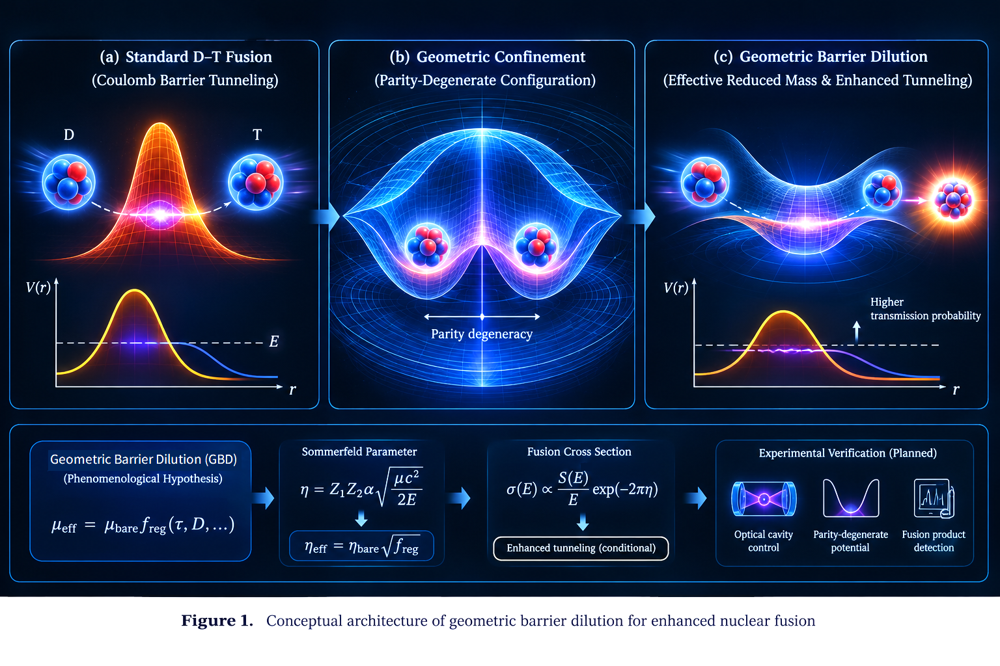

# Geometric Barrier Dilution: A Scheme for Enhanced Nuclear Fusion via Parity-Degenerate Confinement

**Baoliin (Zaitian) Wu 伍宝林**

*ORCID:* [0009-0003-2051-5247](https://orcid.org/0009-0003-2051-5247)

*Email:* zaitian001@gmail.com

*Affiliation:* People's Government of Guangdong Province, Guangzhou, CN

**October 22, 2026**

**Paper ID: DW58553923**

---

## Abstract

Standard nuclear physics predicts that the fusion cross-section at room temperature is suppressed by the Gamow factor $T_{\mathrm{Gamow}}\sim\exp(-2\pi\eta)$, with $\eta = Z_1 Z_2 \alpha \sqrt{\mu c^2/2E}$. For deuterium-tritium (D-T) fusion at $E=0.025$ eV, using $m_Dc^2=1875.6$ MeV, $m_Tc^2=2808.9$ MeV, and $\alpha^{-1}=137.035999084$, the Sommerfeld parameter is $\eta_{\mathrm{bare}}\approx1094.4274$, so $2\pi\eta_{\mathrm{bare}}\approx6876.4901$ and the Gamow penetrability is $T_{\mathrm{bare}}\approx10^{-2986.4217}$. We examine **Geometric Barrier Dilution (GBD)** as a phenomenological hypothesis within the author's **MES (Modified Einstein Spherical) cosmological architecture** [4–6]. MES curvature scalings are treated here as model postulates, not as experimentally established laws. GBD extends the geometric mass-dilution hypothesis of DW58553922 [1] from macroscopic tunneling to the nuclear scale, proposing that the effective reduced mass entering the Gamow exponent may depend on a measurement interval $\tau$ and a state-complexity proxy. The manuscript distinguishes two sub-hypotheses: GBD-A, concerning experimentally controllable nuclear reaction dynamics, and GBD-B, the stronger claim that an effective reduced mass entering the Gamow exponent changes beyond standard nuclear and atomic effects.

Using the stated masses and the fine-structure constant gives $\eta_{\mathrm{bare}}\approx1094.4274$, $2\pi\eta_{\mathrm{bare}}\approx6876.4901$, and $T_{\mathrm{bare}}\approx10^{-2986.4217}$ for D-T fusion at $E=0.025$ eV. The proposed GBD mass law is not derived from a fundamental nuclear action, and the same finite-resolution regularization used in DW58553922 [1] is adopted by analogy, not by derivation. The cavity-to-nuclear-relative-coordinate coupling mechanism is not established. Writing a coupled nuclear-cavity Hamiltonian does not by itself prove energy conservation under explicitly time-dependent driving or open-system evolution. A staged research program using ion traps, optical cavities, and calibrated fusion-product detection is proposed. This paper frames GBD as a **candidate—not established—form of physical manifold programming** applied to the nuclear scale. All statements are classified by evidence status (L1–L4), and GBD-A is kept logically separate from GBD-B. No room-temperature fusion enhancement or experimental feasibility claim is made.

**Keywords:** geometric barrier dilution, nuclear fusion, Gamow factor, reduced mass, parity degeneracy, levitated optomechanics, manifold programming, MES universe model, energy accounting, failure mode analysis, evidence-level classification L1–L4

---

## 0. Evidence-Level Classification (L1–L4)

Throughout this paper, we adopt the four-level evidence hierarchy established in DW58553905 [7] and used in DW58553922 [1]:

| Level | Label | Nature of Evidence | Example in This Paper |
| --- | --- | --- | --- |
| **L1** | Strict mathematical theorem, or reproducible mathematical calculation | A result obtained by direct derivation or calculation from stated inputs and standard mathematics, without reliance on unverified physical assumptions. | Gamow parameter $\eta_{\mathrm{bare}}\approx1094.4274$, $2\pi\eta_{\mathrm{bare}}\approx6876.4901$, and $T_{\mathrm{bare}}\approx10^{-2986.4217}$ for D-T at $0.025$ eV; algebraic form $\eta\propto\sqrt{\mu}$ |
| **L2** | Strict mathematical construction, or conditional mathematical derivation | A definitional construction or algebraic consequence that depends on explicitly stated assumptions or construction choices; the derivation does not validate those assumptions physically. | Regularized mass function $f_{\mathrm{reg}}$ adopted by analogy with DW58553922 [1] (construction); effective Gamow parameter $\eta_{\mathrm{eff}}=\eta_{\mathrm{bare}}\sqrt{f_{\mathrm{reg}}}$ conditional on the GBD hypothesis |
| **L3** | Testable modeling hypothesis | Proposed relationship whose complete derivation or empirical validation remains outstanding | GBD effective reduced-mass hypothesis; MES curvature scaling applied to nuclear scale; candidate Lindblad dynamics; total nuclear-cavity Hamiltonian; candidate manifold-programming interpretation |
| **L4** | Unverified conjecture or engineering blueprint | Exploratory concept or architectural proposal | $\tau$ divergence at parity-degenerate point; application to room-temperature fusion devices; cavity control of nuclear relative coordinate |

**MES postulates** (inherited from DW58553914, DW58553921) are labeled **P** and treated as the theoretical baseline of this paper. The regularization function is adopted by analogy with DW58553922 [1] and is not independently derived here.

---

## 1. Introduction

### 1.1 The Coulomb Barrier Deadlock

Nuclear fusion requires fusing nuclei to overcome the Coulomb barrier. For two nuclei with charges $Z_1 e$ and $Z_2 e$, the barrier height is

$$ V_C = \frac{Z_1 Z_2 e^2}{4\pi\varepsilon_0 r}, \quad (1) $$

where $r$ is the inter-nuclear distance. At the classical turning point, $r\sim10^{-15}$ m, and the barrier height is of order $V_C\sim1$ MeV for hydrogen isotopes.

In standard quantum mechanics, the fusion cross-section is suppressed by the **Gamow factor**:

$$ \sigma(E) \propto \frac{S(E)}{E} \exp\left( -2\pi\eta \right), \quad (2) $$

where $\eta$ is the Sommerfeld parameter:

$$ \eta = \frac{Z_1 Z_2 e^2}{4\pi\varepsilon_0 \hbar v} = Z_1 Z_2 \alpha \sqrt{\frac{\mu c^2}{2E}}, \quad (3) $$

with $\alpha\approx1/137$ the fine-structure constant, $\mu = m_1 m_2/(m_1+m_2)$ the reduced mass, and $E$ the center-of-mass energy.

**Numerical audit (L1).** For D-T fusion, $Z_1=Z_2=1$, $m_D\approx1875.6$ MeV/$c^2$, $m_T\approx2808.9$ MeV/$c^2$, so

$$ \mu c^2 = \frac{(1875.6)(2808.9)}{1875.6+2808.9}\,\text{MeV} \approx 1124.6393\,\text{MeV}. \quad (3\text{a}) $$

At room temperature, $E\sim0.025$ eV $=2.5\times10^{-8}$ MeV, and

$$ \eta_{\mathrm{bare}} = \alpha\sqrt{\frac{1124.6393\,\text{MeV}}{2(2.5\times10^{-8}\,\text{MeV})}} \approx 1094.4274. \quad (3\text{b}) $$

The corresponding Gamow factor is

$$ T_{\mathrm{bare}} = e^{-2\pi\eta_{\mathrm{bare}}} \approx e^{-6876.4901} \approx 10^{-2986.4217}. \quad (3\text{c}) $$

This value follows from the stated parameters; it is not a universal threshold for fusion. The Gamow exponent scales as $\sqrt{\mu}$ when $Z_1$, $Z_2$, and $E$ are fixed, not linearly in $\mu$.

This suppression is why fusion requires temperatures of order $10^8$ K—the thermal energy must be large enough to reduce $\eta$ to order unity. The distinctive GBD-B claim—that a geometric-control protocol changes the effective reduced mass entering the Gamow exponent beyond standard nuclear and atomic effects—requires a dedicated test and is not established by the baseline calculation.

**Competing standard effects (L1).** At very low energies, electron screening can enhance the fusion cross-section by reducing the effective Coulomb barrier. This is a standard atomic-physics effect, distinct from GBD, and must be modeled or independently constrained before any GBD-B claim can be assessed.

### 1.2 The MES Cosmological Architecture

The MES (Modified Einstein Spherical) universe model, developed in a series of the author's self-preprints [4,5,6], posits that the universe is a topologically closed $S^3$ manifold equipped with a dynamical scalar curvature field. Physical constants and particle properties emerge from the curvature of this manifold.

The MES architecture adopts the following curvature scaling relations as **testable modeling hypotheses (L3)**:

$$ c(R) = c_0 \left( \frac{R}{R_0} \right)^{1/2}, \quad \hbar(R) = \hbar_0 \left( \frac{R_0}{R} \right)^{1/2}, \quad m(R) = m_0 \left( \frac{R_0}{R} \right)^{1/2}. \quad (\text{MES-1}) $$

[Source: [5], Eq. (3)–(4); [4], Eq. (19)–(21); L3]

These imply two curvature invariants:

$$ \hbar(R) c(R) = \hbar_0 c_0, \quad m(R) c(R) = m_0 c_0. \quad (\text{MES-2}) $$

[Source: [5], Eq. (3)–(4); L3]

The MES architecture also proposes a decoherence rate scaling $\Gamma(R)\propto R^{3/2}$ and redefines effective mass as "the local effective inertia of the open quantum geometric field under the constraint of the universal curvature network" [6]. In the MES architecture, gravity is itself a curvature-driven emergent phenomenon and is therefore not treated as an independent contributor to the measurement interval $\tau$.

**Important status note.** The MES scaling relations (MES-1) are explicitly labeled as "linked hypotheses" in DW58553921 [4], not as derived consequences of the closed $S^3$ geometry. The present paper adopts MES-1 as its theoretical baseline and extends it with the GBD hypothesis.

### 1.3 Geometric Barrier Dilution (GBD): The Core Hypothesis

We introduce **Geometric Barrier Dilution (GBD)** as a phenomenological extension of the geometric mass-dilution hypothesis of DW58553922 [1] to the nuclear scale. The central hypothesis is that the **effective reduced mass** $\mu$ entering the Gamow exponent (3) may depend on local MES curvature $R$, a measurable control interval $\tau$, and a separately defined state-complexity statistic $D$:

$$ \mu_{\mathrm{eff}}(R,\tau,D) = \mu_{\mathrm{bare}}(R) \cdot f_{\mathrm{reg}}(\tau,R,D), \quad (4) $$

where $\mu_{\mathrm{bare}}(R) = \mu_0 (R_0/R)^{1/2}$ follows from the MES mass scaling (P-1), and $f_{\mathrm{reg}}$ is the **same regularized function** adopted in DW58553922 [1], Eq. (3):

$$ f_{\mathrm{reg}}(\tau,R,D) = \frac{\tau_0(R)^2}{\tau^2+\tau_0(R)^2} \cdot \frac{\chi(D)}{\chi(D_{\mathrm{ref}})}. \quad (5) $$

This regularization is adopted **by analogy**, not by independent derivation. The same conditions apply: $D$ is a declared state-complexity observable; $D_{\mathrm{ref}}$ is a pre-registered reference state with $\chi(D_{\mathrm{ref}})>0$; the choice $\chi(D)=\sqrt{1-1/D}$ is one phenomenological option, not a verified law.

**Status (L2/L3).** Equation (5) is a modeling construction (L2) combined with a testable hypothesis (L3). The analogy with DW58553922 [1] does not constitute a derivation for the nuclear case. The physical meaning of $\tau$ must be operationally specified by an independently measurable protocol in the nuclear context.

Substituting (4) into (3), the **effective Sommerfeld parameter** is

$$ \eta_{\mathrm{eff}} = Z_1 Z_2 \alpha \sqrt{\frac{\mu_{\mathrm{eff}} c^2}{2E}} = \eta_{\mathrm{bare}} \sqrt{f_{\mathrm{reg}}}. \quad (6) $$

The modified Gamow factor is

$$ T_{\mathrm{GBD}} = \exp\left( -2\pi\eta_{\mathrm{bare}} \sqrt{f_{\mathrm{reg}}} \right). \quad (7) $$

**Conditional algebraic scaling (L2).** For $\tau\sim10^{-3}$ s and $\tau_{0,0}\sim10^{-44}$ s, the temporal factor of $f_{\mathrm{reg}}$ is approximately $10^{-82}$ when $R\approx R_0$. Then $\sqrt{f_{\mathrm{reg}}}\sim10^{-41}$, and $\eta_{\mathrm{eff}}\sim10^3\times10^{-41}=10^{-38}$, giving $T_{\mathrm{GBD}}\sim\exp(-2\pi\times10^{-38})\approx1$.

This is an algebraic consequence of the candidate function (5), **not a physical prediction**. It depends critically on (i) the assumption that $\tau_{0,0}$ is the relevant crossover scale for nuclear relative motion; (ii) the assumption that $f_{\mathrm{reg}}$ applies to the reduced mass in the Gamow exponent; (iii) the choice of $\chi(D)$ and $D_{\mathrm{ref}}$; and (iv) the neglect of competing standard effects (electron screening, nuclear structure, etc.). No numerical fusion rate is claimed until these are independently specified or calibrated.

**Figure 1. Conceptual architecture of geometric barrier dilution (GBD) for enhanced nuclear fusion.** (a) Standard D-T fusion requires overcoming the Coulomb barrier via quantum tunneling. (b) A parity-degenerate confinement configuration, representing a candidate state-space or geometric control protocol. (c) The proposed GBD mechanism, where a modification of the effective reduced mass conditionally enhances the transmission probability. The bottom panel summarizes the phenomenological hypothesis and the conditional algebraic relations $\mu_{\mathrm{eff}}=\mu_{\mathrm{bare}}f_{\mathrm{reg}}$, $\eta_{\mathrm{eff}}=\eta_{\mathrm{bare}}\sqrt{f_{\mathrm{reg}}}$, and the standard fusion cross-section. The experimental verification panel illustrates the planned research program. Here the double-well potential and cavity control shown are conceptual; no existing platform currently demonstrates coherent optical-cavity control of the nuclear relative coordinate at the femtometer scale. The enhanced tunneling is a conditional algebraic consequence of the candidate model, not an established physical effect.

### 1.4 Scope of This Paper

This paper presents a staged research plan to test the GBD hypothesis using ion traps, optical cavities, and calibrated fusion-product detection. It aims to:

1. Calibrate a cavity-controlled nuclear confinement and measure the relevant energy scales; the conjectured divergence of $\tau$ near a degeneracy point remains L4.
2. Test whether a pre-registered control protocol changes a declared state-complexity observable, without assuming that a true correlation dimension decreases toward unity.
3. Measure fusion-product statistics and compare them with a calibrated standard nuclear model including electron screening.
4. Test algebraic identities implied by the MES scaling assumptions, while keeping those assumptions distinct from empirical validation.
5. Analyze failure modes and separate experimental limitations from falsification of a specified model.
6. Formulate a candidate total Hamiltonian and a complete work-and-heat budget; energy conservation is not presumed from a Hamiltonian decomposition alone.
7. Distinguish GBD-A (dynamical change) from GBD-B (effective-inertia change) and organize the research program by the G1/G2/G3 manifold-programming hierarchy.

**Feasibility note.** The proposed ion-trap/optical-cavity platform is not currently demonstrated to control the nuclear relative coordinate at the femtometer scale. The cavity modulates potentials on nm–$\mu$m scales, while the nuclear barrier acts at fm scales. This paper therefore proposes a research program, not an engineering blueprint.

---

## 2. MES Cosmological Foundations and Their Implications for Geometric Barrier Dilution

### 2.1 MES Fundamental Postulates (Inherited)

**Postulate 1 (Closed Spherical Geometry).** The universe is modeled as a closed spatial $S^3$ manifold equipped with a dynamical scalar curvature field $R(x,t)$. [Source: [4], Postulate 1; L3]

**Postulate 2 (Curvature-Dependent Physical Constants).** Physical constants scale with local curvature as:

$$ c(R) = c_0 (R/R_0)^{1/2}, \quad \hbar(R) = \hbar_0 (R_0/R)^{1/2}, \quad m(R) = m_0 (R_0/R)^{1/2}, \quad (\text{P-1}) $$

with the algebraic constraints:

$$ \hbar(R) c(R) = \hbar_0 c_0, \quad m(R) c(R) = m_0 c_0. \quad (\text{P-2}) $$

[Source: [5], Eq. (3)–(4); [4], Eq. (19)–(21); L3]

**Postulate 3 (Curvature-Dependent Planck Time).** Under the scaling (P-1), with the gravitational constant derived self-consistently as $G(R) = \hbar(R)c(R)/m_p(R)^2 \propto R$, the Planck time becomes:

$$ \tau_0(R) = \tau_{0,0} \left( \frac{R_0}{R} \right). \quad (\text{P-3}) $$

[Derived from P-1 and the self-consistent definition of $G$; L2; see Appendix B]

**Postulate 4 (Curvature-Dependent Decoherence).** The decoherence rate scales as:

$$ \Gamma(R) = \Gamma_0 (R/R_0)^{3/2}. \quad (\text{P-4}) $$

[Source: [16], Eq. (12); [5], Eq. (7); L3]

**Postulate 5 (Geometric Inertia).** The effective inertial mass of a body is redefined as "the local effective inertia of the open quantum geometric field under the constraint of the universal curvature network." [Source: [6], Section 3; L3]

**Postulate 6 (Gravity as Curvature-Driven Emergence).** In the MES architecture, gravity is itself a curvature-driven emergent phenomenon, treated on the same footing as mass. It is therefore not an independent contributor to the measurement interval $\tau$. [Source: [4]; L3]

### 2.2 From MES Postulates to the GBD Formula: Step-by-Step Derivation

**Step 1: Curvature-dependence of bare reduced mass (L3, inherited from P-1).**

$$ \mu_{\mathrm{bare}}(R) = \mu_0 (R_0/R)^{1/2}. \quad (\text{GBD-1}) $$

**Step 2: Curvature-dependence of the Planck time (L2, derived from P-1 and P-3).**

$$ \tau_0(R) = \tau_{0,0} (R_0/R). \quad (\text{GBD-2}) $$

**Step 3: Introduction of the measurement interval $\tau$ (L4, new assumption).**

We hypothesize that the observer's measurement interval $\tau$ is an independent geometric parameter, not fixed by the MES postulates. In standard nuclear physics, $\tau\to0$. In the GBD regime, $\tau$ can be extended by the parity-degenerate confinement.

**Step 4: Candidate regularized dilution function (L2/L3, adopted by analogy).**

We adopt the same regularized function as DW58553922 [1], Eq. (3):

$$ f_{\mathrm{reg}}(\tau,R,D) = \frac{\tau_0(R)^2}{\tau^2+\tau_0(R)^2} \cdot \frac{\chi(D)}{\chi(D_{\mathrm{ref}})}. \quad (\text{GBD-3}) $$

The analogy with the macroscopic case is a **modeling choice**, not a derivation for the nuclear case. The function $\chi$ and the measured state-complexity variable $D$ must be declared before fitting or predicting data.

**Step 5: Effective reduced mass (L2/L3, conditional inference).**

Substituting (GBD-1) and (GBD-2) into (4):

$$ \mu_{\mathrm{eff}} = \mu_0 \left( \frac{R_0}{R} \right)^{1/2} \frac{\tau_{0,0}^2(R_0/R)^2}{\tau^2+\tau_{0,0}^2(R_0/R)^2} \frac{\chi(D)}{\chi(D_{\mathrm{ref}})}. \quad (\text{GBD-4}) $$

This is an internally consistent algebraic expression given the stated model choices; it is not a first-principles derivation or evidence that the physical reduced mass changes.

**Step 6: Experimental-regime simplification (L3).**

For the illustrative regime $R\approx R_0$, the candidate function reduces to

$$ \mu_{\mathrm{eff}} \approx \mu_0 \frac{\tau_{0,0}^2}{\tau^2+\tau_{0,0}^2} \frac{\chi(D)}{\chi(D_{\mathrm{ref}})}. \quad (\text{GBD-5}) $$

**Step 7: Effective Sommerfeld parameter and Gamow factor (L2).**

$$ \eta_{\mathrm{eff}} = \eta_{\mathrm{bare}} \sqrt{f_{\mathrm{reg}}}, \quad T_{\mathrm{GBD}} = \exp\left( -2\pi\eta_{\mathrm{bare}} \sqrt{f_{\mathrm{reg}}} \right). \quad (\text{GBD-6}) $$

**Step 8: Conditional numerical scaling (L2/L3).**

For $\tau\sim10^{-3}$ s and $\tau_{0,0}\sim10^{-44}$ s, the temporal factor is approximately $10^{-82}$ when $R\approx R_0$. This is an algebraic consequence of the candidate function, not a physical mass prediction. No numerical $\mu_{\mathrm{eff}}$ or fusion rate is reported until $\chi(D)$, $D_{\mathrm{ref}}$, the measurement protocol, and standard competing effects are specified.

### 2.3 Inheritance vs. New Inference vs. Hypothesis: Summary Table

| Element | Status | Source |
| --- | --- | --- |
| $S^3$ closed geometry | MES postulate (P), L3 | [4], Postulate 1 |
| $c(R)$, $\hbar(R)$, $m(R)$ scaling | MES postulate (P), L3 | [5], Eq. (3); [4], Eq. (19)–(21) |
| $\tau_0(R)$ scaling | Derived (L2), conditional on $G(R)\propto R$ | This paper, Appendix B |
| $\Gamma(R)\propto R^{3/2}$ | MES postulate (P), L3 | [16], Eq. (12); [5], Eq. (7) |
| Geometric inertia | MES postulate (P), L3 | [6], Section 3 |
| Gravity as emergent | MES postulate (P), L3 | [4] |
| Measurement interval $\tau$ | New assumption (L4) | This paper |
| Regularized dilution function $f_{\mathrm{reg}}$ | Construction (L2) + modeling hypothesis (L3), **adopted by analogy with DW58553922 [1]** | This paper, Eq. (GBD-3) |
| $\mu_{\mathrm{eff}}$ formula | Conditional inference (L2/L3) | This paper, Eq. (GBD-4) |
| Effective Gamow factor $T_{\mathrm{GBD}}$ | Conditional algebraic consequence (L2) | This paper, Eq. (GBD-6) |
| Total Hamiltonian | New hypothesis (L3) | This paper, Section 2.12 |
| Lindblad evolution of nuclear relative coordinate | Candidate open-system model (L3) | This paper, Appendix C.2 |

### 2.4 Curvature-Dependent Decoherence

From Postulate 4 (P-4):

$$ \Gamma(R) = \Gamma_0 (R/R_0)^{3/2}. \quad (8) $$

This scaling provides a quantitative basis for the state-complexity control protocol. In the parity-degenerate confinement, the effective MES curvature $R$ can in principle be tuned by adjusting the confinement potential—though we emphasize that the connection between **optical potential curvature** and **MES curvature $R$** is not established (L4). We therefore treat the $\Gamma\propto R^{3/2}$ scaling as a theoretical prediction (L3) requiring experimental verification.

### 2.5 Parity Degeneracy and the Measurement Interval

In a standard symmetric double-well potential with finite barrier height, the two lowest energy eigenstates are the symmetric and antisymmetric superpositions, with an energy splitting $\Delta = E_+ - E_- > 0$. Equal well depths do **not** imply $E_+ = E_-$. The splitting vanishes only in the limit of infinite barrier height (zero tunneling coupling).

We define the **parity-degenerate point** as the limit in which the tunneling coupling is negligibly small compared to all other energy scales. In this limit, the measurement interval $\tau$ is hypothesized to diverge (L4). The derivation of this divergence from a microscopic model remains an open problem.

### 2.6 State-Complexity Control and Decoherence

We hypothesize that decoherence is governed by Eq. (8). To freeze decoherence, we propose:

1. Test whether a pre-registered pulse sequence reproducibly changes a declared state-complexity observable; do not assume in advance that a true correlation dimension decreases toward 1.
2. Reduce the environmental coupling by canceling the background curvature through the confinement potential.

The pulse sequence is designed to implement $C_4$ symmetry operations on the phase-space lattice. A candidate Lindblad model and distinct definitions for $D_{\mathrm{PR}}$ and $D_2$ are given in Appendix C.

**Caveat.** Reducing decoherence does not automatically reduce the effective reduced mass. The connection between decoherence control and barrier dilution is a **model assumption (L3)**. We therefore separate GBD into two independently testable sub-hypotheses:

* **GBD-A:** Geometric control can modify the system's effective nuclear reaction dynamics (transition rates, effective barrier, or coherence time) beyond standard nuclear and atomic effects (L3).
* **GBD-B:** After excluding ordinary control effects, standard nuclear structure, and electron screening, the system exhibits an effective reduced mass or Gamow scaling that cannot be explained by standard nuclear Hamiltonians (L4).

### 2.7 Terminology: Three Distinct Time Scales

| Symbol | Name | Physical Meaning | Typical Value |
| --- | --- | --- | --- |
| $\tau$ | Measurement interval | Characteristic time over which the observer's coordinate frame projects the nuclear relative coordinate onto a definite spatial basis; controlled by the pulse sequence and confinement modulation | $10^{-5}$–$10^{-3}$ s (GBD regime, hypothetical) |
| $\tau_c$ | Confinement photon lifetime | Decay time of the intracavity field; determined by cavity finesse and mirror losses | $\sim10^{-6}$ s for $F=10^5$, $L_{\mathrm{cav}}=1$ cm |
| $T_2$ | Nuclear relative-coordinate decoherence time | Coherence time of the relative motion; determined by environmental coupling and the state-complexity control protocol | $10^{-6}$–$10^{-3}$ s (target) |

The GBD regime would require $\tau\gg\tau_c$ and $\tau\sim T_2$, so that the measurement interval dominates over both the cavity dynamics and the residual decoherence.

### 2.8 Geometric State-Space Reconstruction and Dynamical Identifiability at the Nuclear Scale

This section imports the same methodological distinction used in DW58553922 [1], Section 2.8, from the author's **Geometric Pathology** architecture [17]: geometry of a state space, dynamics on that state space, and empirical identification of a mechanism are related but non-equivalent questions. This methodological connection does not constitute evidence for GBD, nor does it transfer results from macroscopic optomechanics directly to the nuclear scale.

$D_2$ in the GBD ansatz is not identified with any density-matrix statistic. A true correlation dimension must be independently defined and estimated; $D_{\mathrm{PR}}$ (Appendix C.2) is an optional, distinct proxy and must not be substituted for $D_2$ without a justified mapping.

#### 2.8.1 Operational state space and metric

Let $\mathbf{x}(t)$ denote a vector of experimentally reconstructed observables relevant to the nuclear relative coordinate—for example, the inter-nuclear separation and relative momentum, together with calibrated control variables. A state-space metric $g_{ij}(\mathbf{x})$ may be estimated only after specifying the observables, their uncertainties, and the reconstruction procedure. The metric is a statistical or dynamical descriptor of the selected representation; it must not be identified automatically with MES curvature $R$ or with the curvature of the confinement potential.

#### 2.8.2 Dynamics and stability are separate from geometry

A reconstructed state-space geometry does not establish that a nuclear state is an attractor. For a deterministic reduced model $\dot{\mathbf{x}}=\mathbf{F}(\mathbf{x},t)$, local stability must be tested using the Jacobian and its eigenvalues, while stochastic dynamics require an explicit noise model and appropriate stability or escape-rate analysis. Any claimed reduction in decoherence must be supported by independently measured coherence times or a validated open-system model.

#### 2.8.3 Mechanism identifiability

A change in observed fusion rate can arise from several mechanisms that must be discriminated: (i) changes in the effective Coulomb barrier from electron screening or atomic environment; (ii) ordinary drive-induced transitions or heating; (iii) changes in environmental decoherence; (iv) state preparation and detection bias; (v) nuclear structure effects; or (vi) a genuine change in the effective reduced mass entering the Gamow exponent. The sixth interpretation is the distinctive GBD-B claim and cannot be inferred from a rate increase alone. Barrier spectroscopy, independent reduced-mass calibration, control-sequence reversals, temperature and density scans, and a standard nuclear model should be used to test competing explanations.

#### 2.8.4 Falsifiable separation of GBD-A and GBD-B

GBD-A is supported only if the control protocol produces reproducible nuclear reaction-rate or coherence changes beyond calibrated ordinary-control and standard nuclear effects. GBD-B requires an additional, independently identifiable deviation in the Gamow scaling that remains after those effects are modeled. Evidence for GBD-A does not imply GBD-B. A null result constrains only the parameter region actually reached and measured; it falsifies a specified GBD-B model only when its predicted signal and uncertainty are fixed in advance and excluded by the data.

**Geometric caveat.** State-space statistical curvature, confinement-potential curvature, and MES scalar curvature are different mathematical and physical quantities. Any mapping among them must be defined and experimentally or theoretically justified rather than assumed.

#### 2.8.5 GBD as a Candidate Form of Physical Manifold Programming at the Nuclear Scale

Within the MES research architecture, **manifold programming** is used here as a working methodological term for a controlled intervention that reproducibly changes a system's accessible state-space organization, its dynamical law or vector field, or the stability and accessibility of its states. The term does not mean that a physical manifold is literally rewritten, and it does not imply a change in effective reduced mass. In a nuclear implementation, the controlled objects may include confinement parameters, parity splitting, drive protocols, couplings, and the experimentally reconstructed relative-coordinate distribution.

GBD may therefore be investigated as a **candidate physical realization of manifold programming** at the nuclear scale if a controlled geometric or cavity intervention produces a reproducible, independently characterized change in the system's state-space description and dynamics. This is a research connection, not an established equivalence. In particular, a changed confinement potential, a changed state-space metric, or a changed coherence time is not by itself evidence that the reduced mass in the Gamow exponent has changed.

The proposed causal sequence is:

$$ \text{geometric control} \rightarrow \text{state-space reconstruction} \rightarrow \text{dynamical response} \rightarrow \text{effective reduced-mass hypothesis} \rightarrow \text{verifiable fusion test}. \quad (\text{GP-2}) $$

Equation (GP-2) is a research logic diagram, not a derived physical law. Each arrow represents a separate claim requiring operational definitions, quantitative modeling, and evidence. A result at an earlier stage does not establish a later stage.

#### 2.8.6 Three Levels of Manifold-Programming Claims at the Nuclear Scale

| Level | Claim | Minimum evidence required | What it does not establish |
| --- | --- | --- | --- |
| **G1: State-space programming** | Controlled intervention changes the experimentally reconstructed accessible-state distribution, constraints, or operational geometry of the nuclear relative coordinate | A declared reconstruction method, uncertainty estimates, reproducibility, and controls for measurement artefacts | A new dynamical law or a change in effective reduced mass |
| **G2: Dynamical programming** | The intervention reproducibly changes nuclear stability, coherence, transition rates, or state accessibility beyond standard nuclear and atomic effects | Independent dynamical measurements, standard nuclear model including electron screening, and comparison with the calibrated baseline | GBD-B or barrier dilution |
| **G3: Effective-inertia programming** | An independently identifiable effective reduced mass entering the Gamow exponent changes beyond conventional explanations | A self-consistent dynamical model, calibrated Coulomb barrier, independent reduced-mass constraints, and pre-registered tests that discriminate alternative mechanisms | A universal or fundamental mass law beyond the tested regime |

G1 and G2 are experimentally meaningful outcomes even if G3 fails. Conversely, an apparent fusion-rate enhancement cannot be assigned to G3 unless changes in the effective Coulomb barrier (including electron screening), external driving, heating, environmental decoherence, state preparation, detection efficiency, and nuclear structure have been constrained. This hierarchy keeps the weaker state-space and coherence claims separate from the stronger GBD-B claim.

#### 2.8.7 Complementarity with Geometric Pathology

The author's Geometric Pathology architecture [17] studies how structural organization and dynamical stability of complex-system state spaces may deteriorate or undergo transitions. Manifold programming, as used in this paper, asks the complementary intervention-oriented question: can controlled changes reproducibly reshape a system's accessible states or dynamics? The two perspectives can inform a common methodological program, but they are not exact opposites, and no one-to-one reversible transformation between them is assumed.

For GBD, the practical implication is modest but useful: use the state-space methodology to organize candidate observables and intervention tests, while retaining an independent derivation and falsification burden for the effective reduced-mass hypothesis. The geometric-programming interpretation does not repair the currently missing derivation of the dilution function, prove energy conservation, or demonstrate fusion-rate enhancement.

### 2.9 Effective Reduced Mass: Conditional Numerical Scaling

For the candidate regularized function in Eq. (GBD-3), take $R\approx R_0$, $\tau\sim10^{-3}$ s, and $\tau_{0,0}\sim10^{-44}$ s. The temporal factor is

$$ \frac{\tau_{0,0}^2}{\tau^2+\tau_{0,0}^2} \approx 10^{-82}. \quad (9) $$

Thus the model would give

$$ \frac{\mu_{\mathrm{eff}}}{\mu_{\mathrm{bare}}} \approx 10^{-82} \frac{\chi(D)}{\chi(D_{\mathrm{ref}})}. \quad (9\text{a}) $$

This is a conditional algebraic substitution into a phenomenological function, not a physical prediction. It depends critically on the assumption that $\tau_{0,0}$ is the relevant crossover scale for nuclear relative motion and that the chosen state-complexity ratio is defined and calibrated. No numerical fusion rate is claimed from this expression alone.

### 2.10 Modified Gamow Factor

For D-T fusion at $E=0.025$ eV, the GBD exponent becomes

$$ S_{\mathrm{GBD}} = 2\pi\eta_{\mathrm{bare}} \sqrt{f_{\mathrm{reg}}}. \quad (10) $$

For a fixed $E$ and unchanged $\alpha$, the exponent obeys the conditional identity $S_{\mathrm{GBD}} = S_{\mathrm{bare}} \sqrt{f_{\mathrm{reg}}}$ if $Z_1$, $Z_2$, and $E$ remain unchanged. With $S_{\mathrm{bare}} = 2\pi\eta_{\mathrm{bare}} \approx 6.9\times10^3$, this relation must be evaluated using a specified, regularized $\mu_{\mathrm{eff}}$. An extremely small assumed mass can make this algebraic exponent small, but that conditional result is not evidence that such a mass is physically realized.

No observable fusion rate is predicted here until the regularized reduced-mass function, standard nuclear and atomic effects (including electron screening), preparation probability, decoherence, and detection efficiency are specified. A small Gamow exponent alone does not determine an experimental event rate.

### 2.11 Algebraic Self-Consistency Constraints

The scaling relations (P-1) imply two algebraic constraints:

$$ \hbar(R) c(R) = \hbar_0 c_0 = \text{constant}, \quad (11) $$

$$ m(R) c(R) = m_0 c_0 = \text{constant}. \quad (12) $$

Both relations follow algebraically from (P-1) and (P-2) (L2). They provide **verification criteria** for GBD. If the measured fusion-rate enhancement is accompanied by a change in the product $\hbar c$ or $mc$ that violates these constraints, the GBD mechanism is ruled out.

**Caveat.** Measuring a change in the cavity resonance frequency is not sufficient to establish a change in the speed of light $c$, because the resonance frequency also depends on the cavity length, refractive index, and temperature (L4).

### 2.12 Total Hamiltonian and Energy Accounting

Energy accounting is a consistency requirement, but it must be derived from a dynamical model. A useful starting decomposition for the nuclear-relative-coordinate problem is

$$ H_{\mathrm{model}}(t) = H_{\mathrm{nuc}}(t) + H_{\mathrm{cavity}}(t) + H_{\mathrm{int}}(t). \quad (13) $$

with candidate terms

$$ H_{\mathrm{nuc}}(t) = \frac{p_r^2}{2\mu_{\mathrm{eff}}(t)} + V_C(r) + V_{\mathrm{nuc}}(r), \quad (14) $$

$$ H_{\mathrm{cavity}} = \hbar\omega_c a^\dagger a, \quad (15) $$

$$ H_{\mathrm{int}}(t) = g(t) a^\dagger a \frac{p_r^2}{2\mu_0}, \quad (16) $$

where $r$ is the inter-nuclear separation, $p_r$ the relative momentum, $V_C(r)$ the Coulomb potential, and $V_{\mathrm{nuc}}(r)$ the short-range nuclear potential.

These expressions define a phenomenological ansatz, not a derived interaction. The control pulse, $\mu_{\mathrm{eff}}(t)$, and $g(t)$ may be explicitly time dependent. For a closed quantum system evolving unitarily under a Hamiltonian $H(t)$, the expectation value obeys

$$ \frac{d}{dt}\langle H\rangle = \left\langle\frac{\partial H}{\partial t}\right\rangle. \quad (17) $$

Consequently, $d\langle H\rangle/dt=0$ does not follow when the Hamiltonian is explicitly time dependent. In an open system with Lindblad evolution, additional dissipative terms enter the energy balance. A conservation statement requires either (i) an autonomous enlarged Hamiltonian that includes the pulse source and relevant reservoirs, or (ii) an explicit work-and-heat balance including drive work, cavity leakage, environmental exchange, and nuclear-cavity interaction energy.

The equality

$$ \Delta E_{\mathrm{nuc}} = -\Delta E_{\mathrm{cavity}} \quad (18) $$

is therefore not imposed as a general identity. It is a testable special-case prediction only if all other energy channels are negligible or independently measured and the interaction model derives that balance. The form of $H_{\mathrm{int}}$ must ultimately be obtained from a microscopic coupling or a stated effective action; it cannot be selected solely to enforce the desired conservation result.

### 2.13 Energy Budget: What Can and Cannot Be Concluded

For $H_{\mathrm{nuc}} = p_r^2/[2\mu_{\mathrm{eff}}(t)] + V_C(r) + V_{\mathrm{nuc}}(r)$, the explicit time derivative contains

$$ \frac{\partial H_{\mathrm{nuc}}}{\partial t} = -\frac{p_r^2}{2\mu_{\mathrm{eff}}^2} \frac{d\mu_{\mathrm{eff}}}{dt} + \frac{\partial V_C}{\partial t} + \frac{\partial V_{\mathrm{nuc}}}{\partial t}. \quad (19) $$

This expression identifies work associated with a changing effective reduced-mass parameter and a driven potential. It does not, by itself, identify which subsystem receives that energy. To calculate a transfer, one must solve the coupled equations for the nuclear relative coordinate, cavity, drive source, and environment using specified initial conditions and coupling parameters.

A future estimate $|\Delta E|$ must calculate the measured output quadrature or photon-number estimator, propagate quantum and technical noise, and distinguish coherent signal accumulation from statistical averaging.

The cavity energy capacity alone cannot establish detectability. For independent repetitions with an unbiased estimator, statistical uncertainty often improves as $N^{-1/2}$, whereas a coherent signal may accumulate linearly only under a specified phase-stable protocol; systematic drift and correlated noise need separate treatment. A QND readout proposal therefore requires a complete measurement model and noise budget before a signal-to-noise claim can be made.

**Current status:** the total-Hamiltonian decomposition is a candidate modeling architecture (L3). Energy conservation, the magnitude and sign of nuclear-cavity energy transfer, and its detectability remain open calculations, not established results.

---

## 3. Experimental Scheme

### 3.1 Platform: Ion Traps and Optical Cavities

We consider a hybrid platform combining an ion trap (Penning or Paul trap) for nuclear confinement with a high-finesse optical cavity for geometric control. The nuclear relative coordinate is confined in a double-well potential within the cavity field. The platform draws on demonstrated techniques in ion trapping, cavity QED, and precision nuclear spectroscopy.

**Relevant demonstrated capabilities:**

* **Single-ion trapping and cooling** is routine in precision metrology [18,19].
* Cavity-generated dynamical optical potentials for cold atoms have been studied [20]; this does not demonstrate cavity control of trapped-ion nuclear relative coordinates.
* **Nuclear reaction studies at low energies** have been performed with ion beams and static targets [21].

The proposed GBD experiment would require extending these techniques to the simultaneous control of nuclear relative motion and cavity fields—a substantial technical challenge (L4). No demonstrated platform currently controls the nuclear relative coordinate at the fm scale with optical cavities.

### 3.2 Corrected Experimental Parameters

**Nuclear reduced mass (L1).** For D-T fusion:

$$ \mu c^2 \approx 1.12\times10^3 \text{ MeV}. \quad (20) $$

**Alternative: D-D fusion.** For D-D fusion, $m_D = 1875.6$ MeV/$c^2$, $\mu c^2 = m_D/2 \approx 937.8$ MeV.

| Parameter | Value |
| --- | --- |
| Trap type | Penning or Paul trap with optical cavity |
| Cavity finesse | $F > 10^5$ |
| Cavity length | $L_{\mathrm{cav}} \sim 1$ cm |
| Wavelength | $\lambda \sim 1064$ nm |
| Nuclei | D-T or D-D |
| Relative-coordinate well separation | $d \sim 100$ nm (hypothetical) |
| Effective Coulomb barrier | $V_C \sim 1$ MeV at $r \sim 10^{-15}$ m |
| Modulation frequency | $\omega_{\mathrm{mod}} \sim 2$ MHz |
| Vacuum | $< 10^{-10}$ mbar |

### 3.3 Parity-Controlled Confinement Design

We consider a confinement potential for the nuclear relative coordinate of the form

$$ V(r,t) = V_0 \cos^2(k r) + V_1 \cos(2k r + \phi(t)) + V_C(r) + V_{\mathrm{nuc}}(r). \quad (21) $$

When $\phi(t)$ is controlled so that the tunneling coupling is small relative to declared experimental energy scales, the system may approach an operational near-degeneracy regime. Equal well depths alone do not imply exact degeneracy of the lowest symmetric and antisymmetric eigenstates; a finite barrier generally leaves a nonzero splitting. The conjectured divergence of the measurement interval $\tau$ at a parity-degenerate point remains L4 and is not derived here.

**Important physical caveat.** The Coulomb barrier $V_C(r)\sim1$ MeV at $r\sim10^{-15}$ m is six orders of magnitude larger than typical optical potential depths ($\sim$meV). The optical cavity modulates the relative-coordinate potential on a much larger length scale ($\sim$nm) than the nuclear barrier ($\sim$fm). Whether the optical modulation can influence the effective reduced mass entering the Gamow exponent is a central open question (L4). No microscopic coupling mechanism is currently derived.

### 3.4 State-Complexity Control Protocol

A sequence of rapid optical pulses is proposed as a controlled intervention, not as an established decoherence-freezing mechanism:

1. **Pulse sequence:** Specify pulse duration, separation, amplitude, phase, and calibration uncertainty before data collection.
2. **State reconstruction:** Measure the selected observables (relative position, momentum) and report reconstruction uncertainty. If $D_{\mathrm{PR}}$ is used, compute it from density-matrix moments; if $D_2$ is claimed, estimate it separately from a phase-space correlation integral over a justified scaling interval.
3. **Feedback:** Record the feedback law and the control-to-potential transfer function.
4. **Environmental controls:** Measure heating, pressure dependence, optical scattering, and ordinary dynamical-decoupling effects.

**Caveat.** Optical-potential curvature is not identified with MES curvature $R$. Any change in a state-complexity statistic or coherence time is an empirical result to be measured, not assumed. Appendix C distinguishes density-matrix evolution from correlation-dimension estimation.

### 3.5 Fusion Measurement Protocol

The protocol separates baseline calibration, state preparation, control intervention, and fusion-product detection:

1. **Baseline calibration:** Measure the confinement potential, effective Coulomb barrier (including electron screening if present), relative-coordinate energy spectrum, drive transfer function, and environmental decoherence.
2. **Initialization:** Prepare a specified localized or energy eigenstate and independently estimate preparation fidelity.
3. **Control intervention:** Apply the pre-registered cavity/pulse protocol. If the barrier is changed to enable a measurable transition, record the time-dependent potential and treat the system as driven and potentially non-equilibrium.
4. **Detection:** After a pre-registered hold time, detect fusion products (neutrons, alpha particles, gamma rays) using calibrated detectors. Estimate detection efficiency and false-positive rate.
5. **Repetition:** Set trial count by power analysis and account for correlated noise, drift, and systematic uncertainty.

### 3.6 Algebraic Self-Consistency Tests

To test the constraints (11) and (12):

1. **Effective reduced-mass measurement:** The relative-coordinate oscillation frequency is measured via its power spectral density.
2. **Effective speed of light measurement:** The cavity's resonance frequency is measured with high precision.
3. **Constraint verification:** The products $\hbar(R)c(R)$ and $m(R)c(R)$ are computed from the measured values.

**Verification:** If the measured products deviate from the constraints by more than the experimental uncertainty, GBD is ruled out.

### 3.7 Energy Transfer Measurement

To test the energy conservation condition (18):

1. **Nuclear relative kinetic energy measurement:** The relative-coordinate kinetic energy is extracted from its momentum distribution.
2. **Cavity energy measurement:** The intracavity photon number is measured via homodyne detection.
3. **Correlation analysis:** The nuclear kinetic energy change $\Delta E_{\mathrm{nuc}}$ is compared with the cavity energy change $\Delta E_{\mathrm{cavity}}$ as a function of $\tau$ and $D$.

**Verification:** Construct the full measured energy-balance residual including nuclear energy, cavity energy, drive work, cavity leakage, interaction energy, and estimated environmental exchange. A nonzero residual beyond the combined uncertainty challenges the specified complete model; a mismatch between nuclear and cavity energies alone does not rule out Eq. (13) because omitted channels may carry energy.

---

## 4. Expected Signals and Verifiable Predictions

### 4.1 Gamow Factor Scaling Law

The conditional relation is

$$ S_{\mathrm{GBD}} = S_{\mathrm{bare}} \sqrt{f_{\mathrm{reg}}}, \quad (22) $$

provided $Z_1$, $Z_2$, $E$, and $\alpha$ are unchanged. Here $S_{\mathrm{bare}} = 2\pi\eta_{\mathrm{bare}}$ is dimensionless and $f_{\mathrm{reg}}$ is dimensionless. A full prediction must substitute a fully specified regularized reduced-mass law and include any GBD-induced changes to the Coulomb barrier or open-system dynamics.

Standard nuclear physics predicts:

$$ \sigma_{\mathrm{std}}(E) \propto \frac{S(E)}{E} \exp\left( -2\pi\eta_{\mathrm{bare}} \right), \quad (23) $$

where $S(E)$ is the astrophysical S-factor.

**Key distinction.** The candidate GBD parametrization adds dependence on $\tau$, $R$, and a declared state-complexity observable $D$; its empirical value must be assessed against a calibrated standard nuclear model including electron screening.

### 4.2 Parity-Modulated Switching: Conditional Signature

A resonance near $\omega_{\mathrm{mod}}\approx\omega_{\mathrm{trap}}$ is a candidate phenomenological signature, not a derived prediction of the current model. Neither a sharp resonance nor a quality factor $Q>10^4$ follows from the equations presented here. Quantitative predictions require specified driven open-system dynamics, coupling strengths, damping rates, and a measurement transfer function.

### 4.3 State-Complexity Dependence: Open Hypothesis

The current model does not establish a universal monotonic relation between $D_2$ and fusion rate. A candidate dependence may be tested only after the state-complexity observable, $\chi(D)$, and regularized reduced-mass function are pre-registered. Since a complexity factor can approach zero near a chosen boundary, the sign of the predicted effect cannot be inferred from the label "fractal dimension" alone.

### 4.4 Curvature-Dependent Decoherence Signature

The MES scaling $\Gamma\propto R^{3/2}$ is a conditional model hypothesis inherited from the MES architecture, not a consequence of the GBD reduced-mass function. Testing it requires an operational definition of the relevant curvature variable and independent control of ordinary changes in confinement potential, temperature, and environmental coupling.

### 4.5 Algebraic Constraint Violation

If the products $\hbar(R)c(R)$ or $m(R)c(R)$ deviate from their reference values, GBD is ruled out (L2).

### 4.6 Energy Transfer Signature

A coupled energy-transfer signature is a possible test only after the drive, cavity loss, environment, and interaction Hamiltonian are included in a closed energy budget. Equation (18) is not a general identity in the current model.

### 4.7 Comparison with Standard Nuclear Physics

A quantitative comparison must be generated from a fixed parameter set and a common model for fusion cross-section, astrophysical S-factor, electron screening, preparation, decoherence, and detection efficiency.

---

## 5. Feasibility and Technical Challenges

### 5.1 Current State of the Art

Ion trapping and cavity QED have advanced rapidly:

* **Single-ion trapping and cooling** is routine [18,19].
* Cavity-generated dynamical optical potentials for cold atoms have been studied [20]; this does not demonstrate cavity control of trapped-ion nuclear relative coordinates.
* **Low-energy nuclear reaction studies** are established [21].
* **UHV technology** ($<10^{-10}$ mbar) is standard.

### 5.2 Key Challenges and Mitigations

The measurement-backaction and quantum-noise constraints relevant to quantum-limited readout are treated in standard quantum-measurement analyses [14,15]. Their inclusion motivates the need for a complete measurement model; it does not imply that the proposed GBD signal is detectable.

| Challenge | Mitigation |
| --- | --- |
| Precise parity degeneracy tuning | Active feedback locking; precision $<1$ ppm |
| Maintaining $D_2\approx1$ | Optimize pulse sequence; machine learning |
| Low signal-to-noise for fusion products | Optimized detector geometry; background rejection |
| Gravity and vibration | Vibration-isolated cryostat; microgravity |
| Heating from modulation | Low-loss mirrors; optimized waveforms |
| Curvature-dependent constant measurements | High-precision cavity spectroscopy |
| Energy transfer measurement | QND homodyne detection with squeezed probe beams |
| Competing electron screening | Independent measurement or theoretical modeling |
| fm-scale coupling to nuclear relative coordinate | Not currently demonstrated; requires new mechanism (L4) |

### 5.3 Staged Research Plan

**Phase 1 (12–18 months): Platform development and state-complexity modeling.**

* Construct parity-controlled confinement.
* Achieve ground-state cooling of nuclear relative coordinate (if feasible).
* Numerically integrate Eq. (C2) to predict density-matrix evolution and calculate $D_{\mathrm{PR}}(t)$; estimate a phase-space correlation dimension $D_2$ separately only if a validated reconstruction protocol and scaling regime are available.
* **Go/no-go criterion:** Stable double-well potential with tunable barrier.

**Phase 2 (6–12 months): Decoherence characterization.**

* Measure decoherence rate as a function of confinement parameters.
* Test the $\Gamma\propto R^{3/2}$ scaling.
* **Go/no-go criterion:** Pre-register a quantitative target and uncertainty budget; any observed suppression must be distinguished from ordinary dynamical decoupling and environmental changes.

**Phase 3 (12–18 months): Fusion-rate measurements.**

* Prepare the system in the GBD state.
* Measure fusion-product statistics with $>5\sigma$ significance.
* **Go/no-go criterion:** Compare measured event statistics with a calibrated standard nuclear model including electron screening; an excess is interpretable only after barrier, drive, preparation, decoherence, and detection uncertainties are included.

**Phase 4 (6–12 months): Constraint tests and energy transfer measurement.**

* Test the algebraic constraints $\hbar c = \text{const}$ and $mc = \text{const}$.
* Measure nuclear-cavity energy transfer.
* **Go/no-go criterion:** Evaluate pre-registered residuals against a fully specified model and full energy balance; no energy-transfer prediction is considered established in advance.

**Total estimated duration: 36–60 months (preliminary).**
**Estimated cost: \$5–10 million (preliminary; not a feasibility claim).**

### 5.4 Failure Mode Analysis

If the experiment does not observe fusion-rate enhancement beyond the standard nuclear background, it is essential to distinguish between a genuine falsification of GBD and an experimental limitation. We identify four failure modes:

| Failure Mode | Diagnostic | Implication for GBD |
| --- | --- | --- |
| **FM-1: $\tau$ below threshold** | Independent measurement of $\tau$ via cavity spectroscopy; check whether $\tau\geq10^{-4}$ s | If $\tau\ll10^{-4}$ s, GBD is not tested |
| **FM-2: pre-registered state-complexity target not reached** | Independent estimation of the selected statistic: $D_{\mathrm{PR}}$ from density-matrix moments or $D_2$ from a justified phase-space correlation-integral scaling range | If the target is not reached, the pre-registered state-complexity regime has not been tested |
| **FM-3: Nuclear parameters or screening deviate** | Independent calibration of $Z_1$, $Z_2$, $E$, $\mu$, and electron screening; check whether parameters deviate beyond stated uncertainties | If parameters deviate, the Gamow baseline must be recalculated |
| **FM-4: GBD mechanism incorrect** | All of FM-1, FM-2, FM-3 are independently excluded, yet no signal is observed | GBD is falsified at the L3 level for the pre-registered model |

**Key criterion.** A null result can be interpreted as a falsification of GBD **only if FM-1, FM-2, and FM-3 are simultaneously and independently ruled out** and the GBD-B model, parameter range, predicted signal, uncertainty budget, and test statistic were pre-registered. Until then, the null result can only place constraints on the GBD parameter space $(\tau, D, R)$.

**Quantitative criteria for FM-1 and FM-2:**

* **FM-1:** The measurement interval $\tau$ is independently determined from the cavity linewidth and modulation response. If the measured $\tau$ is at least $10^{-4}$ s, the experiment is in the GBD regime. If $\tau<10^{-5}$ s, the experiment is in the standard nuclear regime.
* **FM-2:** The state-complexity statistic is independently estimated from a declared reconstruction method. If a true correlation dimension is intended, it must instead be defined from a correlation integral and a scaling regime, with uncertainty and finite-sample bias reported. Thresholds such as $D_2\leq1.5$ or $D_2>3$ are not universal and are not retained as established regime boundaries; any threshold must be pre-registered and justified by calibration and uncertainty analysis.

**Statistical criterion for FM-4:** A null result is declared a falsification only if the pre-registered 95% confidence interval for the fusion rate excludes the GBD prediction by at least $3\sigma$ for a fully specified model. Otherwise it is a constraint.

---

## 6. Discussion

### 6.1 Implications for Nuclear Physics

If a specified GBD-B model survives controls and is supported by reproducible evidence, it would motivate a reassessment of the effective reduced mass used in the Gamow exponent for that tested nuclear-dynamical regime. Such a result would not, by itself, establish that nuclear masses are universally determined by an observer's coordinate frame; that broader interpretation would require an independently derived theory and tests across distinct nuclear systems and energy regimes.

### 6.2 Relation to Other Low-Energy Fusion Enhancement Mechanisms

GBD is distinct from other proposals:

* **Muon-catalyzed fusion** reduces the effective Bohr radius but does not modify the reduced mass in the Gamow exponent.
* **Electron screening** in metallic or molecular environments reduces the effective Coulomb barrier; this is a standard atomic-physics effect and must be modeled or independently constrained.
* **Inertial confinement fusion** increases temperature and density but does not alter the fundamental tunneling exponent.
* **Pyroelectric fusion** uses electric fields to accelerate ions but does not dilute the Coulomb barrier.
* **Tests of spontaneous collapse models** predict enhanced decoherence for large masses; GBD predicts the opposite under specific geometric conditions.

Thus, GBD offers only a candidate qualitative comparison and does **not** constitute a unique or decisive experimental signature. The relevant predictions depend on the specific standard-model parameters, environmental decoherence, preparation, and readout model; quantitative parameter-space overlap and nuisance parameters must be analyzed before claiming discriminating power.

### 6.3 Curvature-Driven Mass Redefinition and Candidate Manifold Programming at the Nuclear Scale

The MES architecture [4–6] postulates curvature-linked relations for mass and physical constants; in this manuscript these relations remain modeling hypotheses rather than experimentally established laws. GBD is intended as a possible tabletop test of a stronger proposition: whether a controlled geometric or cavity intervention can produce a measurable change in the effective reduced mass governing nuclear fusion. It is therefore premature to call GBD an operational realization of curvature-driven mass redefinition.

The manifold-programming perspective supplies a staged way to test the idea. First, establish whether the intervention changes a declared state-space representation (G1); second, determine whether it changes nuclear dynamics beyond standard driving, open-system effects, and electron screening (G2); only then test whether an independent effective reduced-mass shift is required (G3). Geometric Pathology [17] contributes methods for distinguishing structural descriptors from dynamical stability, while manifold programming emphasizes controlled intervention. Their connection is methodological and does not establish the GBD mechanism.

### 6.4 Potential Applications

If GBD can be controlled, it would enable room-temperature fusion devices, nuclear transmutation, and fundamental tests of quantum geometry at the nuclear scale (L4). These are conjectural long-term possibilities, not near-term applications.

### 6.5 Limitations and Open Questions

1. **Derivation of $\tau$ from first principles at the nuclear scale.** Can $\tau$ be derived from the nuclear confinement structure?
2. **Applicability of the regularization function.** Is the regularization function $f_{\mathrm{reg}}$ from DW58553922 [1] the correct form for nuclear relative motion?
3. **Curvature-dependent constants.** Are the scaling relations (P-1) exact?
4. **Algebraic constraints.** Are Eqs. (11) and (12) exact?
5. **Form of the interaction Hamiltonian.** Can $H_{\mathrm{int}}$ be derived from the MES action principle?
6. **Competing electron screening.** How can standard screening effects be independently constrained to isolate a GBD-B signal?
7. **GBD-B identifiability.** Can a change in the effective reduced mass be distinguished from conventional changes in the Coulomb barrier, driving, decoherence, preparation, and detection?
8. **Cavity-to-nuclear coupling.** What microscopic mechanism couples optical-cavity degrees of freedom to the nuclear relative coordinate at the fm scale?

---

## 7. Conclusion

We have presented a staged, falsifiable research program for **Geometric Barrier Dilution (GBD)**, a phenomenological hypothesis that the effective reduced mass entering the Gamow exponent may depend on a measurement interval, a state-complexity statistic, and geometric control. For the stated D-T parameters at room temperature, the numerical baseline is $\eta_{\mathrm{bare}}\approx1094.4274$, $2\pi\eta_{\mathrm{bare}}\approx6876.4901$, and $T_{\mathrm{bare}}\approx10^{-2986.4217}$. The proposed GBD law could algebraically reduce this suppression if it implied a sufficiently small effective reduced mass, but neither the law nor the corresponding mass change is derived or experimentally established.

This paper frames GBD as a **candidate form of physical manifold programming at the nuclear scale**, not as an established equivalence with Geometric Pathology. The proposed hierarchy is G1 (state-space reconstruction), G2 (dynamical change), and G3 (independently identified effective reduced-mass change). The regularized reduced-mass function is adopted **by analogy** with DW58553922 [1], not derived for the nuclear case. The density-matrix participation statistic $D_{\mathrm{PR}}$ is explicitly separated from the phase-space correlation dimension $D_2$. Evidence at G1 or G2 would not establish G3; each stage requires separate operational definitions, controls, and falsifiable predictions.

The plan provides candidate tests organized by evidence level:

* **L1 (strict theorem or reproducible calculation):** Gamow factor algebraic form $\eta\propto\sqrt{\mu}$; numerical evaluation $\eta_{\mathrm{bare}}\approx1094.4274$, $2\pi\eta_{\mathrm{bare}}\approx6876.4901$, and $T_{\mathrm{bare}}\approx10^{-2986.4217}$ for D-T at $0.025$ eV.
* **L2 (strict construction or conditional derivation):** Regularized reduced-mass function $f_{\mathrm{reg}}$ (construction, adopted by analogy); effective Gamow parameter $\eta_{\mathrm{eff}}=\eta_{\mathrm{bare}}\sqrt{f_{\mathrm{reg}}}$ (conditional derivation); curvature-dependent Planck-time derivation (conditional on $G\propto R$).
* **L3 (testable modeling hypothesis):** GBD effective reduced-mass hypothesis, MES curvature scaling at the nuclear scale, open-system dynamics, and coupled energy budget remain modeling hypotheses requiring derivation and validation.
* **L4 (unverified conjecture or engineering blueprint):** $\tau$ divergence at parity-degenerate point; cavity control of the nuclear relative coordinate; application to room-temperature fusion devices.

**Four bottom lines must be maintained:**

1. **Numerical reproducibility.** The Gamow baseline is a direct calculation from declared inputs; it is not a new fusion law.
2. **Dynamical closure.** Energy conservation must be demonstrated in an autonomous enlarged model or a complete work-and-heat balance.
3. **Evidence separation.** Mathematical identities, phenomenological assumptions, numerical predictions, and experimental conclusions must remain distinct.
4. **Manifold-programming hierarchy.** State-space change (G1), dynamical change (G2), and effective reduced-mass change (G3) are separate claims. The first two can motivate further study but cannot be presented as proof of the third.

If future tests support GBD-B after ordinary nuclear, atomic, and environmental explanations are excluded, the result would motivate a substantial revision of current effective-mass modeling at the nuclear scale. At present, that interpretation remains conditional and is not established by this manuscript.

---

## Appendix A: Regularization and Standard-Limit Conditions

The regularized function adopted by analogy with DW58553922 [1], Eq. (3), is

$$ f_{\mathrm{reg}}(\tau,R,D) = \frac{\tau_0(R)^2}{\tau^2+\tau_0(R)^2} \frac{\chi(D)}{\chi(D_{\mathrm{ref}})}. \quad (\text{A1}) $$

Assume $\tau_0(R)>0$ and $\chi(D_{\mathrm{ref}})>0$. Then the temporal factor lies between zero and one, tends to one as $\tau\to0$, and approaches $[\tau_0(R)/\tau]^2$ when $\tau\gg\tau_0(R)$. The full function satisfies $f_{\mathrm{reg}}(0,R,D_{\mathrm{ref}})=1$. At other values of $D$, the zero-interval limit is $\chi(D)/\chi(D_{\mathrm{ref}})$; therefore recovery of a unit standard-limit factor requires either the reference state or an independently justified condition on $\chi$.

A provisional choice is $\chi(D)=\sqrt{1-1/D}$ for $D>1$, but this paper does not treat this as established physics. The meaning of $D$ must be fixed: a phase-space correlation dimension and a density-matrix participation-rank statistic are distinct observables. They cannot be interchanged without a validated mapping.

**Status.** Equation (A1) is a phenomenological interpolation adopted by analogy, not a consequence of the uncertainty principle, a nuclear measurement theorem, or a fundamental action. Its crossover scale and state-complexity dependence require independent calibration at the nuclear scale.

## Appendix B: Curvature-Dependent Planck Time with Self-Consistent Gravitational Constant

The Planck time is

$$ \tau_0 = \sqrt{\frac{\hbar G}{c^5}}. \quad (\text{B1}) $$

We do **not** assume $G$ constant. In the MES architecture, the gravitational constant is defined self-consistently through the Planck mass:

$$ G(R) = \frac{\hbar(R) c(R)}{m_p(R)^2}, \quad (\text{B2}) $$

where the Planck mass $m_p(R)$ obeys the same curvature scaling as all other masses (Postulate 2):

$$ m_p(R) = m_{p,0} \left( \frac{R_0}{R} \right)^{1/2}. \quad (\text{B3}) $$

Substituting the curvature-dependent constants (P-1):

$$ G(R) = \frac{\hbar_0 (R_0/R)^{1/2} \cdot c_0 (R/R_0)^{1/2}}{m_{p,0}^2 (R_0/R)} = G_0 \left( \frac{R}{R_0} \right). \quad (\text{B4}) $$

Therefore, the gravitational constant scales linearly with curvature: $G(R)\propto R$.

Substituting (B4) and (P-1) into (B1):

$$ \tau_0(R) = \sqrt{\frac{\hbar_0 (R_0/R)^{1/2} \cdot G_0 (R/R_0)}{c_0^5 (R/R_0)^{5/2}}} = \tau_{0,0} \left( \frac{R_0}{R} \right). \quad (\text{B5}) $$

The corrected exponent is $1$ (L2, conditional on the self-consistent definition of $G$).

## Appendix C: Open-System Dynamics and State-Complexity Observables

### C.1 Iterated-Map Construction

The proposed pulse protocol has previously been represented by the iterated map

$$ Z_{n+1} = Z_n^2 + C_n. \quad (\text{C1}) $$

where $C_n$ is a time-dependent control parameter intended to reshape a phase-space distribution. Equation (C1) is a mathematical proposal only. A mapping from $C_n$ and the complex variable $Z_n$ to experimentally controlled pulse amplitudes, nuclear relative-coordinate quadratures, and the measured state distribution has not been derived. No general result establishes that this map reduces a correlation dimension or suppresses decoherence.

### C.2 Lindblad Dynamics and Density-Matrix Participation Rank

A candidate open-system model is

$$ \frac{d\rho}{dt} = -\frac{i}{\hbar}[H_{\mathrm{eff}},\rho] + \mathcal{L}[\rho]. \quad (\text{C2}) $$

with

$$ \mathcal{L}[\rho] = \sum_k \gamma_k(t)\left(L_k\rho L_k^\dagger - \frac{1}{2}\{L_k^\dagger L_k,\rho\}\right), \quad (\text{C3}) $$

where each rate must satisfy $\gamma_k(t)\geq0$ for the standard Lindblad form. The operators $L_k$, rates $\gamma_k(t)$, and their relation to the optical pulse protocol must be specified and calibrated. Referring to these operators as implementing $C_4$ symmetry is not sufficient to determine their physical action.

The density-matrix statistic considered here is

$$ D_{\mathrm{PR}}(t) = \frac{[\mathrm{Tr}(\rho^2)]^2}{\mathrm{Tr}(\rho^4)}. \quad (\text{C4}) $$

We call this a **density-matrix participation-rank statistic**. It is not the conventional phase-space correlation dimension $D_2$. Its numerical value alone does not establish fractality, decoherence freezing, or a change in effective reduced mass. Given a fully specified $H_{\mathrm{eff}}$, Lindblad operators, rates, and initial state, Eq. (C2) can be integrated to obtain $\rho(t)$ and then $D_{\mathrm{PR}}(t)$; it does not automatically yield a correlation-dimension trajectory.

### C.3 Operational Definition of a Correlation Dimension

If the GBD hypothesis is to use a true correlation dimension $D_2$, the experiment must reconstruct a declared phase-space trajectory or state distribution and estimate a correlation integral, for example

$$ C(\epsilon) = \frac{1}{N(N-1)}\sum_{i\ne j}\Theta(\epsilon-\|\mathbf{x}_i-\mathbf{x}_j\|), \quad (\text{C5}) $$

where $\mathbf{x}_i$ are reconstructed phase-space samples and $\Theta$ is the step function. A candidate estimate is the slope $D_2 = d\log C(\epsilon)/d\log\epsilon$ over a justified scaling interval. In practice, the existence and width of such an interval, finite-sample bias, measurement noise, embedding choices, and confidence intervals must all be reported. If no robust scaling interval exists, a correlation dimension should not be reported as a measured quantity.

Consequently, this work does not assume that $D_{\mathrm{PR}}=D_2$, nor that one is a validated proxy for the other. The GBD reduced-mass function must use whichever observable is actually defined, and its dependence $\chi(D)$ must be specified before fitting or testing the model.

**Status.** Equations (C1)–(C5) define a candidate modeling and measurement program (L3/L4). They do not establish that a pulse sequence drives the system toward a pure state, reduces a correlation dimension, freezes decoherence, or changes the effective reduced mass.

## Appendix D: Algebraic Self-Consistency Constraints

From the scaling relations (P-1):

$$ \hbar(R) c(R) = \hbar_0 c_0, \quad (\text{D1}) $$

which is Eq. (11). The mass constraint

$$ m(R) c(R) = m_0 c_0 \quad (\text{D2}) $$

follows from (P-1) and (P-2) (L2).

---

## Acknowledgments

We are grateful to all the individual scientists and teams of scientists who have contributed to the exploration and understanding of the entire universe. Supported by AI-driven Supercomputers and the MES Universe Project. We have benefited from our amazing AI partners.

## Funding

Not applicable

## Availability of data and material

Code, mathematical scripts, and preprints are available at GitHub: https://github.com/Zaitian001/-Self-Preprint-V1.1-

## Competing interests

Not applicable

## Author Contributions

Baoliin (Zaitian) Wu 伍宝林 is the sole author of this manuscript and is responsible for all aspects of the research, including conceptualization, methodology, theoretical formulation, and manuscript writing.

---

## References

[1] Baoliin (Zaitian) Wu 伍宝林. (2026). Geometric Mass Dilution: A Scheme for Observable Quantum Tunneling of Macroscopic Objects via Parity-Degenerate Cavities. Self-Preprint Archive. DW58553922. https://Zaitian001.github.io/-Self-Preprint-V1.1-/preprints/DW58553922.html

[2] Baoliin (Zaitian) Wu. (2025). The Pure Geometric Origin of Mass and Light. Preprints. https://doi.org/10.20944/preprints202505.2249.v1

[3] Baoliin (Zaitian) Wu 伍宝林. (2026). The Overlooked Coordinate System Exorcising the Demons and Ghosts of Quantum Measurement. Self-Preprint Archive. https://Zaitian001.github.io/-Self-Preprint-V1.1-/preprints/DW58553901.html

[4] Baoliin (Zaitian) Wu 伍宝林. (2026). All Things as Wuxing Attractors: MES Universe Curvature Knots and Variable Light Speed. Self-Preprint Archive. https://Zaitian001.github.io/-Self-Preprint-V1.1-/preprints/DW58553921.html

[5] Baoliin (Zaitian) Wu 伍宝林. (2026). Curvature-Driven Open Quantum Dynamics and the Pure Geometric Origin of Physics Constants. Self-Preprint Archive. https://Zaitian001.github.io/-Self-Preprint-V1.1-/preprints/DW58553914.html

[6] Baoliin (Zaitian) Wu 伍宝林. (2026). Room-Temperature Superconductivity as the Developmental Terminal State of a Generalized Adaptive Intelligent System: The Topological Condensation of a Dynamic Equilibrium Quantum Manifold. Self-Preprint Archive. https://Zaitian001.github.io/-Self-Preprint-V1.1-/preprints/DW58553911.html

[7] Baoliin (Zaitian) Wu 伍宝林. (2026). Wuxing Dao. Self-Preprint Archive. https://Zaitian001.github.io/-Self-Preprint-V1.1-/preprints/DW58553905.html

[8] Delić, U., Reisenbauer, M., Dare, K., et al. (2020). Cooling of a levitated nanoparticle to the motional quantum ground state. Science, 367, 892–895. https://doi.org/10.1126/science.aba3993

[9] Magrini, L., Rosenzweig, P., Bach, C. et al. (2021). Real-time optimal quantum control of mechanical motion at room temperature. Nature 595, 373–377. https://doi.org/10.1038/s41586-021-03602-3

[10] Tebbenjohanns, F., Mattana, M.L., Rossi, M. et al. (2021). Quantum control of a nanoparticle optically levitated in cryogenic free space. Nature 595, 378–382. https://doi.org/10.1038/s41586-021-03617-w

[11] Roda-Llordes, M., Riera-Campeny, A., Candoli, D. et al. (2024). Macroscopic Quantum Superpositions via Dynamics in a Wide Double-Well Potential. Physical Review Letters 132, 023601. https://doi.org/10.1103/PhysRevLett.132.023601

[12] Rossi, M., Militaru, A., Carlon Zambon, N. et al. (2025). Quantum Delocalization of a Levitated Nanoparticle. Physical Review Letters 135, 083601. https://doi.org/10.1103/2yzc-fsm3

[13] Troyer, S., Fechtel, F., Hummer, L. et al. (2026). Quantum ground-state cooling of two librational modes of a nanorotor. Nat. Phys. 22, 584–590. https://doi.org/10.1038/s41567-026-03219-1

[14] Caves, Carlton M., Thorne, Kip S., Drever, Ronald W. P. et al. (1980). On the measurement of a weak classical force coupled to a quantum-mechanical oscillator. I. Issues of principle. Reviews of Modern Physics 52, 341. https://doi.org/10.1103/RevModPhys.52.341

[15] Clerk, A. A., Devoret, M. H., Girvin, S. M. et al. (2010). Introduction to quantum noise, measurement, and amplification. Reviews of Modern Physics 82, 1155. https://doi.org/10.1103/RevModPhys.82.1155

[16] Baoliin (Zaitian) Wu 伍宝林. (2026). Experimental Roadmap for MES-PUF (NQP-QPUF): Curvature-Driven Open Quantum Systems in Superconducting, Cold-Atom, and Skyrmion Platforms. Self-Preprint Archive. https://Zaitian001.github.io/-Self-Preprint-V1.1-/preprints/DW58553917.html

[17] Baoliin (Zaitian) Wu 伍宝林. (2026). Geometric Pathology: Topological Collapse and Landscape Reprogramming in Complex Adaptive Systems. Self-Preprint Archive. https://Zaitian001.github.io/-Self-Preprint-V1.1-/preprints/DW58553909.html

[18] Leibfried, D., Blatt, R., Monroe, C. et al. (2003). Quantum dynamics of single trapped ions. Reviews of Modern Physics, 75, 281. https://doi.org/10.1103/RevModPhys.75.281

[19] Wineland, D. J., Monroe, C., Itano, W. M. et al. (1998). Experimental issues in coherent quantum-state manipulation of trapped atomic ions. Journal of Research of the National Institute of Standards and Technology, 103, 259. https://doi.org/10.6028/jres.103.019

[20] Ritsch, H., Domokos, P., Brennecke, F. et al. (2013). Cold atoms in cavity-generated dynamical optical potentials. Reviews of Modern Physics, 85, 553. https://doi.org/10.1103/RevModPhys.85.553

[21] Rolfs, C., and Rodney, W. S. (1988). Cauldrons in the Cosmos: Nuclear Astrophysics. University of Chicago Press.
