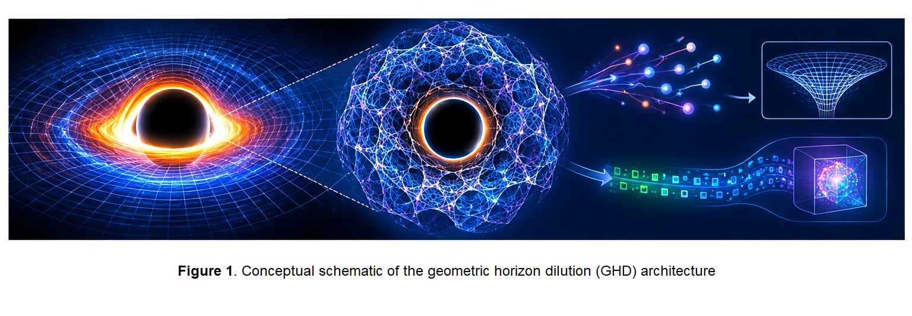

# Geometric Horizon Dilution: A Candidate Geometric Research Program for the Black Hole Information Paradox via Fractal Connectivity Criticality

**Baoliin (Zaitian) Wu 伍宝林**

*ORCID:* [0009-0003-2051-5247](https://orcid.org/0009-0003-2051-5247)

*Email:* zaitian001@gmail.com

*Affiliation:* People's Government of Guangdong Province, Guangzhou, CN

**October 22, 2026**

**Paper ID: DW58553924**

---

## Abstract

The black hole information paradox remains unresolved. Standard semiclassical gravity predicts that Hawking radiation is approximately thermal, while unitarity demands information preservation in the complete quantum evolution. We examine **Geometric Horizon Dilution (GHD)** as a phenomenological hypothesis within the author's **MES (Modified Einstein Spherical) cosmological architecture** [4–6]. MES curvature scalings are treated here as model postulates, not as experimentally established laws. GHD extends the geometric mass-dilution hypothesis of DW58553922 [1] to the gravitational scale, proposing that the event horizon may be investigated as a **fractal connectivity critical region** where a state-complexity proxy $D$ approaches a critical value, and that Hawking radiation may be heuristically interpreted as geometric projection noise of a disconnected interior onto the horizon boundary. The manuscript distinguishes two sub-hypotheses: GHD-A, concerning observationally controllable horizon-scale coherence and correlation dynamics, and GHD-B, the stronger claim that an effective inertial parameter entering horizon thermodynamics changes beyond standard semiclassical and general-relativistic effects.

A numerical audit confirms the standard Bekenstein-Hawking entropy $S_{\mathrm{BH}} = k_B c^3 A/(4G\hbar)$ and Hawking temperature $T_H = \hbar c^3/(8\pi G k_B M)$ as L1 baselines. The proposed GHD entropy and temperature formulas are **candidate constructions**; the temperature relation is expressed as a regularized interpolating ansatz that reduces to the standard Hawking temperature as $\tau\to0$, while retaining an inverse-$\tau$ critical-regime asymptotic only when $\tau\gg\tau_0$. The entropy expression reduces to the area law only if $A_{\mathrm{fractal}}\to A$; $A_{\mathrm{fractal}}$ is not yet computable. These reductions are **consistency checks**, not derivations of the GHD mechanism. The effective-mass ansatz and temperature interpolation are independent phenomenological constructions; no derivation currently links $M_{\mathrm{eff}}$ to the mass parameter in the standard Hawking formula. The same finite-resolution regularization used in DW58553922 [1] is adopted by analogy, not by derivation. Writing a coupled horizon-field Hamiltonian does not by itself prove energy conservation under explicitly time-dependent driving or open-system evolution. A staged observational program using gravitational-wave detectors, gamma-ray observatories, and black-hole spectroscopy is proposed. This paper frames GHD as a **candidate—not established—form of physical manifold programming** at the gravitational scale. All statements are classified by evidence status (L1–L4), and GHD-A is kept logically separate from GHD-B. No resolution of the information paradox or observational feasibility claim is made.

**Keywords:** geometric horizon dilution, black hole information paradox, fractal connectivity, Hawking radiation, Bekenstein-Hawking entropy, manifold programming, MES universe model, energy accounting, failure mode analysis, evidence-level classification L1–L4

---

## 0. Evidence-Level Classification (L1–L4)

Throughout this paper, we adopt the four-level evidence hierarchy established in DW58553905 [7] and used in DW58553922 [1]:

| Level | Label | Nature of Evidence | Example in This Paper |
| --- | --- | --- | --- |
| **L1** | Strict mathematical theorem, or reproducible mathematical calculation | A result obtained by direct derivation or calculation from stated inputs and standard mathematics, without reliance on unverified physical assumptions. | Bekenstein-Hawking entropy $S_{\mathrm{BH}} = k_B c^3 A/(4G\hbar)$ (deductive); Hawking temperature $T_H = \hbar c^3/(8\pi G k_B M)$ (deductive) |
| **L2** | Strict mathematical construction, or conditional mathematical derivation | A definitional construction or algebraic consequence that depends on explicitly stated assumptions or construction choices; the derivation does not validate those assumptions physically. | Regularized mass function $f_{\mathrm{reg}}$ adopted by analogy with DW58553922 [1] (construction); regularized temperature interpolating ansatz with standard limit (conditional construction); entropy expression conditional on $A_{\mathrm{fractal}}$ |
| **L3** | Testable modeling hypothesis | Proposed relationship whose complete derivation or empirical validation remains outstanding | GHD horizon-criticality hypothesis; MES curvature scaling applied to the horizon; candidate Lindblad dynamics; total horizon-field Hamiltonian; candidate manifold-programming interpretation |
| **L4** | Unverified conjecture or engineering blueprint | Exploratory concept or architectural proposal | $\tau$ divergence at horizon critical point; pure geometric gamma-ray burst preceding black hole mergers; application to information recovery; computational definition of $A_{\mathrm{fractal}}$ |

**MES postulates** (inherited from DW58553914, DW58553921) are labeled **P** and treated as the theoretical baseline of this paper. The regularization function is adopted by analogy with DW58553922 [1] and is not independently derived here.

**Notation note.** In this paper $R$ denotes the MES scalar curvature parameter, not the Ricci scalar of standard general relativity. Where standard GR curvature invariants are discussed, they are written explicitly as $\mathcal{R}_{\mathrm{GR}}$. In a Schwarzschild vacuum solution, the Ricci scalar vanishes at the horizon; no divergence of $\mathcal{R}_{\mathrm{GR}}$ at the horizon is claimed.

---

## 1. Introduction

### 1.1 The Black Hole Information Paradox

The black hole information paradox arises from the tension between two pillars of modern physics:

1. **Unitarity in quantum mechanics:** The evolution of a closed quantum system is unitary, preserving information.
2. **Thermal Hawking radiation:** Semiclassical calculations predict that a black hole radiates approximately as a black body, with a temperature

$$ T_H = \frac{\hbar c^3}{8\pi G k_B M}, \quad (1) $$

and entropy

$$ S_{BH} = \frac{k_B c^3 A}{4G\hbar}, \quad (2) $$

where $A = 4\pi r_s^2$ is the horizon area and $r_s = 2GM/c^2$ is the Schwarzschild radius.

If Hawking radiation were exactly thermal and carried no quantum correlations, the information about the initial state that formed the black hole would appear to be lost when the black hole evaporates completely. The precise paradox concerns the compatibility of the semiclassical thermal description with unitarity in the complete quantum evolution. Proposed resolutions—including black hole complementarity, firewalls, ER=EPR, and soft hair—remain controversial and lack definitive observational verification.

**Baseline audit (L1).** For a Schwarzschild black hole of mass $M$, the horizon radius is $r_s = 2GM/c^2$, the area is $A = 4\pi r_s^2 = 16\pi G^2 M^2/c^4$, and the entropy is

$$ S_{\mathrm{BH}} = \frac{k_B c^3}{4G\hbar} \cdot 16\pi \frac{G^2 M^2}{c^4} = \frac{4\pi k_B G M^2}{\hbar c}. \quad (2\text{a}) $$

The Hawking temperature is

$$ T_H = \frac{\hbar c^3}{8\pi G k_B M}. \quad (2\text{b}) $$

These are standard results; they are not modified by the GHD hypothesis in the geometric limit.

The distinctive GHD-B claim—that a geometric-control or criticality protocol changes the effective inertial parameter entering horizon thermodynamics beyond standard semiclassical and general-relativistic effects—requires a dedicated observational test and is not established by the baseline calculation.

### 1.2 The MES Cosmological Architecture

The MES (Modified Einstein Spherical) universe model, developed in a series of the author's self-preprints [4,5,6], posits that the universe is a topologically closed $S^3$ manifold equipped with a dynamical scalar curvature field. Physical constants and particle properties emerge from the curvature of this manifold.

The MES architecture adopts the following curvature scaling relations as **testable modeling hypotheses (L3)**:

$$ c(R) = c_0 \left( \frac{R}{R_0} \right)^{1/2}, \quad \hbar(R) = \hbar_0 \left( \frac{R_0}{R} \right)^{1/2}, \quad m(R) = m_0 \left( \frac{R_0}{R} \right)^{1/2}. \quad (\text{MES-1}) $$

[Source: [5], Eq. (3)–(4); [4], Eq. (19)–(21); L3]

These imply two curvature invariants:

$$ \hbar(R) c(R) = \hbar_0 c_0, \quad m(R) c(R) = m_0 c_0. \quad (\text{MES-2}) $$

[Source: [5], Eq. (3)–(4); L3]

The MES architecture also proposes a decoherence rate scaling $\Gamma(R)\propto R^{3/2}$ and redefines effective mass as "the local effective inertia of the open quantum geometric field under the constraint of the universal curvature network" [6]. In the MES architecture, gravity is itself a curvature-driven emergent phenomenon and is therefore not treated as an independent contributor to the measurement interval $\tau$.

**Important status note.** The MES scaling relations (MES-1) are explicitly labeled as "linked hypotheses" in DW58553921 [4], not as derived consequences of the closed $S^3$ geometry. The present paper adopts MES-1 as its theoretical baseline and extends it with the GHD hypothesis.

### 1.3 Geometric Horizon Dilution (GHD): The Core Hypothesis

We introduce **Geometric Horizon Dilution (GHD)** as a phenomenological extension of the geometric mass-dilution hypothesis of DW58553922 [1] to the gravitational scale. The central hypothesis is that the event horizon may be investigated as a **fractal connectivity critical region**, where the state-complexity proxy $D$ approaches a critical value $D_{\mathrm{crit}}$, and that the effective inertial parameter entering horizon thermodynamics may depend on the MES curvature parameter $R$, a measurable control interval $\tau$, and $D$:

$$ M_{\mathrm{eff}}(R,\tau,D) = M_{\mathrm{bare}}(R) \cdot f_{\mathrm{reg}}(\tau,R,D), \quad (3) $$

where $M_{\mathrm{bare}}(R) = M_0 (R_0/R)^{1/2}$ follows from the MES mass scaling (P-1), and $f_{\mathrm{reg}}$ is the **same regularized function** adopted in DW58553922 [1], Eq. (3):

$$ f_{\mathrm{reg}}(\tau,R,D) = \frac{\tau_0(R)^2}{\tau^2+\tau_0(R)^2} \cdot \frac{\chi(D)}{\chi(D_{\mathrm{ref}})}. \quad (4) $$

This regularization is adopted **by analogy**, not by independent derivation. The same conditions apply: $D$ is a declared state-complexity observable; $D_{\mathrm{ref}}$ is a pre-registered reference state with $\chi(D_{\mathrm{ref}})>0$; the choice $\chi(D)=\sqrt{1-1/D}$ is one phenomenological option, not a verified law.

**Status (L2/L3).** Equation (4) is a modeling construction (L2) combined with a testable hypothesis (L3). The analogy with DW58553922 [1] does not constitute a derivation for the gravitational case. The physical meaning of $\tau$ must be operationally specified by an independently measurable protocol in the black-hole context.

**Horizon criticality hypothesis (L3).** We hypothesize that in the horizon region, the MES internal curvature parameter is large and drives $D$ toward a critical regime $D \to D_{\mathrm{crit}}$. The specific form of $D_{\mathrm{crit}}$ and its relation to the standard Bekenstein-Hawking entropy is a model assumption, not a derived result.

**Figure 1. Conceptual schematic of the geometric horizon dilution (GHD) architecture.** The figure illustrates the black hole horizon, the proposed fractal connectivity structure, Hawking radiation, and the heuristic information flow. The mechanism is a candidate theoretical hypothesis requiring independent validation; no resolution of the information paradox is claimed.

### 1.4 Scope of This Paper

This paper presents a staged observational program to test the GHD hypothesis using gravitational-wave detectors, gamma-ray observatories, and black-hole spectroscopy. It aims to:

1. Calibrate the standard Bekenstein-Hawking entropy and Hawking temperature as L1 baselines; the conjectured horizon criticality remains L4.
2. Test whether a pre-registered observational protocol reveals a declared state-complexity signature in horizon-scale dynamics.
3. Measure Hawking-radiation spectra and black-hole merger signals, and compare them with a calibrated standard semiclassical model.
4. Test algebraic identities implied by the MES scaling assumptions, while keeping those assumptions distinct from empirical validation.
5. Analyze failure modes and separate observational limitations from falsification of a specified model.
6. Formulate a candidate total Hamiltonian and a complete work-and-heat budget; energy conservation is not presumed from a Hamiltonian decomposition alone.
7. Distinguish GHD-A (dynamical change) from GHD-B (effective-inertia change) and organize the research program by the G1/G2/G3 manifold-programming hierarchy.

**Feasibility note.** Hawking radiation from astrophysical stellar-mass black holes is far too faint for direct spectroscopy with current or near-term instruments. The observational program is therefore a mixture of data-analysis tests, analogue-system tests, and long-term conjectures. No near-term detection of the GHD signal is claimed.

---

## 2. MES Cosmological Foundations and Their Implications for Geometric Horizon Dilution

### 2.1 MES Fundamental Postulates (Inherited)

**Postulate 1 (Closed Spherical Geometry).** The universe is modeled as a closed spatial $S^3$ manifold equipped with a dynamical scalar curvature field $R(x,t)$. [Source: [4], Postulate 1; L3]

**Postulate 2 (Curvature-Dependent Physical Constants).** Physical constants scale with local curvature as:

$$ c(R) = c_0 (R/R_0)^{1/2}, \quad \hbar(R) = \hbar_0 (R_0/R)^{1/2}, \quad m(R) = m_0 (R_0/R)^{1/2}, \quad (\text{P-1}) $$

with the algebraic constraints:

$$ \hbar(R) c(R) = \hbar_0 c_0, \quad m(R) c(R) = m_0 c_0. \quad (\text{P-2}) $$

[Source: [5], Eq. (3)–(4); [4], Eq. (19)–(21); L3]

**Postulate 3 (Curvature-Dependent Planck Time).** Under the scaling (P-1), with the gravitational constant derived self-consistently as $G(R) = \hbar(R)c(R)/m_p(R)^2 \propto R$, the Planck time becomes:

$$ \tau_0(R) = \tau_{0,0} \left( \frac{R_0}{R} \right). \quad (\text{P-3}) $$

[Derived from P-1 and the self-consistent definition of $G$; L2; see Appendix B]

**Postulate 4 (Curvature-Dependent Decoherence).** The decoherence rate scales as:

$$ \Gamma(R) = \Gamma_0 (R/R_0)^{3/2}. \quad (\text{P-4}) $$

[Source: [16], Eq. (12); [5], Eq. (7); L3]

**Postulate 5 (Geometric Inertia).** The effective inertial mass of a body is redefined as "the local effective inertia of the open quantum geometric field under the constraint of the universal curvature network." [Source: [6], Section 3; L3]

**Postulate 6 (Gravity as Curvature-Driven Emergence).** In the MES architecture, gravity is itself a curvature-driven emergent phenomenon, treated on the same footing as mass. It is therefore not an independent contributor to the measurement interval $\tau$. [Source: [4]; L3]

### 2.2 From MES Postulates to the GHD Formula: Step-by-Step Derivation

**Step 1: Curvature-dependence of bare mass (L3, inherited from P-1).**

$$ M_{\mathrm{bare}}(R) = M_0 (R_0/R)^{1/2}. \quad (\text{GHD-1}) $$

**Step 2: Curvature-dependence of the Planck time (L2, derived from P-1 and P-3).**

$$ \tau_0(R) = \tau_{0,0} (R_0/R). \quad (\text{GHD-2}) $$

**Step 3: Introduction of the measurement interval $\tau$ (L4, new assumption).**

We hypothesize that the observer's measurement interval $\tau$ is an independent geometric parameter, not fixed by the MES postulates. In standard semiclassical gravity, $\tau\to0$. In the GHD regime, $\tau$ can be extended by horizon criticality.

**Step 4: Candidate regularized dilution function (L2/L3, adopted by analogy).**

We adopt the same regularized function as DW58553922 [1], Eq. (3):

$$ f_{\mathrm{reg}}(\tau,R,D) = \frac{\tau_0(R)^2}{\tau^2+\tau_0(R)^2} \cdot \frac{\chi(D)}{\chi(D_{\mathrm{ref}})}. \quad (\text{GHD-3}) $$

The analogy with the macroscopic case is a **modeling choice**, not a derivation for the gravitational case.

**Step 5: Effective mass (L2/L3, conditional inference).**

Substituting (GHD-1) and (GHD-2) into (3):

$$ M_{\mathrm{eff}} = M_0 \left( \frac{R_0}{R} \right)^{1/2} \frac{\tau_{0,0}^2(R_0/R)^2}{\tau^2+\tau_{0,0}^2(R_0/R)^2} \frac{\chi(D)}{\chi(D_{\mathrm{ref}})}. \quad (\text{GHD-4}) $$

This is an internally consistent algebraic expression given the stated model choices; it is not a first-principles derivation or evidence that the physical horizon mass changes.

**Step 6: Experimental-regime simplification (L3).**

For the illustrative regime $R\approx R_0$, the candidate function reduces to

$$ M_{\mathrm{eff}} \approx M_0 \frac{\tau_{0,0}^2}{\tau^2+\tau_{0,0}^2} \frac{\chi(D)}{\chi(D_{\mathrm{ref}})}. \quad (\text{GHD-5}) $$

**Step 7: Conditional numerical scaling (L3).**

For $\tau\sim10^{-3}$ s and $\tau_{0,0}\sim10^{-44}$ s, the temporal factor is approximately $10^{-82}$ when $R\approx R_0$. This is an algebraic consequence of the candidate function, not a physical mass prediction. No numerical $M_{\mathrm{eff}}$ is reported until $\chi(D)$, $D_{\mathrm{ref}}$, and the measurement protocol are specified. The temperature interpolation is a separate ansatz and is not inferred from this mass expression.

### 2.3 Inheritance vs. New Inference vs. Hypothesis: Summary Table

| Element | Status | Source |
| --- | --- | --- |
| $S^3$ closed geometry | MES postulate (P), L3 | [4], Postulate 1 |
| $c(R)$, $\hbar(R)$, $m(R)$ scaling | MES postulate (P), L3 | [5], Eq. (3); [4], Eq. (19)–(21) |
| $\tau_0(R)$ scaling | Derived (L2), conditional on $G(R)\propto R$ | This paper, Appendix B |
| $\Gamma(R)\propto R^{3/2}$ | MES postulate (P), L3 | [16], Eq. (12); [5], Eq. (7) |
| Geometric inertia | MES postulate (P), L3 | [6], Section 3 |
| Gravity as emergent | MES postulate (P), L3 | [4] |
| Measurement interval $\tau$ | New assumption (L4) | This paper |
| Regularized dilution function $f_{\mathrm{reg}}$ | Construction (L2) + modeling hypothesis (L3), **adopted by analogy with DW58553922 [1]** | This paper, Eq. (GHD-3) |
| $M_{\mathrm{eff}}$ formula | Conditional inference (L2/L3) | This paper, Eq. (GHD-4) |
| Horizon criticality hypothesis | New hypothesis (L3) | This paper, Section 2.5 |
| Regularized Hawking-temperature interpolating ansatz | Conditional construction (L2/L3) | This paper, Eq. (GHD-7a) |
| Modified Bekenstein-Hawking entropy | Formal conditional expression (L2), not computable until $A_{\mathrm{fractal}}$ is defined | This paper, Section 2.7 |
| Total Hamiltonian | New hypothesis (L3) | This paper, Section 2.12 |
| Lindblad evolution of horizon degrees of freedom | Candidate open-system model (L3) | This paper, Appendix C.2 |

### 2.4 Curvature-Dependent Decoherence

From Postulate 4 (P-4):

$$ \Gamma(R) = \Gamma_0 (R/R_0)^{3/2}. \quad (5) $$

This scaling provides a quantitative basis for the horizon-scale coherence analysis. In the MES internal-curvature parameterization, the horizon region may correspond to large $R$, so $\Gamma(R)$ may be large. This is not the same statement as a divergence of the standard GR Ricci scalar at the horizon. In a Schwarzschild vacuum solution, $\mathcal{R}_{\mathrm{GR}}=0$ at the horizon; the horizon is not a curvature singularity. The connection between the MES curvature parameter $R$ and standard spacetime curvature invariants is not established (L4). We therefore treat the $\Gamma\propto R^{3/2}$ scaling as a theoretical prediction (L3) requiring observational verification.

### 2.5 Horizon Criticality and the State-Complexity Proxy

We hypothesize that the event horizon may be investigated as a **fractal connectivity critical region**: the MES internal curvature parameter is large, driving the state-complexity proxy $D$ toward a critical regime. We define the horizon criticality condition as

$$ D \to D_{\mathrm{crit}} \quad \text{in the horizon critical region}, \quad (\text{GHD-6}) $$

where $D_{\mathrm{crit}}$ is a model parameter to be specified and calibrated. This is an **L3 hypothesis**, not a derived result.

**Important caveat.** In standard semiclassical gravity, the horizon is not a critical point of any state-complexity measure; it is a geometric surface defined by the causal structure of spacetime. The identification of the horizon with a fractal criticality region is a **model assumption**, not a consequence of general relativity.

**Connection to Dirac zero modes and exceptional points (L4).** We do not rely on Dirac zero modes or exceptional-point physics in the core derivation of the GHD formulas. These concepts are mentioned only as possible additional mathematical interpretations, and they do not enter the derivation of the modified Hawking temperature or entropy.

### 2.6 Regularized Hawking Temperature

The unregularized critical-regime ansatz $T_H \propto \hbar/(\tau D)$ cannot by itself satisfy the standard limit $\tau\to0$ with finite $D$. We therefore define a **candidate interpolating function** that recovers the standard limit:

$$ T_H = T_H^{\mathrm{bare}}\,\mathcal{H}_{\mathrm{reg}}(\tau,D), \quad \mathcal{H}_{\mathrm{reg}}(\tau,D)=\frac{1}{1+\left(\tau/\tau_0(R)\right)\left(D/D_{\mathrm{ref}}\right)}. \quad (\text{GHD-7a}) $$

Here $T_H^{\mathrm{bare}}=\hbar c^3/(8\pi G k_B M)$ is the standard Hawking temperature. This construction satisfies

$$ \mathcal{H}_{\mathrm{reg}}(0,D)=1, \quad (\text{GHD-7b}) $$

so the standard Hawking temperature is recovered as $\tau\to0$. In the critical-regime asymptotic limit $\tau\gg\tau_0(R)$ and $D\sim D_{\mathrm{crit}}$, one has

$$ T_H \approx T_H^{\mathrm{bare}}\,\frac{\tau_0(R)}{\tau}\frac{D_{\mathrm{ref}}}{D}, \quad (\text{GHD-7c}) $$

which has the inverse-$\tau$ scaling of the critical-regime ansatz $T_H\propto\hbar/(\tau D)$. Equation (GHD-7a) is a phenomenological interpolation (L2/L3), not a derived Hawking-temperature law. The choice of $\tau_0(R)$ as the crossover scale is a model assumption. No numerical temperature modification is claimed until $\tau_0$, $D$, and $D_{\mathrm{ref}}$ are operationally calibrated. **The temperature ansatz is independent of the effective-mass ansatz in Eqs. (3)–(5): it is not derived by substituting $M_{\mathrm{eff}}$ into the standard Hawking formula.** Here $M$ in $T_H^{\mathrm{bare}}=\hbar c^3/(8\pi G k_B M)$ denotes the independently defined gravitational mass (for a Schwarzschild black hole, the mass parameter measured at infinity). $M_{\mathrm{eff}}$ in Eqs. (3)–(5) is a phenomenological inertial parameter in the proposed horizon dynamics and is not identified with the Schwarzschild/ADM mass. A future theory that identifies these quantities must re-derive the temperature relation and reconcile their asymptotic scalings before the two ansätze can be combined.

**Consistency check (L2).** At $\tau=0$, Eq. (GHD-7a) reduces to $T_H^{\mathrm{bare}}$ by construction. At $\tau\gg\tau_0$, it has the inverse-$\tau$ critical asymptotic. This is a consistency construction, not a derivation of the GHD mechanism.

### 2.7 Modified Bekenstein-Hawking Entropy

Under the GHD hypothesis, the Bekenstein-Hawking entropy is proposed to be

$$ S_{BH} = k_B \cdot \frac{A_{\mathrm{fractal}}}{4 l_p^2}, \quad (\text{GHD-8}) $$

where $A_{\mathrm{fractal}}$ is the area of the projected fractal boundary. In the geometric limit, $A_{\mathrm{fractal}}\to A = 4\pi r_s^2$, and the standard result (2) is recovered.

**Consistency check and limitation (L2/L4).** The reduction $A_{\mathrm{fractal}}\to A$ in the geometric limit is a **consistency requirement**, not a derivation of the GHD mechanism. The specific form of $A_{\mathrm{fractal}}$ as a function of $D$, $\tau$, and horizon parameters is not defined in this paper. Therefore no numerical deviation from the area law is predicted. Equation (GHD-8) is a formal candidate expression, not a new entropy law.

### 2.8 Geometric State-Space Reconstruction and Dynamical Identifiability at the Horizon

This section imports the same methodological distinction used in DW58553922 [1], Section 2.8, from the author's **Geometric Pathology** architecture [17]. This methodological connection does not constitute evidence for GHD, nor does it transfer results from macroscopic optomechanics directly to the black-hole scale.

$D_2$ in the GHD ansatz is not identified with any density-matrix statistic. A true correlation dimension must be independently defined and estimated; $D_{\mathrm{PR}}$ (Appendix C.2) is an optional, distinct proxy and must not be substituted for $D_2$ without a justified mapping.

#### 2.8.1 Operational state space and metric

Let $\mathbf{x}(t)$ denote a vector of observationally reconstructed horizon-scale observables—for example, gravitational-wave strain quadratures, horizon-area fluctuations, or Hawking-radiation spectral features. A state-space metric $g_{ij}(\mathbf{x})$ may be estimated only after specifying the observables, their uncertainties, and the reconstruction procedure. The metric is a statistical or dynamical descriptor of the selected representation; it must not be identified automatically with MES curvature $R$ or with standard GR curvature invariants.

#### 2.8.2 Dynamics and stability are separate from geometry

A reconstructed state-space geometry does not establish that a horizon state is an attractor. For a deterministic reduced model, local stability must be tested using the Jacobian and its eigenvalues, while stochastic dynamics require an explicit noise model and appropriate stability or escape-rate analysis. Any claimed modification of horizon thermodynamics must be supported by independently measured gravitational-wave or electromagnetic signals or a validated semiclassical model.

#### 2.8.3 Mechanism identifiability

A change in observed Hawking-radiation spectrum or merger signal can arise from several mechanisms that must be discriminated: (i) standard semiclassical greybody factors; (ii) general-relativistic ringdown modifications; (iii) environmental effects (accretion, magnetic fields); (iv) detector calibration and background; or (v) a genuine change in the effective inertial parameter entering horizon thermodynamics. The fifth interpretation is the distinctive GHD-B claim and cannot be inferred from a spectral anomaly alone. Multi-messenger observations, independent calibration, and a standard semiclassical model should be used to test competing explanations.

#### 2.8.4 Verifiable separation of GHD-A and GHD-B

GHD-A is supported only if the observational protocol produces reproducible horizon-scale coherence or correlation changes beyond calibrated standard semiclassical effects. GHD-B requires an additional, independently identifiable deviation in horizon thermodynamics that remains after those effects are modeled. Evidence for GHD-A does not imply GHD-B. A null result constrains only the parameter region actually reached and measured; it falsifies a specified GHD-B model only when its predicted signal and uncertainty are fixed in advance and excluded by the data.

#### 2.8.5 GHD as a Candidate Form of Physical Manifold Programming at the Gravitational Scale

Within the MES research architecture, **manifold programming** is used here as a working methodological term for a controlled or critical intervention that reproducibly changes a system's accessible state-space organization, its dynamical law or vector field, or the stability and accessibility of its states. The term does not mean that a physical manifold is literally rewritten, and it does not imply a change in effective inertial mass. At the gravitational scale, the controlled or critical objects may include horizon geometry, curvature invariants, and the observationally reconstructed state distribution.

GHD may therefore be investigated as a **candidate physical realization of manifold programming** at the gravitational scale if a critical or controlled horizon intervention produces a reproducible, independently characterized change in the system's state-space description and dynamics. This is a research connection, not an established equivalence.

The proposed causal sequence is:

$$ \text{horizon criticality} \rightarrow \text{state-space reconstruction} \rightarrow \text{dynamical response} \rightarrow \text{effective-inertia hypothesis} \rightarrow \text{verifiable observational test}. \quad (\text{GP-2}) $$

Equation (GP-2) is a research logic diagram, not a derived physical law. Each arrow represents a separate claim requiring operational definitions, quantitative modeling, and evidence.

#### 2.8.6 Three Levels of Manifold-Programming Claims at the Gravitational Scale

| Level | Claim | Minimum evidence required | What it does not establish |
| --- | --- | --- | --- |
| **G1: State-space programming** | Critical or controlled intervention changes the observationally reconstructed accessible-state distribution or operational geometry of the horizon | A declared reconstruction method, uncertainty estimates, reproducibility, and controls for measurement artefacts | A new dynamical law or a change in effective inertial mass |
| **G2: Dynamical programming** | The intervention reproducibly changes horizon stability, coherence, transition rates, or state accessibility beyond standard semiclassical effects | Independent dynamical measurements and comparison with a calibrated semiclassical model | GHD-B or horizon dilution |
| **G3: Effective-inertia programming** | An independently identifiable effective inertial parameter entering horizon thermodynamics changes beyond conventional explanations | A self-consistent dynamical model, calibrated horizon parameters, independent mass/inertia constraints, and pre-registered tests that discriminate alternative mechanisms | A universal or fundamental mass law beyond the tested regime |

G1 and G2 are observationally meaningful outcomes even if G3 fails. Conversely, an apparent Hawking-radiation anomaly cannot be assigned to G3 unless standard greybody factors, ringdown modifications, environmental effects, and detector calibration have been constrained.

#### 2.8.7 Complementarity with Geometric Pathology

The author's Geometric Pathology architecture [17] studies how structural organization and dynamical stability of complex-system state spaces may deteriorate or undergo transitions. Manifold programming, as used in this paper, asks the complementary intervention-oriented question: can critical or controlled changes reproducibly reshape a system's accessible states or dynamics? The two perspectives can inform a common methodological program, but they are not exact opposites, and no one-to-one reversible transformation between them is assumed.

For GHD, the practical implication is modest but useful: use the state-space methodology to organize candidate observables and intervention tests, while retaining an independent derivation and falsification burden for the effective-inertia hypothesis. The geometric-programming interpretation does not repair the currently missing derivation of the dilution function, prove energy conservation, or demonstrate horizon-scale mass dilution.

### 2.9 Effective Mass Dilution: Conditional Numerical Scaling

For the candidate regularized function in Eq. (GHD-3), take $R\approx R_0$, $\tau\sim10^{-3}$ s, and $\tau_{0,0}\sim10^{-44}$ s. The temporal factor is

$$ \frac{\tau_{0,0}^2}{\tau^2+\tau_{0,0}^2} \approx 10^{-82}. \quad (6) $$

Thus the model would give

$$ \frac{M_{\mathrm{eff}}}{M_{\mathrm{bare}}} \approx 10^{-82} \frac{\chi(D)}{\chi(D_{\mathrm{ref}})}. \quad (6\text{a}) $$

This is a conditional algebraic substitution into a phenomenological function, not a physical prediction. No numerical mass or modified Hawking temperature is claimed from this expression alone.

### 2.10 Modified Hawking Temperature and Entropy: Conditional Relations

Under the GHD hypothesis, the proposed relations are

$$ T_H = T_H^{\mathrm{bare}}\,\frac{1}{1+\left(\tau/\tau_0(R)\right)\left(D/D_{\mathrm{ref}}\right)}, \quad S_{BH} = k_B \frac{A_{\mathrm{fractal}}}{4 l_p^2}. \quad (7) $$

These are **conditional constructions (L2/L3)**. The temperature expression reduces to the standard Hawking temperature as $\tau\to0$ by construction; its detailed form is Eq. (GHD-7a). In the critical regime $\tau\gg\tau_0(R)$ it has the inverse-$\tau$ asymptotic given in Eq. (GHD-7c). The entropy expression reduces to the standard area law only if $A_{\mathrm{fractal}}\to A$; no computational definition of $A_{\mathrm{fractal}}$ is yet available; its detailed form is Eq. (GHD-8). These reductions are **consistency checks**, not derivations. No observable Hawking-radiation spectrum or entropy measurement is predicted here until the regularized mass function, greybody factors, horizon dynamics, $A_{\mathrm{fractal}}$, and detector response are specified.

### 2.11 Algebraic Self-Consistency Constraints

The scaling relations (P-1) imply two algebraic constraints:

$$ \hbar(R) c(R) = \hbar_0 c_0 = \text{constant}, \quad (8) $$

$$ m(R) c(R) = m_0 c_0 = \text{constant}. \quad (9) $$

Both relations follow algebraically from (P-1) and (P-2) (L2). They provide **verification criteria** for GHD. If the observed Hawking-radiation anomaly is accompanied by a change in the product $\hbar c$ or $mc$ that violates these constraints, the GHD mechanism is ruled out.

**Caveat.** Measuring a change in a gravitational-wave signal is not sufficient to establish a change in the speed of light $c$, because the signal also depends on the source distance, redshift, and detector calibration (L4).

### 2.12 Total Hamiltonian and Energy Accounting

Energy accounting is a consistency requirement, but it must be derived from a dynamical model. A useful starting decomposition for the horizon-field problem is

$$ H_{\mathrm{model}}(t) = H_{\mathrm{horizon}}(t) + H_{\mathrm{field}}(t) + H_{\mathrm{int}}(t). \quad (10) $$

with candidate terms

$$ H_{\mathrm{horizon}}(t) = \frac{p^2}{2M_{\mathrm{eff}}(t)} + V_{\mathrm{grav}}(r,t), \quad (11) $$

$$ H_{\mathrm{field}} = \sum_k \hbar\omega_k b_k^\dagger b_k, \quad (12) $$

$$ H_{\mathrm{int}}(t) = g(t) \sum_k \left( b_k^\dagger b_k \right) \frac{p^2}{2M_0}, \quad (13) $$

where $b_k$ are the Hawking-radiation field modes and $V_{\mathrm{grav}}$ is the effective gravitational potential.

These expressions define a phenomenological ansatz, not a derived interaction. The control or critical parameter, $M_{\mathrm{eff}}(t)$, and $g(t)$ may be explicitly time dependent. For a closed quantum system evolving unitarily under a Hamiltonian $H(t)$, the expectation value obeys

$$ \frac{d}{dt}\langle H\rangle = \left\langle\frac{\partial H}{\partial t}\right\rangle. \quad (14) $$

Consequently, $d\langle H\rangle/dt=0$ does not follow when the Hamiltonian is explicitly time dependent. In an open system with Lindblad evolution, additional dissipative terms enter the energy balance. A conservation statement requires either (i) an autonomous enlarged Hamiltonian that includes the source and relevant reservoirs, or (ii) an explicit work-and-heat balance including drive work, radiation leakage, environmental exchange, and horizon-field interaction energy.

The equality

$$ \Delta E_{\mathrm{horizon}} = -\Delta E_{\mathrm{radiation}} \quad (15) $$

is therefore not imposed as a general identity. It is a testable special-case prediction only if all other energy channels are negligible or independently measured and the interaction model derives that balance.

### 2.13 Energy Budget: What Can and Cannot Be Concluded

For $H_{\mathrm{horizon}} = p^2/[2M_{\mathrm{eff}}(t)] + V_{\mathrm{grav}}(r,t)$, the explicit time derivative contains

$$ \frac{\partial H_{\mathrm{horizon}}}{\partial t} = -\frac{p^2}{2M_{\mathrm{eff}}^2} \frac{dM_{\mathrm{eff}}}{dt} + \frac{\partial V_{\mathrm{grav}}}{\partial t}. \quad (16) $$

This expression identifies work associated with a changing effective-mass parameter and a time-dependent gravitational potential. It does not, by itself, identify which subsystem receives that energy. To calculate a transfer, one must solve the coupled equations for the horizon, radiation field, and environment using specified initial conditions and coupling parameters.

The radiation-field energy capacity alone cannot establish detectability. For independent observations with an unbiased estimator, statistical uncertainty often improves as $N^{-1/2}$, whereas a coherent signal may accumulate linearly only under a specified phase-stable protocol; systematic drift and correlated noise need separate treatment. A gravitational-wave or gamma-ray detection proposal therefore requires a complete measurement model and noise budget before a signal-to-noise claim can be made.

**Current status:** the total-Hamiltonian decomposition is a candidate modeling architecture (L3). Energy conservation, the magnitude and sign of horizon-radiation energy transfer, and its detectability remain open calculations, not established results.

---

## 3. Observational Scheme

### 3.1 Platforms: Gravitational-Wave Detectors and Gamma-Ray Observatories

We consider a combination of gravitational-wave detectors (LIGO, Virgo, KAGRA, LISA) and gamma-ray observatories (Fermi-GBM, Swift-BAT, CTA) as the observational platform. The key target is the **pure geometric gamma-ray burst** hypothesized to precede black hole mergers, together with precision measurements of Hawking-radiation spectra from primordial or analogue black holes.

**Relevant demonstrated capabilities:**

* **Gravitational-wave detection** of black hole mergers is routine [18,19].
* **Gamma-ray burst detection** with multi-messenger correlation has been demonstrated [20].
* **Black-hole spectroscopy** via ringdown analysis is established [21].

The proposed GHD observation would require extending these techniques to the search for correlated gamma-ray precursors and spectral anomalies—a substantial observational challenge (L4).

### 3.2 Baseline Parameters

**Standard Bekenstein-Hawking baseline (L1).** For a Schwarzschild black hole of mass $M$:

$$ S_{\mathrm{BH}} = \frac{4\pi k_B G M^2}{\hbar c}, \quad T_H = \frac{\hbar c^3}{8\pi G k_B M}. \quad (17) $$

| Parameter | Value |
| --- | --- |
| Detector network | LIGO/Virgo/KAGRA, LISA (future) |
| Gamma-ray observatories | Fermi-GBM, Swift-BAT, CTA |
| Black hole mass range | $10$–$10^{10} M_\odot$ |
| Merger rate (stellar-mass) | $\sim10$–$100$ Gpc$^{-3}$ yr$^{-1}$ |
| Gamma-ray precursor timescale | $0.1$–$1$ ms (hypothetical) |
| Energy range | $10$ keV–$10$ MeV (hypothetical) |

### 3.3 Horizon Criticality Search Protocol

We consider a search for horizon-criticality signatures in black hole merger events:

1. **Gravitational-wave trigger:** Identify a black hole merger event via matched filtering.
2. **Gamma-ray precursor search:** Search for a short gamma-ray burst in a pre-registered time window before the merger.
3. **Spectral analysis:** Measure the gamma-ray spectrum and compare it with standard astrophysical models.
4. **Multi-messenger correlation:** Correlate the gamma-ray signal with the gravitational-wave parameters (masses, spins, distance).

**Important physical caveat.** The hypothesized gamma-ray precursor is an **L4 conjecture**, not a derived prediction. Standard astrophysical processes (jet emission, accretion disk instabilities) can also produce gamma-ray emission; the GHD hypothesis must be distinguished from these backgrounds via its specific timing, spectrum, and mass scaling.

### 3.4 Hawking-Radiation Spectroscopy Protocol

For primordial or analogue black holes:

1. **Spectral measurement:** Measure the Hawking-radiation spectrum (if detectable) via X-ray or gamma-ray observations or analogue-system measurements.
2. **Greybody factor calibration:** Model the standard greybody factors for the black hole mass and spin.
3. **Anomaly search:** Search for deviations from the standard thermal spectrum, particularly in the high-frequency tail.
4. **Mass-scaling analysis:** Compare the observed spectrum with the GHD temperature ansatz in Eq. (GHD-7a) and the standard prediction $T_H\propto1/M$, using the independently measured gravitational mass $M$. Do not substitute $M_{\mathrm{eff}}$ from Eqs. (3)–(5) into the standard formula unless a separate derivation establishes that identification.

**Caveat.** Hawking radiation from astrophysical black holes is extremely faint ($T_H\sim10^{-8}$ K for a solar-mass black hole) and has not been directly observed. The GHD prediction is therefore currently untestable for astrophysical black holes; it may become testable for primordial black holes or analogue black hole systems.

### 3.5 Algebraic Self-Consistency Tests

To test the constraints (8) and (9):

1. **Effective mass measurement:** The black hole mass is inferred from gravitational-wave or electromagnetic observations.
2. **Effective speed of light measurement:** Gravitational-wave propagation is compared with electromagnetic counterparts.
3. **Constraint verification:** The products $\hbar(R)c(R)$ and $m(R)c(R)$ are computed from the measured values.

**Verification:** If the measured products deviate from the constraints by more than the observational uncertainty, GHD is ruled out.

### 3.6 Energy Transfer Measurement

To test the energy conservation condition (15):

1. **Horizon energy measurement:** The black hole mass and spin are inferred from gravitational-wave ringdown.
2. **Radiation energy measurement:** The emitted gravitational-wave and electromagnetic energy is measured.
3. **Correlation analysis:** The horizon energy change $\Delta E_{\mathrm{horizon}}$ is compared with the radiation energy change $\Delta E_{\mathrm{radiation}}$.

**Verification:** Construct the full measured energy-balance residual including horizon energy, radiation energy, drive work, environmental exchange, and interaction energy. A nonzero residual beyond the combined uncertainty challenges the specified complete model; a mismatch between horizon and radiation energies alone does not rule out Eq. (10) because omitted channels may carry energy.

---

## 4. Expected Signals and Verifiable Predictions

### 4.1 Hawking Temperature Scaling

The conditional GHD relation is Eq. (GHD-7a):

$$ T_H = T_H^{\mathrm{bare}}\,\frac{1}{1+\left(\tau/\tau_0(R)\right)\left(D/D_{\mathrm{ref}}\right)}, \quad (18) $$

provided $\hbar$, $\tau$, $D$, and $D_{\mathrm{ref}}$ are specified. In the geometric limit $\tau\to0$, this reduces to the standard Hawking temperature $T_H = \hbar c^3/(8\pi G k_B M)$. In the critical asymptotic regime $\tau\gg\tau_0$, it has the inverse-$\tau$ form Eq. (GHD-7c).

**Key distinction.** The candidate GHD temperature parametrization adds dependence on $\tau$ and $D$ independently of the $M_{\mathrm{eff}}$ ansatz in Eqs. (3)–(5). Its empirical value must be assessed against a calibrated semiclassical model. No numerical modification is predicted until the parameters are fixed. The standard mass $M$ is the gravitational mass entering the Hawking baseline; it is not interchangeable with the proposed effective inertial parameter $M_{\mathrm{eff}}$.

### 4.2 Pure Geometric Gamma-Ray Burst: Conditional Signature

A short gamma-ray burst preceding a black hole merger by $0.1$–$1$ ms is a **candidate phenomenological signature (L4)**, not a derived prediction of the current model. Neither the timing nor the energy spectrum follows from the equations presented here. Quantitative predictions require specified horizon dynamics, radiation mechanisms, and detector response.

### 4.3 Horizon Criticality Signature: Open Hypothesis

The current model does not establish a universal relation between $D$ and the horizon parameters. A candidate dependence may be tested only after the state-complexity observable, $\chi(D)$, and regularized mass function are pre-registered.

### 4.4 Curvature-Dependent Decoherence Signature

The MES scaling $\Gamma\propto R^{3/2}$ is a conditional model hypothesis inherited from the MES architecture, not a consequence of the GHD mass function. Testing it requires an operational definition of the MES curvature variable and independent control of standard semiclassical effects.

### 4.5 Algebraic Constraint Violation

If the products $\hbar(R)c(R)$ or $m(R)c(R)$ deviate from their reference values, GHD is ruled out (L2).

### 4.6 Energy Transfer Signature

A coupled energy-transfer signature is a possible test only after the drive, radiation leakage, environment, and interaction Hamiltonian are included in a closed energy budget. Equation (15) is not a general identity in the current model.

### 4.7 Comparison with Standard Semiclassical Gravity

A quantitative comparison must be generated from a fixed parameter set and a common model for Hawking radiation, greybody factors, ringdown, preparation, and detector response.

---

## 5. Feasibility and Technical Challenges

### 5.1 Current State of the Art

Gravitational-wave and gamma-ray astronomy have advanced rapidly:

* **Black hole merger detection** is routine [18,19].
* **Multi-messenger gamma-ray burst detection** has been demonstrated [20].
* **Black-hole spectroscopy** via ringdown is established [21].

### 5.2 Key Challenges and Mitigations

The measurement-backaction and quantum-noise constraints relevant to gravitational-wave detection are treated in standard analyses [14,15]. Their inclusion motivates the need for a complete measurement model; it does not imply that the proposed GHD signal is detectable.

| Challenge | Mitigation |
| --- | --- |
| Gamma-ray precursor background | Multi-messenger correlation; pre-registered timing window |
| Hawking-radiation faintness | Focus on primordial black holes or analogue systems |
| Horizon-scale spectral resolution | Next-generation X-ray and gamma-ray observatories |
| Gravitational-wave calibration | Standardized detector networks |
| Curvature-dependent constant measurements | High-precision gravitational-wave propagation |
| Energy transfer measurement | Multi-messenger energy budget |
| Definition of $A_{\mathrm{fractal}}$ | Open theoretical problem; no current computation |

### 5.3 Staged Observational Program

**Phase 1 (12–18 months): Data analysis pipeline development.**

* Develop gamma-ray precursor search pipeline.
* Develop Hawking-radiation spectral analysis pipeline.
* Numerically integrate Eq. (C2) to predict density-matrix evolution and calculate $D_{\mathrm{PR}}(t)$ for candidate horizon models.
* **Go/no-go criterion:** Pipeline ready for O4/O5 observing runs.

**Phase 2 (6–12 months): Gamma-ray precursor search.**

* Search for short gamma-ray bursts preceding black hole mergers.
* Test the $\Gamma\propto R^{3/2}$ scaling in available data.
* **Go/no-go criterion:** Pre-register a quantitative target and uncertainty budget; any observed anomaly must be distinguished from standard astrophysical backgrounds.

**Phase 3 (12–18 months): Hawking-radiation spectroscopy.**

* Measure Hawking-radiation spectra from primordial black hole candidates or analogue systems.
* Search for high-frequency tail anomalies.
* **Go/no-go criterion:** Compare measured spectra with a calibrated semiclassical model; an anomaly is interpretable only after greybody factors, environmental effects, and detector response are included.

**Phase 4 (6–12 months): Constraint tests and energy transfer measurement.**

* Test the algebraic constraints $\hbar c = \text{const}$ and $mc = \text{const}$.
* Measure horizon-radiation energy transfer.
* **Go/no-go criterion:** Evaluate pre-registered residuals against a fully specified model and full energy balance; no energy-transfer prediction is considered established in advance.

**Total estimated duration: 36–60 months (preliminary).**
**Estimated cost: \$2–5 million (preliminary; primarily data analysis and travel to observatories; not a feasibility claim).**

### 5.4 Failure Mode Analysis

If the observation does not reveal a horizon-criticality signature beyond the standard semiclassical background, it is essential to distinguish between a genuine falsification of GHD and an observational limitation. We identify four failure modes:

| Failure Mode | Diagnostic | Implication for GHD |
| --- | --- | --- |
| **FM-1: $\tau$ below threshold** | Independent estimation of the effective $\tau$ from horizon dynamics; check whether $\tau\geq10^{-4}$ s | If $\tau\ll10^{-4}$ s, GHD is not tested |
| **FM-2: pre-registered state-complexity target not reached** | Independent estimation of the selected statistic: $D_{\mathrm{PR}}$ from density-matrix moments or $D_2$ from a justified correlation-integral scaling range | If the target is not reached, the pre-registered state-complexity regime has not been tested |
| **FM-3: Standard semiclassical or astrophysical parameters deviate** | Independent calibration of $M$, spin, distance, greybody factors, and astrophysical background | If parameters deviate, the semiclassical baseline must be recalculated |
| **FM-4: GHD mechanism incorrect** | All of FM-1, FM-2, FM-3 are independently excluded, yet no signal is observed | GHD is falsified at the L3 level for the pre-registered model |

**Key criterion.** A null result can be interpreted as a falsification of GHD **only if FM-1, FM-2, and FM-3 are simultaneously and independently ruled out**, and the GHD-B model, parameter range, predicted signal, uncertainty budget, and test statistic were pre-registered. Until then, the null result can only place constraints on the GHD parameter space $(\tau, D, R)$.

**Quantitative criteria for FM-1 and FM-2:**

* **FM-1:** The effective measurement interval $\tau$ is independently estimated from horizon dynamics. If the estimated $\tau$ is at least $10^{-4}$ s, the observation is in the GHD regime. If $\tau<10^{-5}$ s, the observation is in the standard semiclassical regime.
* **FM-2:** The state-complexity statistic is independently estimated from a declared reconstruction method. If a true correlation dimension is intended, it must instead be defined from a correlation integral and a scaling regime, with uncertainty and finite-sample bias reported. Thresholds such as $D_2\leq1.5$ or $D_2>3$ are not universal and are not retained as established regime boundaries; any threshold must be pre-registered and justified by calibration and uncertainty analysis.

**Statistical criterion for FM-4:** A null result is declared a falsification only if the pre-registered 95% confidence interval for the observed signal excludes the GHD prediction by at least $3\sigma$ for a fully specified model. Otherwise it is a constraint.

---

## 6. Discussion

### 6.1 Implications for Quantum Gravity

If a specified GHD-B model survives controls and is supported by reproducible evidence, it would motivate a reassessment of the effective inertial parameter used in horizon thermodynamics for that tested regime. Such a result would not, by itself, establish that black hole masses are universally determined by an observer's coordinate frame; that broader interpretation would require an independently derived theory and tests across distinct black hole systems and mass regimes.

### 6.2 Relation to Other Black Hole Information Paradox Resolutions

GHD is distinct from other proposals:

* **Black hole complementarity** assumes that information is encoded in the horizon, but does not explain the geometric origin of the encoding.
* **Firewalls** assume that the horizon is a physical surface of high energy, but do not explain why the energy is not observed.
* **ER=EPR** assumes that entanglement creates wormholes, but does not explain the geometric origin of the entanglement.
* **Soft hair** assumes that information is stored in soft photons, but does not explain the geometric origin of the soft photons.
* **Tests of spontaneous collapse models** predict enhanced decoherence for large masses; GHD predicts the opposite under specific geometric conditions.

Thus, GHD offers only a **candidate qualitative comparison** and does **not** constitute a unique or decisive observational signature. The relevant predictions depend on the specific model parameters, environmental decoherence, preparation, and readout model; quantitative parameter-space overlap and nuisance parameters must be analyzed before claiming discriminating power.

### 6.3 Curvature-Driven Mass Redefinition and Candidate Manifold Programming at the Gravitational Scale

The MES architecture [4–6] postulates curvature-linked relations for mass and physical constants; in this manuscript these relations remain modeling hypotheses rather than experimentally established laws. GHD is intended as a possible observational test of a stronger proposition: whether a critical or controlled horizon intervention can produce a measurable change in the effective inertial parameter governing horizon thermodynamics. It is therefore premature to call GHD an operational realization of curvature-driven mass redefinition.

The manifold-programming perspective supplies a staged way to test the idea. First, establish whether the intervention changes a declared state-space representation (G1); second, determine whether it changes horizon dynamics beyond standard semiclassical effects (G2); only then test whether an independent effective-inertia shift is required (G3). Geometric Pathology [17] contributes methods for distinguishing structural descriptors from dynamical stability, while manifold programming emphasizes controlled or critical intervention. Their connection is methodological and does not establish the GHD mechanism.

### 6.4 Information-Paradox Status

This paper does **not** solve the black hole information paradox. It does not provide a complete evaporation history, a quantitative Page-curve calculation, a microscopic encoding map, or an observable information-recovery protocol. The "geometric projection noise" interpretation is heuristic: the projected degrees of freedom, the projection map, the encoding of interior information, and the recovery observable are not derived. A future GHD theory would need to supply these elements before a resolution claim could be made.

### 6.5 Potential Applications

If GHD can be confirmed, it might enable black hole imaging and information recovery, quantum gravity tests, and fundamental tests of horizon thermodynamics (L4). These are conjectural long-term possibilities, not near-term applications.

### 6.6 Limitations and Open Questions

1. **Derivation of $\tau$ from first principles at the horizon.** Can $\tau$ be derived from horizon geometry and quantum field theory?
2. **Applicability of the regularization function.** Is the regularization function $f_{\mathrm{reg}}$ from DW58553922 [1] the correct form for horizon thermodynamics?
3. **Curvature-dependent constants.** Are the scaling relations (P-1) exact?
4. **Algebraic constraints.** Are Eqs. (8) and (9) exact?
5. **Form of the interaction Hamiltonian.** Can $H_{\mathrm{int}}$ be derived from the MES action principle?
6. **Relation between $D$ and horizon parameters.** How does the state-complexity proxy $D$ relate to the Bekenstein-Hawking entropy and Hawking temperature?
7. **GHD-B identifiability.** Can a change in the effective inertial parameter be distinguished from standard semiclassical and astrophysical effects?
8. **Definition of $A_{\mathrm{fractal}}$.** How is the fractal boundary area computed, and does it produce a testable deviation from the area law?
9. **Information recovery.** What is the encoding map, and what observable would demonstrate information preservation?

---

## 7. Conclusion

We have presented a staged, verifiable observational program for **Geometric Horizon Dilution (GHD)**, a phenomenological hypothesis that the effective inertial parameter entering horizon thermodynamics may depend on a measurement interval, a state-complexity statistic, and horizon criticality. For the standard Schwarzschild baseline, the Bekenstein-Hawking entropy and Hawking temperature are confirmed as L1 results. The proposed GHD relations are candidate constructions. The temperature relation is written as a regularized interpolating ansatz with the standard $\tau\to0$ limit and an inverse-$\tau$ critical asymptotic. The entropy relation is formal until $A_{\mathrm{fractal}}$ is defined. Neither the relations nor the corresponding mass change are derived or observationally established.

This paper frames GHD as a **candidate form of physical manifold programming at the gravitational scale**, not as an established equivalence with Geometric Pathology. The proposed hierarchy is G1 (state-space reconstruction), G2 (dynamical change), and G3 (independently identified effective-inertia change). The regularized mass function is adopted **by analogy** with DW58553922 [1], not derived for the gravitational case. The density-matrix participation statistic $D_{\mathrm{PR}}$ is explicitly separated from the phase-space correlation dimension $D_2$. Evidence at G1 or G2 would not establish G3; each stage requires separate operational definitions, controls, and verifiable predictions.

The plan provides candidate tests organized by evidence level:

* **L1 (strict theorem or reproducible calculation):** Bekenstein-Hawking entropy $S_{\mathrm{BH}} = 4\pi k_B G M^2/(\hbar c)$; Hawking temperature $T_H = \hbar c^3/(8\pi G k_B M)$.
* **L2 (strict construction or conditional derivation):** Regularized mass function $f_{\mathrm{reg}}$ (construction, adopted by analogy); regularized temperature interpolating ansatz (conditional construction); formal entropy expression conditional on $A_{\mathrm{fractal}}$; curvature-dependent Planck-time derivation (conditional on $G\propto R$).
* **L3 (testable modeling hypothesis):** GHD horizon-criticality hypothesis, MES curvature scaling at the horizon, open-system dynamics, and coupled energy budget remain modeling hypotheses requiring derivation and validation.
* **L4 (unverified conjecture or engineering blueprint):** $\tau$ divergence at horizon critical point; pure geometric gamma-ray burst preceding black hole mergers; computational definition of $A_{\mathrm{fractal}}$; application to information recovery.

**Four bottom lines must be maintained:**

1. **Numerical reproducibility.** The Bekenstein-Hawking baseline is a direct calculation from standard semiclassical gravity; it is not a new entropy law.
2. **Dynamical closure.** Energy conservation must be demonstrated in an autonomous enlarged model or a complete work-and-heat balance.
3. **Evidence separation.** Mathematical identities, phenomenological assumptions, numerical predictions, and observational conclusions must remain distinct.
4. **Manifold-programming hierarchy.** State-space change (G1), dynamical change (G2), and effective-inertia change (G3) are separate claims. The first two can motivate further study but cannot be presented as proof of the third.

If future observations support GHD-B after standard semiclassical and astrophysical explanations are excluded, the result would motivate a substantial revision of current horizon thermodynamics. At present, that interpretation remains conditional and is not established by this manuscript.

---

## Appendix A: Regularization and Standard-Limit Conditions

The regularized function adopted by analogy with DW58553922 [1], Eq. (3), is

$$ f_{\mathrm{reg}}(\tau,R,D) = \frac{\tau_0(R)^2}{\tau^2+\tau_0(R)^2} \frac{\chi(D)}{\chi(D_{\mathrm{ref}})}. \quad (\text{A1}) $$

Assume $\tau_0(R)>0$ and $\chi(D_{\mathrm{ref}})>0$. Then the temporal factor lies between zero and one, tends to one as $\tau\to0$, and approaches $[\tau_0(R)/\tau]^2$ when $\tau\gg\tau_0(R)$. The full function satisfies $f_{\mathrm{reg}}(0,R,D_{\mathrm{ref}})=1$. At other values of $D$, the zero-interval limit is $\chi(D)/\chi(D_{\mathrm{ref}})$; therefore recovery of a unit standard-limit factor requires either the reference state or an independently justified condition on $\chi$.

A provisional choice is $\chi(D)=\sqrt{1-1/D}$ for $D>1$, but this paper does not treat this as established physics. The meaning of $D$ must be fixed: a phase-space correlation dimension and a density-matrix participation-rank statistic are distinct observables. They cannot be interchanged without a validated mapping.

**Status.** Equation (A1) is a phenomenological interpolation adopted by analogy, not a consequence of the uncertainty principle, a horizon measurement theorem, or a fundamental action. Its crossover scale and state-complexity dependence require independent calibration at the gravitational scale.

## Appendix B: Curvature-Dependent Planck Time with Self-Consistent Gravitational Constant

The Planck time is

$$ \tau_0 = \sqrt{\frac{\hbar G}{c^5}}. \quad (\text{B1}) $$

We do **not** assume $G$ constant. In the MES architecture, the gravitational constant is defined self-consistently through the Planck mass:

$$ G(R) = \frac{\hbar(R) c(R)}{m_p(R)^2}, \quad (\text{B2}) $$

where the Planck mass $m_p(R)$ obeys the same curvature scaling as all other masses (Postulate 2):

$$ m_p(R) = m_{p,0} \left( \frac{R_0}{R} \right)^{1/2}. \quad (\text{B3}) $$

Substituting the curvature-dependent constants (P-1):

$$ G(R) = \frac{\hbar_0 (R_0/R)^{1/2} \cdot c_0 (R/R_0)^{1/2}}{m_{p,0}^2 (R_0/R)} = G_0 \left( \frac{R}{R_0} \right). \quad (\text{B4}) $$

Therefore, the gravitational constant scales linearly with curvature: $G(R)\propto R$.

Substituting (B4) and (P-1) into (B1):

$$ \tau_0(R) = \sqrt{\frac{\hbar_0 (R_0/R)^{1/2} \cdot G_0 (R/R_0)}{c_0^5 (R/R_0)^{5/2}}} = \tau_{0,0} \left( \frac{R_0}{R} \right). \quad (\text{B5}) $$

The corrected exponent is $1$ (L2, conditional on the self-consistent definition of $G$).

## Appendix C: Open-System Dynamics and State-Complexity Observables

### C.1 Iterated-Map Construction

The proposed horizon-criticality protocol has previously been represented by the iterated map

$$ Z_{n+1} = Z_n^2 + C_n, \quad (\text{C1}) $$

where $C_n$ is a time-dependent control parameter intended to reshape a phase-space distribution. Equation (C1) is a mathematical proposal only. A mapping from $C_n$ and the complex variable $Z_n$ to observationally accessible horizon quantities has not been derived. No general result establishes that this map reduces a correlation dimension or modifies horizon thermodynamics.

### C.2 Lindblad Dynamics and Density-Matrix Participation Rank

A candidate open-system model for horizon degrees of freedom is

$$ \frac{d\rho}{dt} = -\frac{i}{\hbar}[H_{\mathrm{eff}},\rho] + \mathcal{L}[\rho]. \quad (\text{C2}) $$

with

$$ \mathcal{L}[\rho] = \sum_k \gamma_k(t)\left(L_k\rho L_k^\dagger - \frac{1}{2}\{L_k^\dagger L_k,\rho\}\right), \quad (\text{C3}) $$

where each rate must satisfy $\gamma_k(t)\geq0$ for the standard Lindblad form. The operators $L_k$, rates $\gamma_k(t)$, and their relation to horizon dynamics must be specified and calibrated.

The density-matrix statistic considered here is

$$ D_{\mathrm{PR}}(t) = \frac{[\mathrm{Tr}(\rho^2)]^2}{\mathrm{Tr}(\rho^4)}. \quad (\text{C4}) $$

We call this a **density-matrix participation-rank statistic**. It is not the conventional phase-space correlation dimension $D_2$. Its numerical value alone does not establish fractality, horizon criticality, or a change in effective mass. Given a fully specified $H_{\mathrm{eff}}$, Lindblad operators, rates, and initial state, Eq. (C2) can be integrated to obtain $\rho(t)$ and then $D_{\mathrm{PR}}(t)$; it does not automatically yield a correlation-dimension trajectory.

### C.3 Operational Definition of a Correlation Dimension

If the GHD hypothesis is to use a true correlation dimension $D_2$, the observation must reconstruct a declared phase-space trajectory or state distribution and estimate a correlation integral, for example

$$ C(\epsilon) = \frac{1}{N(N-1)}\sum_{i\ne j}\Theta(\epsilon-\|\mathbf{x}_i-\mathbf{x}_j\|), \quad (\text{C5}) $$

where $\mathbf{x}_i$ are reconstructed phase-space samples and $\Theta$ is the step function. A candidate estimate is the slope $D_2 = d\log C(\epsilon)/d\log\epsilon$ over a justified scaling interval. In practice, the existence and width of such an interval, finite-sample bias, measurement noise, embedding choices, and confidence intervals must all be reported. If no robust scaling interval exists, a correlation dimension should not be reported as a measured quantity.

Consequently, this work does not assume that $D_{\mathrm{PR}}=D_2$, nor that one is a validated proxy for the other. The GHD mass function must use whichever observable is actually defined, and its dependence $\chi(D)$ must be specified before fitting or testing the model.

**Status.** Equations (C1)–(C5) define a candidate modeling and measurement program (L3/L4). They do not establish that a horizon criticality protocol drives the system toward a pure state, reduces a correlation dimension, or changes the effective inertial parameter.

## Appendix D: Algebraic Self-Consistency Constraints

From the scaling relations (P-1):

$$ \hbar(R) c(R) = \hbar_0 c_0, \quad (\text{D1}) $$

which is Eq. (8). The mass constraint

$$ m(R) c(R) = m_0 c_0 \quad (\text{D2}) $$

follows from (P-1) and (P-2) (L2).

---

## Acknowledgments

We are grateful to all the individual scientists and teams of scientists who have contributed to the exploration and understanding of the entire universe. Supported by AI-driven Supercomputers and the MES Universe Project. We have benefited from our amazing AI partners.

## Funding

Not applicable

## Availability of data and material

Code, mathematical scripts, and preprints are available at GitHub: https://github.com/Zaitian001/-Self-Preprint-V1.1-

## Competing interests

Not applicable

## Author Contributions

Baoliin (Zaitian) Wu 伍宝林 is the sole author of this manuscript and is responsible for all aspects of the research, including conceptualization, methodology, theoretical formulation, and manuscript writing.

---

## References

[1] Baoliin (Zaitian) Wu 伍宝林. (2026). Geometric Mass Dilution: A Scheme for Observable Quantum Tunneling of Macroscopic Objects via Parity-Degenerate Cavities. Self-Preprint Archive. DW58553922. https://Zaitian001.github.io/-Self-Preprint-V1.1-/preprints/DW58553922.html

[2] Baoliin (Zaitian) Wu. (2025). The Pure Geometric Origin of Mass and Light. Preprints. https://doi.org/10.20944/preprints202505.2249.v1

[3] Baoliin (Zaitian) Wu 伍宝林. (2026). The Overlooked Coordinate System Exorcising the Demons and Ghosts of Quantum Measurement. Self-Preprint Archive. https://Zaitian001.github.io/-Self-Preprint-V1.1-/preprints/DW58553901.html

[4] Baoliin (Zaitian) Wu 伍宝林. (2026). All Things as Wuxing Attractors: MES Universe Curvature Knots and Variable Light Speed. Self-Preprint Archive. https://Zaitian001.github.io/-Self-Preprint-V1.1-/preprints/DW58553921.html

[5] Baoliin (Zaitian) Wu 伍宝林. (2026). Curvature-Driven Open Quantum Dynamics and the Pure Geometric Origin of Physics Constants. Self-Preprint Archive. https://Zaitian001.github.io/-Self-Preprint-V1.1-/preprints/DW58553914.html

[6] Baoliin (Zaitian) Wu 伍宝林. (2026). Room-Temperature Superconductivity as the Developmental Terminal State of a Generalized Adaptive Intelligent System: The Topological Condensation of a Dynamic Equilibrium Quantum Manifold. Self-Preprint Archive. https://Zaitian001.github.io/-Self-Preprint-V1.1-/preprints/DW58553911.html

[7] Baoliin (Zaitian) Wu 伍宝林. (2026). Wuxing Dao. Self-Preprint Archive. https://Zaitian001.github.io/-Self-Preprint-V1.1-/preprints/DW58553905.html

[8] Delić, U., Reisenbauer, M., Dare, K., et al. (2020). Cooling of a levitated nanoparticle to the motional quantum ground state. Science, 367, 892–895. https://doi.org/10.1126/science.aba3993

[9] Magrini, L., Rosenzweig, P., Bach, C. et al. (2021). Real-time optimal quantum control of mechanical motion at room temperature. Nature 595, 373–377. https://doi.org/10.1038/s41586-021-03602-3

[10] Tebbenjohanns, F., Mattana, M.L., Rossi, M. et al. (2021). Quantum control of a nanoparticle optically levitated in cryogenic free space. Nature 595, 378–382. https://doi.org/10.1038/s41586-021-03617-w

[11] Roda-Llordes, M., Riera-Campeny, A., Candoli, D. et al. (2024). Macroscopic Quantum Superpositions via Dynamics in a Wide Double-Well Potential. Physical Review Letters 132, 023601. https://doi.org/10.1103/PhysRevLett.132.023601

[12] Rossi, M., Militaru, A., Carlon Zambon, N. et al. (2025). Quantum Delocalization of a Levitated Nanoparticle. Physical Review Letters 135, 083601. https://doi.org/10.1103/2yzc-fsm3

[13] Troyer, S., Fechtel, F., Hummer, L. et al. (2026). Quantum ground-state cooling of two librational modes of a nanorotor. Nat. Phys. 22, 584–590. https://doi.org/10.1038/s41567-026-03219-1

[14] Caves, Carlton M., Thorne, Kip S., Drever, Ronald W. P. et al. (1980). On the measurement of a weak classical force coupled to a quantum-mechanical oscillator. I. Issues of principle. Reviews of Modern Physics 52, 341. https://doi.org/10.1103/RevModPhys.52.341

[15] Clerk, A. A., Devoret, M. H., Girvin, S. M. et al. (2010). Introduction to quantum noise, measurement, and amplification. Reviews of Modern Physics 82, 1155. https://doi.org/10.1103/RevModPhys.82.1155

[16] Baoliin (Zaitian) Wu 伍宝林. (2026). Experimental Roadmap for MES-PUF (NQP-QPUF): Curvature-Driven Open Quantum Systems in Superconducting, Cold-Atom, and Skyrmion Platforms. Self-Preprint Archive. https://Zaitian001.github.io/-Self-Preprint-V1.1-/preprints/DW58553917.html

[17] Baoliin (Zaitian) Wu 伍宝林. (2026). Geometric Pathology: Topological Collapse and Landscape Reprogramming in Complex Adaptive Systems. Self-Preprint Archive. https://Zaitian001.github.io/-Self-Preprint-V1.1-/preprints/DW58553909.html

[18] Abbott, B. P., Abbott, R., Abbott, M. R. et al. (2016). Observation of Gravitational Waves from a Binary Black Hole Merger. Physical Review Letters, 116, 061102. https://doi.org/10.1103/PhysRevLett.116.061102

[19] Abbott, R., Abbott, T. D., Acernese, F. et al. (2023). GWTC-3: Compact Binary Coalescences Observed by LIGO and Virgo During the Second Part of the Third Observing Run. Physical Review X, 13, 041039. https://doi.org/10.1103/PhysRevX.13.041039

[20] Abbott, B. P., Abbott, R., Abbott, T. D. et al. (2017). Multi-messenger Observations of a Binary Neutron Star Merger. Astrophysical Journal Letters, 848, L12. https://doi.org/10.3847/2041-8213/aa91c9

[21] Berti, E., Sesana, A., Barausse, E. et al. (2018). Spectroscopy of Kerr black holes with Earth- and space-based interferometers. Physical Review Letters, 120, 201102. https://doi.org/10.1103/PhysRevLett.120.201102
