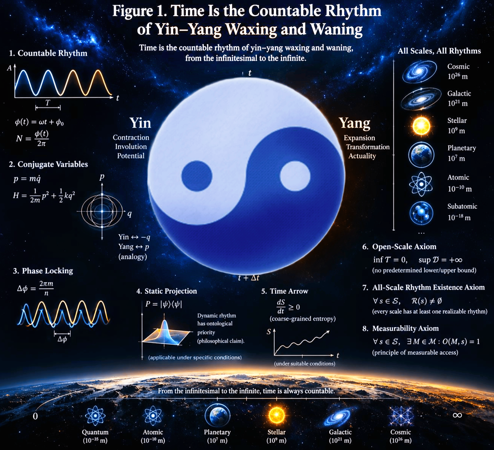

# Time Is the Countable Rhythm of Yin–Yang Waxing and Waning

**Baoliin (Zaitian) Wu 伍宝林**

*ORCID:* [0009-0003-2051-5247](https://orcid.org/0009-0003-2051-5247)

*Email:* zaitian001@gmail.com

*Affiliation:* People's Government of Guangdong Province, Guangzhou, CN

**October 27, 2026**

**Paper ID: DW58553925**

---

## Abstract

> 时也，期也，阴阳消息之期也。
> "Time is periodicity; it is the periodicity of Yin–Yang waxing and waning."
> — *Baihu Tong* 白虎通

**"Time is the countable rhythm of Yin–Yang waxing and waning 时间是阴阳消长的可计数节律."** This paper proposes and defends a definition of time formulated at the intersection of classical Chinese cosmology and modern physics. While modern physics has largely vindicated relationalism over substantivalism, it lacks a canonical positive definition of what time actually *is*. We argue that the classical Chinese tradition provides precisely such a positive definition. The *Baihu Tong* explicitly equates time with the periodicity of Yin–Yang waxing and waning; the *Wenshi Zhenjing* anchors time in "never-ending movement 运而不已"; and the *Zhoubi Suanjing* establishes that Yin–Yang is the cosmic laws of numbers. Crucially, we provide a philological reconstruction of Aristotle's *Physics* through the lens of Chinese cosmology, revealing that his *arithmos kineseōs* was originally a rhythm-order rather than an abstract number, and his "Now" corresponds to the Chinese concept of *Ji* 几 (the critical threshold of phase transition). We provide a proposed operational translation: "Yin–Yang waxing and waning" is illustrated by phase-related variables, while "countable rhythm" is represented by phase accumulation and cycle counting; phase locking is one possible measurement method, not a necessary condition for all counting. From this definition, three consequences follow. First, the "static" is not a fundamental feature of nature but a quasi-static projection of a dynamic rhythm onto an observer's reference frame. Second, the arrow of time is a perspectival phenomenon arising from macroscopic entropy gradients under coarse-graining. Third, the history of timekeeping—from the gnomon to the nuclear clock—is unified as the search for progressively quieter Yin–Yang rhythms. We state an open-scale axiom and a stronger all-scale rhythm-existence axiom, motivated by "the largest has no exterior, the smallest has no interior 大而无外，小而无内". We separately state an in-principle measurability postulate; these are theoretical commitments whose physical standing requires further modelling and testing.

**Keywords:** time; Yin–Yang; countable rhythm; conjugate variables; quasi-static projection; arrow of time; timekeeping; relationalism

---

## 1. Introduction

What is time? The question is among the oldest in philosophy and remains open in physics. Two families of answers dominate. **Substantivalism** treats time as an entity or container in which events are located; **relationalism** treats time as a system of relations among events, defined by change and comparison. Modern physics has largely vindicated relationalism—special relativity makes simultaneity frame-dependent, general relativity makes proper time a line integral along a worldline, and quantum gravity suggests that time may not be fundamental at all. Yet relationalism has never acquired a canonical positive definition. To say that time is "a system of relations" is to say what time is *not* (not a substance) rather than what it *is*.

**Figure 1. Time Is the Countable Rhythm of Yin–Yang Waxing and Waning.** The central Taiji symbol represents the Yin-Yang Universe Model, mapping Yin (contraction, potential) and Yang (expansion, actuality) to conjugate variables. The surrounding panels detail the operational and mathematical architecture of the proposed definition: **(1)** The countable rhythm is formalized by continuous phase accumulation $\phi(t)$ and cycle counting $N$. **(2)** Conjugate variables $(q, p)$ serve as a mathematical analogy for Yin–Yang dynamics, oscillating in phase space. **(3)** Phase locking allows for reference-based comparison and cycle readout. **(4)** The "static" is modeled as a quasi-static projection of the dynamic rhythm onto an observer's slice. **(5)** The arrow of time is perspectival, arising from coarse-grained entropy $S_{\mathrm{cg}}$ under specific macroscopic conditions. **(6–8)** The architecture adopts three explicit theoretical postulates: Open-Scale, All-Scale Existence, and In-Principle Measurability. The right-hand scale illustrates the applicability from the cosmic to the subatomic, echoing "the largest has no exterior, the smallest has no interior."

This paper proposes a positive definition drawn from a tradition that Western philosophy of physics has rarely consulted:

> **Time is the countable rhythm of Yin–Yang waxing and waning.**

The definition is rooted in explicit classical statements. The *Baihu Tong* 白虎通 defines time directly: "Time is periodicity; it is the periodicity of Yin–Yang waxing and waning. 时也，期也，阴阳消息之期也" . The *Wenshi Zhenjing* 文始真经 states: "Time is never-ending movement. 运而不已者为时". The *Zhoubi Suanjing* 周髀算经 declares: "The cosmic laws of numbers originate from the circle and the square. 数之法出于圆方", while Zhao Shuang's commentary clarifies that this refers to Yin–Yang and odd–even numbers, not to the geometric shape of heaven and earth. Furthermore, when we strip away medieval Latin geometricizations and return to the Greek text of Aristotle's *Physics*, we find a striking resonance with this Chinese cosmological architecture.

The definition has three components. **Yin–Yang** names a pair of complementary, mutually defining poles. **Waxing and waning** 消息/消长 names their dynamic, reciprocal transformation. **Countable rhythm** 可计数节律 names the repeatable, partitionable order that this transformation exhibits when compared against a reference process.

The paper is structured as follows. Section 2 recovers the classical sources. Section 3 states the definition. Section 4 provides the physical translation into conjugate-variable oscillation and phase locking, including a dialogue with Aristotle. Section 5 derives the quasi-static character of the "static." Section 6 treats the arrow of time as perspectival. Section 7 reads the history of timekeeping as empirical support. Section 8 addresses the boundaries of the definition. Section 9 concludes.

---

## 2. Classical Sources

### 2.1 Where Do the Names of Time and Space Come From?

Where do the names of **time** and **space** come from? Where do the names of **heaven**, **earth**, and **homo** come from? Where do the names of **all things** come from?

> 《无能子》曰：万物之名亦岂自然著哉？……皆妄作者强名之也。人久习之，不见其强名之初，故讼之而不敢移焉。

Wunengzi says: *How can the names of all things be naturally generated? ... They are all forced names given by delusional authors. People have been accustomed to it for a long time and have not seen where the names come from, so they dare not change them even if they are suspicious.*

> 《文始真经》曰：有天有地，有人有物，皆思成之，盖不可以尘计。安知今之天地，非有思者乎？惟圣人知我无我，知物无物，皆因思虑计之而有。

Wenshi Zhenjing says: *There are heaven and earth, homo and things, all of which are created by consciousness and thinking, and cannot be calculated such as dust. How do we know that the present universe was not created by thinkers? Only the saints know that so-called My-mind is No My-mind, and know that things have no things, all of which are created by consciousness and thinking.*

> 《鬼谷子》曰：粤若稽古，圣人之在天地间也，为众生之先，观阴阳之开阖以命物。

Guiguzi says: *Looking back to ancient times, we find that the saints, in their presence between heaven and earth, served as pioneers for all living beings; by observing the Yin–Yang Waxing and Waning, they defined and gave the names of all things.*

### 2.2 Naming as Protocol: The Cross-Traditional Logic of *Qiangming* 强名

If **time is the countable rhythm of Yin–Yang waxing and waning**, we must first address a foundational epistemological problem: how can the ultimate, ceaseless dynamic of the cosmos be named and measured at all?

Across major philosophical and religious traditions, a universal structural triad emerges regarding the limits of representation:

1. The ultimate is inexpressible.
2. A provisional name (*qiangming* 强名) is nevertheless assigned.
3. The provisional and operational nature of this designation is explicitly marked.

This pattern is well-documented across diverse textual traditions. In classical Daoism, the *Daodejing* (Ch. 25) acknowledges its own inadequacy— *"I do not know its name; I force a word for it and call it Dao"*—immediately setting this forced name into motion as a temporal rhythm (*passing, going far, returning*). In Indian philosophy, Patañjali’s *Yoga Sūtra* defines *Īśvara* via negation (*via negativa*) before introducing the syllable *OṂ* not as an ontological name (*nāman*), but as an operational indicium (*vācaka*)—an interface designed to guide practice rather than capture essence. Similarly, the *Vajracchedikā Prajñāpāramitā Sūtra* employs its characteristic threefold formula (e.g., regarding *paramāṇu* and *lokadhātu*) to de-reify both extremes of scale into conventional designations (*prajñapti*). Western negative theology (*via negativa*) and the *Bhagavad Gītā*'s identification of Krishna with *Kāla* (Time/Destiny) exhibit the exact same formal structure.

What unites these traditions is that **naming is not an ontological description, but a protocol-level locking**.

This epistemological modesty directly governs the classical Chinese definitions of time. When the *Baihu Tong* equates time with Yin–Yang periodicity, the *Wenshi Zhenjing* anchors it in ceaseless movement (*yun er bu yi*), and the *Zhoubi Suanjing* treats circle and square as the numerical grammar of Yin–Yang, these assertions should not be read as rigid metaphysical dogmas. Much like forced names (*qiangming*), they are **operational proposals**—strategic coordinates deployed to map and measure a ceaseless dynamic. Just as the *Vajracchedikā* refuses to reify scale endpoints, our architecture treats the Planck scale or cosmological horizons not as absolute boundaries, but as protocol limits of phase-locking and countability.

### 2.3 The *Baihu Tong*: The Direct Definition

The *Baihu Tong* 白虎通, a foundational text of Han dynasty cosmology, contains the most direct classical definition of time:

> 时也，期也，阴阳消息之期也。

"Time is periodicity; it is the periodicity of Yin–Yang waxing and waning."

"时" (time) is defined as "期" (periodicity/countable rhythm), and this periodicity is exactly the "期" of "阴阳消息" (Yin–Yang waxing and waning). The term "消息" (xiaoxi) is a standard Han dynasty term for the alternation of Yin-Yang—the twelve "xiaoxi hexagrams" 十二消息卦 map precisely onto the Yin-Yang waxing and waning across the year.

This single sentence contains all three elements of the proposed definition: **阴阳** (Yin–Yang), **消息** (waxing and waning), and **期** (periodicity/countable rhythm). The classical Chinese tradition thus independently arrived at a relational-operational definition of time that anticipates modern phase-locking metrology.

### 2.4 The *Wenshi Zhenjing*: The Ontological Anchor

The *Wenshi Zhenjing* 文始真经, attributed to Yin Xi 尹喜, provides the ontological anchor for the definition:

> 运而不已者为时，包而有在者为方。

"Time is never-ending movement. Space is all-embracing existence."

The sentence pairs *shi* 时 (time) with *fang* 方 (space). "运而不已" means "never-ending movement." Time is what is grasped when ceaseless operation is articulated; space is what is grasped when encompassing presence is articulated. Then *Wenshi Zhenjing* explains: "运而不已，四时生焉；包而有在，四方立焉" (Never-ending movement generates time; all-embracing existence establishes space). Time is thus anchored in the **never-ending movement of the universe**, not in a container external to it.

### 2.5 The *Zhoubi Suanjing*: The Numerical Grammar

The *Zhoubi Suanjing* 周髀算经 opens with Shang Gao's reply to the Duke of Zhou: "方属地，圆属天，天圆地方" (square belongs to earth, circle belongs to heaven; heaven is round, earth is square). Zhao Shuang's third-century commentary forecloses a naive geometric reading:

> 天动为圆，其数奇；地静为方，其数耦。此配阴阳之义，非实天地之体也。

"Heaven's motion is circle, its number odd; earth's stillness is square, its number even. This is the meaning of pairing Yin and Yang; it is not the actual body of heaven and earth." Zhao Shuang's gloss is decisive: circle and square are **odd–even numbers, motion–stillness, Yin–Yang pairing**, not geometric shapes. Circle and square are the **numerical grammar** of Yin–Yang. Number becomes possible because Yin–Yang, odd–even, motion–stillness are articulated as a countable order.

### 2.6 Classical Extensions: Cosmological Constancy and Operational Rhythm

Beyond the *Zhoubi Suanjing* and the *Baihu Tong*, two additional classical sources deepen the ontological and operational dimensions of the definition.

Dong Zhongshu (c. 179–104 BCE) in the *Chunqiu Fanlu* 春秋繁露 offers the most direct ontological grounding for the claim that Yin–Yang alternation is not merely one among many natural rhythms, but the constitutive structure of temporal order itself:

> 天地之常，一阴一阳。……迹阴阳终岁之行，以观天之所亲而任。

"The constant principle of Heaven and Earth is simply Yin and Yang. … Trace the course of Yin and Yang through the full year to observe what Heaven draws near to and employs."

The key term *chang* 常—"constant principle"—is a categorical rather than empirical claim. Dong asserts that Yin–Yang alternation is the invariant background against which all change becomes intelligible. The phrase *ji Yin-Yang zhong sui zhi xing* 迹阴阳终岁之行—"trace the course of Yin and Yang through the full year"—operationalizes this constancy: counting is not an afterthought applied to time; the very act of *tracing* 迹 the annual circuit of Yin and Yang *is* the construction of time as a countable quantity.

Complementing Dong's cosmological framing, the *Guiguzi* 鬼谷子 (c. 4th–3rd century BCE) supplies the operational microstructure of Yin–Yang rhythm at the scale of action and communication. Its opening chapter defines *bai he* 捭阖—"opening and closing"—as the fundamental oscillatory unit underlying all agency:

> 捭之者，开也，言也，阳也；阖之者，闭也，默也，阴也。
> (To *bai* is to open, to speak, to be Yang; to *he* is to close, to be silent, to be Yin.)

> 阳动而行，阴止而藏；阳动而出，阴随而入。阳还终始，阴极阳生。
> (Yang moves and proceeds, Yin stops and stores; Yang moves outward, Yin follows inward. Yang returns from end to beginning; Yin at its extreme gives birth to Yang.)

This text demonstrates that the Yin–Yang rhythm is not restricted to astronomical or seasonal scales. A single act of speech (Yang) followed by silence (Yin) constitutes one minimal countable cycle. The closed-loop formulation *Yang huan zhong shi, Yin ji Yang sheng* precisely mirrors the phase-locked oscillation condition in Eq. (4): two conjugate modes alternately dominate, and the reversal at the extreme of each phase guarantees periodicity. The *Guiguzi* thus supplies the **behavioral-dynamical** layer of the definition: every act of an agent—opening/closing, speaking/listening, acting/resting—is simultaneously an instance of time-constitution at the micro-scale.

### 2.7 The Resulting Intuition

From these sources, a single intuition emerges: **time is not a container in which change occurs; it is the countable articulation of a ceaseless cosmic operation.** The *Baihu Tong* supplies the direct definition; the *Wenshi* supplies the ontological anchor; the *Zhoubi* supplies the numerical grammar; the *Chunqiu Fanlu* and *Guiguzi* supply the cosmological constancy and operational microstructure. The proposed definition is the explicit formulation of this intuition.

---

## 3. The Definition

### 3.1 Statement

> **Definition.** Time is the countable rhythm of Yin–Yang waxing and waning.

Three terms require specification.

**Yin–Yang** denotes a pair of complementary poles that are defined reciprocally: neither pole has independent existence; each is what it is only in relation to the other.

**Waxing and waning** denotes the dynamic, reciprocal transformation of the poles: as one waxes the other wanes, and the transformation is cyclic rather than monotonic.

**Countable rhythm** denotes the repeatable, partitionable order exhibited by the waxing and waning when compared against a reference process. "Rhythm" already contains the idea of dynamic balance: a rhythm is an order that persists *through* change, not *despite* it. "Countable" adds the operational condition: the rhythm must admit periodization and comparison.

### 3.2 Formal Statement

Let \(\Phi(t)\) denote an unwrapped phase of a Yin–Yang oscillation, and let \(\omega_0 = 2\pi/T_0\) be a constant reference angular frequency. Define the phase-based elapsed-time estimate relative to this reference as:

$$ \tau_{\Phi} \equiv \frac{\Phi(t)-\Phi(t_0)}{\omega_0}, \quad T_0=\frac{2\pi}{\omega_0} \quad (1) $$

The corresponding accumulated cycle count is \(N_{\Phi}=[\Phi(t)-\Phi(t_0)]/(2\pi)\), which need not be an integer for arbitrary endpoints. If the endpoints are chosen at the same phase after exactly \(N\) complete cycles, then \(\Delta\Phi=2\pi N\) and \(\tau_{\Phi}=NT_0\). For a nonuniform oscillator, this expression is a reference-based phase estimate; its interpretation as physical elapsed time depends on the calibration and stability of the reference. Equation (1) therefore formalizes one operational realization of the proposal: elapsed time can be estimated by accumulated phase relative to a reference rhythm.

### 3.3 What the Definition Is Not

The definition is **not substantival**: it does not posit a time-substance. It is **not purely relational in the bare sense**: it does not merely say that time is a system of relations, but specifies *which* relations—Yin–Yang waxing and waning—constitute it. It is **not a reduction to mechanics**: it does not claim that time *is* motion, but that time is the countable order *of* a certain kind of motion.

---

## 4. Physical Translation

### 4.1 Yin–Yang as Conjugate Variables

A periodic oscillation can be represented by a pair of phase-related variables. For a harmonic oscillator of mass \(m\), amplitude \(A\), angular frequency \(\omega\), and initial phase \(\phi_0\):

$$ q(t)=A\cos(\omega t+\phi_0), \quad p(t)=m\dot q(t)=-mA\omega\sin(\omega t+\phi_0) \quad (2) $$

Here \(p\) is the canonical momentum. If a normalized momentum is used instead, the factor \(m\) may be absorbed into the variable definition. The pair \((q,p)\) is a mathematically useful illustration of complementary, phase-related variables, but its identification with Yin–Yang is a proposed mapping or analogy, not an established physical identity. When \(q\) is maximal, \(p\) is zero; as \(q\) changes, \(p\) varies in quadrature. The phase is:

$$ \Phi(t)=\omega t+\phi_0, \quad N_{\Phi}=\frac{\Phi(t)-\Phi(t_0)}{2\pi} \quad (3) $$

For constant \(\omega\), \(N_{\Phi}\) gives the accumulated number of cycles, which is an integer only when the endpoints delimit complete cycles. Equation (3) is a bridge between the proposed philosophical vocabulary and the operational vocabulary of phase accumulation: **waxing and waning is represented by oscillation; countability is represented by cycle counting.**

### 4.2 Countability as Phase Locking

One way to compare a rhythm against a reference is **phase locking**: two oscillators are locked when their phase difference remains bounded over a specified interval:

$$ |\Phi_1(t)-\Phi_2(t)|\leq C \quad \text{for } t\in I \quad (4) $$

where \(C\) is a finite constant and \(I\) is the stated locking interval. Phase locking can support robust comparison and cycle readout, but it is not a necessary condition for every form of cycle counting: cycles may also be counted by threshold crossings or other calibrated reference procedures. Equation (4) therefore describes one important operational method, not a universal mathematical definition of countability.

### 4.3 Compatibility with Existing Positions

Aristotle says: *δῆλον οὖν ὅτι ὁ χρόνος ἀριθμός ἐστι κινήσεως κατὰ τὸ πρότερον καὶ ὕστερον, καὶ συνεχής (κινήσεως γάρ τινος).*

**Aristotelian Reconstruction.** In *Physics* IV, Aristotle's definition of time is traditionally rendered as "the number of motion with respect to before and after" (δῆλον οὖν ὅτι ὁ χρόνος ἀριθμός ἐστι κινήσεως κατὰ τὸ πρότερον καὶ ὕστερον, καὶ συνεχής). However, reading through the lens of Chinese cosmology reveals a deeper resonance that medieval Latin translations obscured:

1. **ἀριθμός (arithmos)** is not an abstract number but "a measurable order or rhythm" (akin to *rhythmos*). When rendered in classical Chinese, it is **"度" (measure/degree)**—the rhythmic order captured by the mind within ceaseless change.
2. **κατὰ τὸ πρότερον καὶ ὕτερον (before and after)** maps directly to the **"消息之先后" (sequence of waxing and waning)** of Yin and Yang.
3. **συνεχής (synechēs)** means "closely held together, continuous," precisely echoing the *Wenshi Zhenjing*'s **"运而不已" (never-ending movement)**.

Thus, a philologically grounded translation of Aristotle, liberated from geometric linearity, reads: **"Time is the measure of movement, following the sequence of waxing and waning; because it attaches to never-ending movement, its body is continuous and unbroken"** 时者，运之度也，依乎消息之先后，附于不息之运，故其体连绵不绝. This eliminates the dichotomy between Greek and Chinese thought: Aristotle, like the *Baihu Tong*, defines time as the rhythmic order of a dynamic polarity.

**The "Now" and "Ji" 几/幾.** This reconstruction also resolves the Aristotelian paradox of the "Now" (*To Nyn*). In Western geometry, the Now is a dimensionless, vanishing point. But if time is the rhythm of Yin–Yang, the Now corresponds to the Chinese concept of **"几/幾"**—"the subtle incipience of motion" 动之微, the critical threshold where Yin and Yang undergo phase transition. The Now is not an empty geometric cut; it is the phase-locking reset point of the cosmic rhythm, where the old phase ends and the new begins.

**Relationalism (Rovelli).** Rovelli argues that time is not a fundamental entity but a relational structure that emerges from the comparison of physical processes. The proposed definition is relational in this sense, but adds a dynamical vocabulary: the relations are not arbitrary but are structured as Yin–Yang waxing and waning.

**Envariance (Zurek).** Zurek's environment-assisted invariance derives the Born rule from the symmetry of entangled states. The proposed definition does not attempt to derive quantum probabilities, but shares with envariance the insight that **countability is grounded in symmetry**.

---

## 5. The Static as Quasi-Static Projection

### 5.1 The Problem of the Static

If time is a rhythm, what is a "static" moment? The static appears to be the absence of rhythm. But on the proposed definition, the static cannot be fundamental: a static moment is either a rhythm of infinite period or a projection of a rhythm onto a slice.

### 5.2 Projection Formalism

Let \(\mathcal{M}\) be a state space or dynamical manifold, \(\gamma\subset\mathcal{M}\) a trajectory, and \(\Sigma\) a specified observation slice or constraint surface. When the intersection is well-defined, the observed slice is represented by \(\gamma\cap\Sigma\); more generally, a projection or observation map must be specified by the model:

$$ \pi_\Sigma(\gamma)=\gamma\cap\Sigma \quad \text{(when defined)} \quad (5) $$

Equation (5) formalizes a possible representation of a static observation as a slice through a trajectory. By itself, it does not prove that all static configurations are derivative or that dynamic rhythm is ontologically fundamental; those remain interpretive claims of the proposed architecture.

### 5.3 Dependence on Frame, Slice, and Measurement Basis

The projection depends on three choices: (1) the reference frame defining the slice; (2) the time slice selected; (3) the measurement basis used to read out the configuration. The static is therefore **quasi-static**: it is static only relative to a frame, a slice, and a basis. There is no absolute static, because there is no absolute frame, slice, or basis.

### 5.4 Consequence

The consequence is ontological: **the dynamic rhythm is fundamental; the static is derivative.** This inverts the common intuition that time is a succession of static moments. On the proposed definition, there are no static moments *prior* to the rhythm; there are only slices *through* the rhythm.

---

## 6. The Arrow of Time as a Perspectival Phenomenon

### 6.1 The Problem of the Arrow

The fundamental equations of classical and quantum mechanics are time-reversal symmetric. Yet the macroscopic world exhibits a robust arrow: entropy increases, memories form, causes precede effects. If time is a countable rhythm, where does the arrow come from?

### 6.2 The Arrow as Perspectival

The proposed answer is that **the arrow is not a property of the rhythm itself but of the observer's relation to the rhythm.** The rhythm is cyclic—Yin–Yang waxing and waning returns to itself. The arrow arises from the **irreversible accumulation of entropy** along the trajectory:

$$ \frac{dS_{\mathrm{cg}}}{dt}\geq 0 \quad (6) $$

Here \(S_{\mathrm{cg}}\) denotes a coarse-grained thermodynamic entropy under conditions in which the usual macroscopic entropy-increase description applies. The inequality is not a universal pointwise law for every subsystem or every microscopic trajectory, and it does not by itself derive memory, causality, or the full arrow of time. It illustrates how a macroscopic orientation can arise in a coarse-grained description.

### 6.3 Compatibility with the Definition

The definition accommodates the arrow without abandoning the rhythm: **the cyclic rhythm gives the measure; the irreversible accumulation gives the direction.** Time as countable rhythm provides the metric; the entropy gradient provides the orientation. The rhythm is the order, the arrow is the orientation of that order for a coarse-graining observer.

### 6.4 Consequence

The consequence is that **the arrow is not a fundamental feature of time but a feature of the observer's relation to time.** This is consistent with Rovelli's relationalism and with the thermodynamic account of the arrow, but adds a specific claim: the arrow is the **orientation of a cyclic rhythm under coarse-graining**.

---

## 7. The History of Timekeeping as Empirical Support

### 7.1 The Unifying Logic

If time is the countable rhythm of Yin–Yang waxing and waning, then the history of timekeeping should exhibit a single logic: **the search for progressively quieter Yin–Yang rhythms**—rhythms that are less susceptible to environmental perturbation, more stable, and more precisely countable.

### 7.2 The Sequence

**Gnomon and sundial.** The gnomon reads the waxing and waning of the sun's shadow: the shadow shortens as Yang waxes toward the summer solstice, lengthens as Yin waxes toward the winter solstice.

**Water clock and sand glass.** The flow of water or sand provides a rhythm independent of the sun. The Yin–Yang pair is the filling and emptying of the vessels.

**Mechanical clock.** The escapement regulates the waxing and waning of a pendulum or balance wheel, converting a free oscillation into a counted rhythm.

**Atomic clock.** The oscillation is the transition between two hyperfine levels of caesium-133. The Yin–Yang pair is the two levels; the countability is the frequency \(9\,192\,631\,770\) Hz.

**Optical and nuclear clocks.** The oscillation is pushed to higher frequencies and deeper into the atom: from outer-electron transitions to nuclear transitions. The logic is the same—find a rhythm that is **more shielded from environmental perturbation**.

### 7.3 The General Form

For a clock that counts \(N\) complete cycles of a stable reference oscillator, the elapsed reference time is:

$$ \tau=N T_{\mathrm{ref}}=N\frac{2\pi}{\omega_{\mathrm{ref}}} \quad (7) $$

This expression assumes a well-defined reference period and a count of complete cycles; real clocks also require calibration and account for uncertainty and environmental effects. The history of timekeeping is thus the history of improving the stability and readout of \(\omega_{\mathrm{ref}}\)—quieter Yin–Yang rhythms.

---

## 8. Boundaries: No Terminal Point

### 8.1 The Temptation of a Terminal Point

It is tempting to suppose that the definition has a lower bound: the Planck time \(t_P \approx 5.39 \times 10^{-44}\,\text{s}\), below which "countable rhythm" loses meaning. This temptation should be resisted. The Planck time is not a terminal point of countability; it is the **resolution boundary of current locking protocols**.

### 8.2 The Lesson of History

The history of measurement is a history of terminal points being redefined as starting points. The diffraction limit of optical microscopy was overcome by electron and near-field microscopy; the stability limit of atomic clocks was overcome by optical and nuclear clocks. There is no reason to suppose that the Planck scale is different.

### 8.3 Scale Invariance: "大而无外，小而无内"

The classical formula "the largest has no exterior, the smallest has no interior 大而无外，小而无内" captures the correct structure:

- **No largest rhythm**: there is no external frame from which to cap the largest cycle. The "one revolution of the Dao" is the largest countable cycle *within the current architecture*, but if the universe has nested or open topology, this revolution is a phase segment of a larger cycle.
- **No smallest rhythm**: there is no indivisible rhythm-atom. The sub-Planckian landscape is not "rhythmless chaos" but **a finer Yin–Yang waxing and waning that the current locking protocol cannot resolve**—just as the atom was not "indivisible" but "requiring a new grammar."

**Classical Motivation for the Open-Scale Axiom**

The claim that the rhythm definition admits no terminal scale finds a striking classical precedent in the *Guiguzi* 鬼谷子, which explicitly asserts the scale-free character of Yin–Yang alternation:

> 由此言之，无所不出，无所不入，无所不可。可以说人，可以说家，可以说国，可以说天下。为小无内，为大无外。

"From this it follows: there is nowhere it cannot go out, nowhere it cannot enter, nothing it cannot accomplish. It can be applied to a person, to a family, to a state, to the world. The smallest has no interior, the largest has no exterior."

The phrase *the largest has no exterior, the smallest has no interior 大而无外，小而无内* motivates the proposed **open-scale axiom**: the theory does not stipulate an absolute lower or upper boundary for its scale domain. At the small end, the architecture postulates the possibility of finer rhythm structures ("no interior"); at the large end, it postulates no finite terminal bound ("no exterior"). This philosophical motivation does not itself prove scale invariance or establish the physical existence of rhythms at every scale; the latter is stated separately as Axiom B. The Planck time is not adopted as a terminal grain of time in this architecture, although whether any physical limit exists requires a separate argument.

### 8.4 Formal Postulates: Open Scale, All-Scale Existence, and Measurement

The strong claim of this paper is not merely that current measurement limits should not be mistaken for limits on existence. The architecture adopts the following postulates, whose consequences are conditional on their acceptance.

**Axiom A — Open-Scale Axiom.** Let \(\mathcal T\subset(0,\infty)\) be the set of rhythm periods admitted by the theory, and let \(\mathcal D\subset(0,\infty)\) be the set of admitted positive time intervals. Require:

$$ \inf\mathcal T=0, \quad \sup\mathcal D=+\infty \quad (8) $$

This means that \(\mathcal T\) has no strictly positive uniform lower bound and \(\mathcal D\) has no finite upper bound. It does not mean that a zero period or an infinite interval is attained, nor that every positive period is admitted.

**Axiom B — All-Scale Rhythm Existence Axiom.** Let \(\mathcal S\) be the full scale domain stipulated by the theory, and let \(\mathcal R(s)\) denote the set of physically realizable rhythms at scale \(s\). Require:

$$ \forall s\in\mathcal S, \quad \mathcal R(s)\neq\varnothing \quad (9) $$

This is the paper's strong ontological postulate: at every scale in the stipulated domain, at least one physically realizable rhythm is postulated to exist. To express the intended all-scale claim, \(\mathcal S\) must be understood as the full scale domain of the theory, not merely the subset currently accessible to instruments. Axiom B is independent of Axiom A: the absence of a uniform lower or upper bound does not by itself prove that a rhythm exists at every scale.

**Operational Postulate C — In-Principle Measurability.** Let \(\mathcal M\) be the class of physically admissible measurement arrangements, and let \(O(M,s)\) indicate whether arrangement \(M\) can identify a rhythm at scale \(s\) under specified conditions. The strong operational claim is:

$$ \forall s\in\mathcal S, \quad \exists M\in\mathcal M:\ O(M,s)=1 \quad (10) $$

This states that each scale in \(\mathcal S\) has at least one physically admissible measurement arrangement capable of identifying its rhythm. It is stronger than saying that instruments may improve in the future. It requires a physical account of coupling, signal discrimination, resolution, sensitivity, noise, disturbance, and resource constraints. The existence of a mathematical symbol \(M\) is not by itself proof that such an instrument can be physically constructed.

Axioms A and B express the open-scale and all-scale existence commitments of the architecture; Postulate C makes explicit the additional measurement commitment proposed here. They are theoretical postulates, not conclusions established by the historical examples of clocks. Their physical standing depends on whether the architecture can develop internally consistent dynamics and testable consequences.

### 8.5 Consequence

If Axioms A and B are adopted, the definition is intended to apply throughout the stipulated scale domain without an assumed terminal point, and at least one physically realizable rhythm is postulated to exist at each scale in that domain. If Operational Postulate C is also adopted, each such scale is in principle identifiable by some physically admissible measurement arrangement. These are conditional consequences of the postulates, not independent empirical demonstrations. The claim does not entail scale invariance: the rhythm’s physical realization and governing dynamics may differ across scales.

---

## 9. Conclusion

We have proposed and defended a definition: **time is the countable rhythm of Yin–Yang waxing and waning.** The definition has classical roots in the *Baihu Tong*, the *Wenshi Zhenjing*, the *Zhoubi Suanjing*, the *Chunqiu Fanlu*, and the *Guiguzi*; a precise physical translation into conjugate-variable oscillation and phase locking; and three consequences: the static is a quasi-static projection, the arrow is perspectival, and the history of timekeeping is the search for quieter rhythms.

By reconstructing Aristotle's *Physics* through the philological lens of Chinese cosmology, we have shown that the Greek *arithmos* and the Chinese *du* 度 converge on the same truth: time is not a geometric container but the measurable rhythm of a never-ending dynamic. The "Now" is not an empty point but the *Ji* 几/幾 of phase transition. The architecture adopts an open-scale axiom and a stronger all-scale rhythm-existence axiom, motivated in part by "great without exterior, small without interior." These are explicit theoretical commitments; the additional claim of in-principle measurability is stated separately.

The definition is not a metaphor. It is a relational–operational account that specifies *which* relations constitute time and *how* they are counted. Whether it will prove fruitful in the foundations of physics and in metrology is a question for future work—but at minimum, if asked **"What is time,"** an answer worth taking seriously is: 

**"Time is the countable rhythm of Yin–Yang waxing and waning."**

---

## Acknowledgments

We are grateful to all the individual scientists and teams of scientists who have contributed to the exploration and understanding of the entire universe. Supported by AI-driven Supercomputers and the MES Universe Project. We have benefited from our amazing AI partners.

## Funding

Not applicable.

## Availability of data and material

Code, mathematical scripts, and preprints are available at GitHub: https://github.com/Zaitian001/-Self-Preprint-V1.1-

## Competing interests

Not applicable.

## Author Contributions

Baoliin (Zaitian) Wu 伍宝林 is the sole author of this manuscript and is responsible for all aspects of the research, including conceptualization, methodology, theoretical formulation, and manuscript writing.

---

## References

[1] Aristotle. (1831). Φυσικής Ακροάσεως [Physicorum libri VIII]. In I. Bekker (Ed.), Aristoteles Opera (Vol. 1, pp. 184–267). Academia Regia Borussica. (Original work published ca. 350 BCE)

[2] Ban Gu 班固. *Baihu Tong* 白虎通. (Original work published 79 CE)

[3] Wunengzi 无能子. (Original work published 887 CE)

[4] Shang Gao 商高. *Zhoubi Suanjing* 周髀算经. (Original work transmitted orally by Shang Gao and recorded in manuscript by Zhou Gong ca. 1046 BCE)

[5] Yin Xi 尹喜. *Wenshi Zhenjing* 文始真经. (Original work published ca. 485 BCE)

[6] Dong Zhongshu 董仲舒. *Chunqiu Fanlu* 春秋繁露. (Original work published ca. 135 BCE)

[7] Guiguzi 鬼谷子. (Original work published ca. 360 BCE)

[8] Rovelli, C. (2018). The order of time. Riverhead Books.

[9] Rovelli, C. (2011). “Forget time”. Foundations of Physics, 41, 1475–1490. https://doi.org/10.1007/s10701-011-9561-4

[10] Zurek, W. H. (2003). "Environment-Assisted Invariance, Entanglement, and Probabilities in Quantum Physics." *Physical Review Letters* 90, 120404. https://doi.org/10.1103/PhysRevLett.90.120404

[11] Baoliin (Zaitian) Wu 伍宝林. (2026). Curvature-Driven Open Quantum Dynamics and the Pure Geometric Origin of Physics Constants. Self-Preprint Archive. https://Zaitian001.github.io/-Self-Preprint-V1.1-/preprints/DW58553914.html

[12] Baoliin (Zaitian) Wu. (2025). The Pure Geometric Origin of Mass and Light. Preprints. https://doi.org/10.20944/preprints202505.2249.v1

[13] Baoliin (Zaitian) Wu. (2025). The Return to the Einstein Spherical Universe Model. Preprints. https://doi.org/10.20944/preprints202501.2189.v1

[14] Baoliin (Zaitian) Wu. (2025). The Return to the Einstein Spherical Universe: The Dawning Moment of a New Cosmic Science. Preprints. https://doi.org/10.20944/preprints202504.0727.v2

[15] Baoliin (Zaitian) Wu 伍宝林. (2026). The Overlooked Coordinate System Exorcising the Demons and Ghosts of Quantum Measurement. Self-Preprint Archive. https://Zaitian001.github.io/-Self-Preprint-V1.1-/preprints/DW58553901.html

[16] Baoliin (Zaitian) Wu 伍宝林. (2026). Wuxing Dao. Self-Preprint Archive. https://Zaitian001.github.io/-Self-Preprint-V1.1-/preprints/DW58553905.html

[17] Baoliin (Zaitian) Wu 伍宝林. (2026). The Gui-Ju Dao: The Artificial General Intelligence Algorithm, Geometry, and Engineering Paradigm of China's Indigenous Closed Spherical Universe. Self-Preprint Archive. https://Zaitian001.github.io/-Self-Preprint-V1.1-/preprints/DW58553902.html

[18] Baoliin (Zaitian) Wu 伍宝林. (2026). Groma-Ju Dao: The Six Modes of the Zhoubi Suanjin "Ju" as a Geometric Operator System. Self-Preprint Archive. https://Zaitian001.github.io/-Self-Preprint-V1.1-/preprints/DW58553910.html

[19] Laozi 老子. Daodejing 道德经. (Original work published ca. 535 BCE; Confucius first met Laozi)

[20] Patañjali. *Yoga Sūtra*. (Original work published ca. 150 BCE)

[21] Gautama Buddha (attributed). *Vajracchedikā Prajñāpāramitā Sūtra* 金刚经.

[22] Pseudo-Dionysius the Areopagite. *The Mystical Theology*. (Original work published ca. 580 CE)

[23] Vyasa (attributed). *Bhagavad Gītā*. (Original work published ca. 200 BCE)
