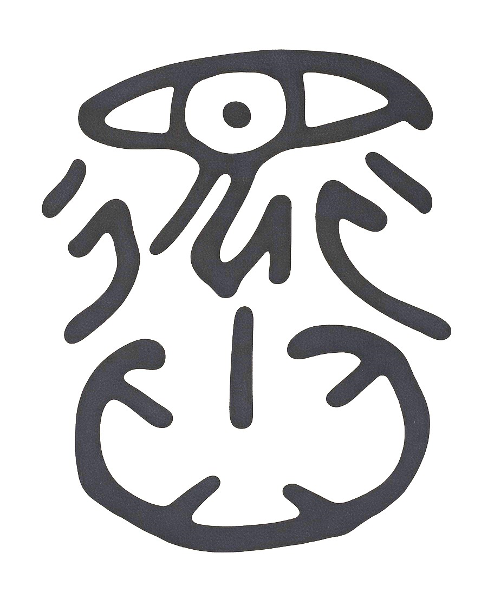

# Mind Is a Geometric Operator at the Observer's Origin

**Baoliin (Zaitian) Wu 伍宝林**

*ORCID:* [0009-0003-2051-5247](https://orcid.org/0009-0003-2051-5247)

*Email:* zaitian001@gmail.com

*Affiliation:* People's Government of Guangdong Province, Guangzhou, CN

**November 4, 2026**

**Paper ID: DW58553927**

---

## Abstract

What is the fundamental nature of mind? **Mind is a geometric operator at the observer's origin.** This paper proposes a geometric and dynamical research architecture that connects an observer's reference origin, symmetry selection, dissipative stabilization, and the formation of discrete representations. Within the author's proposed Modified Einstein Spherical (MES) universe-curvature architecture, mind is modeled as an **observer-anchored geometric operator**: a map that selects a reference frame, transforms continuous state information into an observation representation, and works with dissipative dynamics to stabilize that representation. The paper introduces the *interstice of time* (*Ji*, 几) as a proposed name for a transition or relaxation window, and *qiangming* (强名, force-naming) as a philosophical analogy for assigning operational identities to otherwise continuous or underdetermined states.

A Luoshu-inspired skew-symmetric generator is specified explicitly, and its exponential is shown to be a three-dimensional rotation. A constrained mechanical model and a phase-locking model are then formulated with a consistent Lyapunov function. The analysis establishes conditional convergence toward the critical set of a bounded potential; when the potential is Morse on a compact state space, that critical set is finite. A separate topological result states that a smooth Morse function on the three-torus has at least eight critical points. This lower bound does **not** imply eight stable attractors, nor does it identify the observer's origin as a topological necessity; the eight peripheral phase states used here are instead a chosen $Z_{8}$-symmetric design.

The paper also examines a limited mathematical analogy between unstable modes in stochastic autoregressive systems and error growth. It does not claim that current AI systems must hallucinate because they lack a physical observer origin, or that a geometric hardware anchor alone can eliminate hallucinations. Finally, it outlines an unvalidated engineering proposal, Embodied Mind AGI (EM-AGI), and the Silicon Jade Cong architecture as a possible platform for testing observer-anchored geometric computation. The architecture is conceptual and mathematical at this stage; its physical interpretation and engineering performance require explicit models, simulations, and experiments.

**Keywords:** Mind Equation; Geometric Operator; Observer's Origin; Origin of Knowledge; AI Hallucination; Embodied Mind AGI (EM-AGI); MES universe curvature web; dissipative dynamics; phase locking

---

## 1. Introduction: The Mind-Matter Question and the Self-Observing Universe

The relation between mind and matter remains a central philosophical and scientific problem. Cartesian dualism distinguishes *res cogitans* (thinking substance) from *res extensa* (extended matter), while contemporary cognitive science investigates cognition through neural, computational, and dynamical processes. Quantum theory also raises foundational questions about measurement and the role of observers. However, the appearance of an observer in a physical description does not by itself establish that consciousness causes wave-function collapse, nor does it supply a complete physical theory of mind.

Artificial intelligence provides a practical motivation for revisiting the problem. Large language models generate outputs through learned statistical structure and context-dependent computation. They can produce factually incorrect or spatially inconsistent statements. Such errors have multiple possible causes, including incomplete or conflicting training data, imperfect retrieval, uncertainty, distribution shift, decoding choices, and limitations in model evaluation. It is therefore premature to attribute AI hallucinations to one missing geometric or physical feature.

This paper explores a more limited and testable proposition: **an observer-anchored geometric map, combined with explicit constraints and dissipative stabilization, may provide a useful architecture for converting continuous or uncertain state descriptions into stable, discrete representations.** The proposal is developed within the author's MES universe-curvature architecture. MES is treated here as the motivating theoretical setting, not as an experimentally established cosmological model.

The conceptual sequence is:

```text
Continuous state space
        |
        v
Observer-anchored geometric map
        |
        v
Constraint selection and state representation
        |
        v
Dissipative stabilization / phase locking
        |
        v
Discrete, testable output states
```

The terms used in this paper have distinct roles:

- **Observer's origin:** a selected reference point or local frame used to define coordinates and measurements.
- **Mind operator:** a proposed mathematical map that combines reference-frame selection and representation.
- **Qiangming (强名):** a philosophical analogy for assigning operational labels or identities.
- **Ji (几):** a proposed name for a transition or relaxation window, not an independently established physical constant.
- **Dissipative flow:** a dynamical process whose appropriately defined energy or Lyapunov function decreases.
- **Created reality:** the discrete representation produced by the model; the phrase is epistemological and does not mean that human observation physically creates the universe.

The proposal engages three intellectual lineages. First, Max Scheler's *Die Stellung des Menschen im Kosmos* (1928) examines the distinctive place of the human being in nature. Second, Einstein's discussion of physical concepts and the construction of an external-world description emphasizes the role of conceptual structures in physical knowledge (Einstein, 1936). Third, classical Chinese texts use the language of naming and ordering to discuss how distinctions arise. These connections are interpretive comparisons, not claims that the historical authors anticipated the mathematical model developed here [13, 14].

The paper proceeds as follows. Section 2 discusses naming, *Nous*, and the proposed temporal interstice. Section 3 defines the geometric map and gives a consistent dissipative model. Section 4 explores the epistemological genesis of knowledge through a classical Chinese pictograph, followed by a limited result on stochastic linear instability. Section 5 distinguishes Morse-theoretic facts from the chosen eight-state architecture. Section 6 outlines the proposed EM-AGI hardware concept. The conclusion identifies the work still required for physical and engineering validation.

---

## 2. Classical Foundations: Naming, *Nous*, and the Interstice

### 2.1 Qiangming (强名) as an Analogy for Operational Labeling

In classical Chinese philosophy, *Ming* (名, name) can refer to the distinctions through which things become identifiable in thought and discourse. The *Wunengzi* (无能子) and *Yinwenzi* (尹文子) are relevant to the discussion of naming, form, and the relation between objects and their designations [7, 8]. Their formulations belong to their own historical and philosophical contexts.

In modern mathematical modeling, a continuous state space may admit many coordinate descriptions. An observer or measurement protocol selects variables, a reference frame, and a rule for assigning outcomes. This operation can be compared, at a conceptual level, with *qiangming* (强名): a name is assigned so that a state can be distinguished and used in reasoning.

This analogy should not be confused with gauge fixing in the strict sense of mathematical physics. Gauge fixing selects representatives from equivalence classes associated with a gauge redundancy. A general act of measurement, classification, or coordinate selection need not involve a gauge symmetry. Accordingly, this paper uses **geometric selection** as the general term and reserves **gauge fixing** for cases in which a genuine gauge redundancy has been specified.

### 2.2 Anaxagoras' *Nous* and the Separation of Order

Anaxagoras introduced *Nous* (νοῦς, mind or intellect) as an ordering principle in his account of the cosmos. The surviving fragments are concise and have been interpreted in different ways [9]. In this paper, *Nous* is used as a historical analogy for the operation that distinguishes and organizes states; it is not treated as evidence for a modern physical projection operator.

In the proposed geometric architecture, ordering is represented mathematically by a map from a continuous state description to a selected representation. The map may distinguish coordinates, phases, or classes of states. Whether this procedure describes cognition, physical measurement, or only a computational representation must be determined by the specific implementation.

### 2.3 The Interstice of Time (时之间隙) and the Rhythm of Change

The term *Ji* (几) is used here to designate a transition window in which a system changes from one dynamical regime to another. In an engineered system, such a window could be associated with a relaxation time, a threshold-crossing interval, or a period during which a controller updates its state estimate.

The analogy with the pause between musical notes or between successive contractions is intended to make the idea intuitive: a system's transitions may be as important as its sustained states. These examples are metaphors, not physical derivations. In the mathematical model below, the transition window is represented by a finite timescale $\tau_{Ji} > 0$. Its value must be defined operationally for any particular physical or computational system.

---

## 3. The Geometric and Dynamical Definition of Mind

### 3.1 Operational Definition

> **Definition 1 (Observer-anchored Mind Operator).** In this paper, the Mind operator is a proposed geometric-computational map anchored to an observer-selected reference frame. It acts on a specified state space, applies a declared coordinate or constraint-selection rule, and produces an observation representation. When coupled to a dissipative dynamical system, the resulting representation may converge toward stable states.

This is an operational definition within the proposed architecture. It does not establish that consciousness is identical to a geometric operator, or that the operator is a fundamental term in a known physical field equation.

### 3.2 The Geometric Observation Map

Let the local geometric state be represented in a three-dimensional Euclidean frame with basis vectors $e_{1}, e_{2}, e_{3}$. Define the skew-symmetric matrix

$$
A=\alpha J_{x}+\beta J_{y}+\gamma J_{z} =
\left(
\begin{matrix}
0 & -\gamma & \beta \\
\gamma & 0 & -\alpha \\
-\beta & \alpha & 0
\end{matrix}
\right), \qquad \alpha=-0.4, \quad \beta=1.2, \quad \gamma=0.8. \quad (1)
$$

The coefficients are a **chosen Luoshu-inspired parameterization**. They are formed from selected differences among peripheral entries of the Luoshu square:

$$ \alpha=\frac{4-6}{5}=-0.4, \qquad \beta=\frac{8-2}{5}=1.2, \qquad \gamma=\frac{7-3}{5}=0.8. \quad (2) $$

The construction is a design convention. The Luoshu magic constant alone does not uniquely determine these coefficients, and no uniqueness theorem is claimed.

Substitution gives

$$
A =
\left(
\begin{matrix}
0 & -0.8 & 1.2 \\
0.8 & 0 & 0.4 \\
-1.2 & -0.4 & 0
\end{matrix}
\right). \quad (3)
$$

Because $A^{T} = -A$, its exponential is an element of $SO(3)$. Define

$$ \omega_{0} = \sqrt{\alpha^{2} + \beta^{2} + \gamma^{2}} = \sqrt{2.24}. \quad (4) $$

The Rodrigues-type exponential is

$$ R(\theta) = \exp(\theta A) = I + \frac{\sin(\omega_{0} \theta)}{\omega_{0}} A + \frac{1 - \cos(\omega_{0} \theta)}{\omega_{0}^{2}} A^{2}. \quad (5) $$

Here $\theta$ is dimensionless. The map $R(\theta)$ is a proper rotation about the axis parallel to $(\alpha, \beta, \gamma)$.

Let $C_{\mathrm{Cong}}$ denote a future, explicitly specified representation or boundary-selection map associated with the proposed Jade Cong architecture. The observer-anchored map is written

$$ \mathcal{P}_{\mathrm{Zhi}}(\theta) = C_{\mathrm{Cong}} \circ R(\theta). \quad (6) $$

The symbol $\mathcal{P}_{\mathrm{Zhi}}$ is retained as the name of the Mind operator, but the map is not automatically an orthogonal projector. In particular, idempotence, $\mathcal{P}_{\mathrm{Zhi}}^{2} = \mathcal{P}_{\mathrm{Zhi}}$, would require additional conditions on $C_{\mathrm{Cong}}$ and its domain and codomain. Those conditions are not specified in the present paper.

For a state $q$ in a continuous representation space $\mathcal{X}$, the output is

$$ q_{\mathrm{obs}} = \mathcal{P}_{\mathrm{Zhi}}(\theta)q. \quad (7) $$

Equation (7) is a representation map. It should not be interpreted as a quantum measurement postulate or as proof that a wave function physically collapses into an eigenstate. A Hilbert space, an observable, a measurement interaction, and a probability rule would be needed to make such a quantum claim.

### 3.3 Dynamical Realization: Constrained Dissipative Flow

To study stabilization, consider a mechanical state $x \in \mathbb{R}^{n}$, velocity $v \in \mathbb{R}^{n}$, and a phase error $e \in S^{1}$ with phase-error velocity $u = \dot{e}$. Let $M$ be a constant symmetric positive-definite mass matrix, $D$ a symmetric positive-definite damping matrix, and $W(x)$ a continuously differentiable potential bounded below.

For fixed holonomic constraints $g(x)=0$, let $J_{g}(x) = \partial g / \partial x$ be the constraint Jacobian. The constrained mechanical dynamics are

$$ \dot{x} = v, \quad (8) $$

$$ M\dot{v} = -\nabla W(x) - Dv - J_{g}(x)^{T}\lambda, \quad (9) $$

$$ J_{g}(x)v = 0. \quad (10) $$

The multiplier $\lambda$ is determined algebraically by the constraint equations and their time derivatives, subject to regularity of the constraint Jacobian. It is not assigned an independent evolution equation in this formulation. This distinction is important: an independently postulated multiplier equation would require a separate derivation before it could be included in a Lyapunov proof.

For phase locking, choose an eightfold periodic potential

$$ V_{\phi}(e) = 1 - \cos(8e). \quad (11) $$

The phase dynamics are

$$ \dot{e} = u, \quad (12) $$

$$ I_{\phi}\dot{u} = -\Gamma_{\phi} u - \kappa_{\phi} \frac{\partial V_{\phi}(e)}{\partial e} = -\Gamma_{\phi} u - 8\kappa_{\phi}\sin(8e), \qquad I_{\phi}, \Gamma_{\phi}, \kappa_{\phi} > 0. \quad (13) $$

The eight phase minima are

$$ \Theta = \{2\pi k / 8 : k = 0, \ldots, 7\}. \quad (14) $$

The potential in Eq. (11) is an explicit $Z_{8}$-symmetric design choice. It is not derived from the topology of the three-torus.

For a time-independent constraint and ideal constraint forces, the constraint force does no work because $v^{T}J_{g}^{T}\lambda = \lambda^{T}J_{g}v = 0$. Define the composite energy

$$ \mathcal{V}(x,v,e,u) = \frac{1}{2}v^{T}Mv + W(x) + \frac{1}{2}I_{\phi}u^{2} + \kappa_{\phi}V_{\phi}(e). \quad (15) $$

Along solutions of Eqs. (8)–(13),

$$ \dot{\mathcal{V}} = -v^{T}Dv - \Gamma_{\phi}u^{2} \leq 0. \quad (16) $$

Thus $\mathcal{V}$ is non-increasing. If the relevant sublevel set is compact and the vector field is sufficiently regular, LaSalle's invariance principle implies that trajectories approach the largest invariant subset of

$$ v=0, \qquad u=0, \qquad \nabla_{\mathcal{C}}W(x)=0, \qquad \frac{\partial V_{\phi}}{\partial e}=0, \quad (17) $$

where $\mathcal{C} = \{x : g(x)=0\}$ is the constraint manifold and $\nabla_{\mathcal{C}}W$ denotes the gradient restricted to that manifold.

The limiting set is therefore contained in the critical set of the constrained potential and the phase potential. If the constrained potential is Morse on a compact manifold, it has finitely many critical points. This does not mean that every critical point is an attractor: local minima are candidates for asymptotically stable equilibria, while saddles and maxima are not stable attractors. Additional assumptions are needed to establish convergence to a particular minimum or to quantify its basin of attraction [10].

### 3.4 The Mind Equation (思维创世方程)

The geometric map and dissipative evolution can be combined into a compact operator expression. Let $\mathcal{O}_{\mathrm{web}}$ denote an initial state or state field in a specified function space. Let $L_{D}$ be a dissipative generator with units of inverse time, and let $\tau_{Ji} > 0$ be the operationally defined transition or relaxation time. Then write

$$ \mathcal{R}_{\mathrm{creator}} = \mathcal{P}_{\mathrm{Zhi}} \left[ \exp(-\tau_{Ji}L_{D}) \mathcal{O}_{\mathrm{web}} \right]. \quad (18) $$

Equation (18) is called the **Mind Equation** in this proposed architecture. It is meaningful as an operator composition only after the state space, the domain of $L_{D}$, its boundary conditions, and the action of $\mathcal{P}_{\mathrm{Zhi}}$ have been specified. If $L_{D}$ generates a contraction semigroup in a chosen norm, the exponential describes dissipative evolution over the interval $\tau_{Ji}$. Dissipation does not by itself guarantee a unique final state; that depends on the generator, constraints, and invariant sets.

The terms are interpreted as follows:

- $\mathcal{O}_{\mathrm{web}}$: the initial continuous state description, associated conceptually with the MES curvature web.
- $\mathcal{P}_{\mathrm{Zhi}}$: the observer-anchored geometric selection and representation map.
- $L_{D}$: a specified dissipative generator.
- $\tau_{Ji}$: the transition or relaxation timescale.
- $\mathcal{R}_{\mathrm{creator}}$: the resulting observation representation or stabilized state description.

The expression provides a unifying notation for the proposed architecture; it is not yet a derived fundamental law of nature. In particular, the terms “continuous,” “discrete,” “visible,” “invisible,” “known,” and “unknown” refer to different representational or epistemic distinctions and are not proven to be equivalent dualities.

The construction can be compared philosophically with the Yin–Yang passage in Chapter 42 of the *Daodejing*: “万物负阴而抱阳, 冲气以为和.” In the present interpretation, the continuous state space is associated metaphorically with Yin, while the observer-selected representation is associated with Yang. This is an interpretive analogy, not a mathematical derivation from the classical text.

---

## 4. The Origin of Knowledge and the Nature of AI Hallucination

### 4.1 The Epistemological Genesis of Knowledge

The formation of stable knowledge representations through the Mind Equation (18) provides a critical bridge between modern sensory empiricism and structural rationalism. This epistemic synthesis finds its foundational roots and architectural correspondence in the ancient pictograph *Zhi* 知 (Figure 1), read as "to know," as preserved in the esoteric Daoist text *Xuan Yin Yi Mi* 玄隐遗密 ascribed to Rong Cheng Gong. By decrypting this archaic iconography through the geometric architecture of the *Gui-Ju Dao* 规矩道, the graph is revealed to be a rigorous topological map rather than a mere semantic symbol, embodying a triadic cognitive cycle of observation, reference projection, and dissipative stabilization.

**Figure 1. The Pictograph *Zhi* 知.**



1. **Empiricism (The Observing Eye / $\mathcal{O}_{\mathrm{web}}$):** Knowledge cannot emerge in an informational vacuum. As visually dominated by the central observing eye in the upper half of the pictograph *Zhi* 知 (Figure 1), knowledge requires direct sensory interface with the continuous cosmic state field or curvature web $\mathcal{O}_{\mathrm{web}}$. Modern empiricism correctly identifies raw observation as the primary entry point of cognition. However, an unanchored eye lacking structural orientation perceives only chaotic, infinite-dimensional data stream.

2. **Rationalism (The Orthogonal Frame / $\mathcal{P}_{\mathrm{Zhi}}$):** To transform this unorganized sensory data into structured, actionable experience, the Mind operator $\mathcal{P}_{\mathrm{Zhi}}$ must impose a priori geometric boundaries and reference frames. In the physical structure of the hieroglyph, the eye is structurally bound to a rigid, symmetric orthogonal frame underneath it. This geometric configuration represents the mathematical deployment of coordinate grids and gauge constraints, projecting the amorphous continuous manifold onto the observer's local origin.

3. **Dynamical Convergence (The Bounded Manifold / $\exp(-\tau_{Ji}L_{D})$):** The final step from transient, unstable perception to a discrete, countable output $\mathcal{R}_{\mathrm{creator}}$ requires localized stabilization. The lower portion of the graph forms a bounded continuous domain or basin, which acts as a mathematical representation of a dissipative potential well. The execution of the dissipative generator $\exp(-\tau_{Ji}L_{D})$ over the transition window $\tau_{Ji}$ systematically drives the state trajectories to contract.

Through this profound symbology, *Xuan Yin Yi Mi* and the *Gui-Ju Dao* collectively anticipate the core thesis of this paper: knowledge is neither the passive accumulation of empirical data nor the pure abstract deduction of reason. It is the stabilized geometric output of an anchored observer actively projecting empirical observations through a dissipative, orthogonal mathematical frame.

### 4.2 A Limited Result on Stochastic Linear Instability

The original motivation links unconstrained generative dynamics with the possibility of error accumulation. A mathematically defensible version can be stated for a scalar stochastic autoregressive mode.

**Proposition 1 (Variance growth of an unstable stochastic mode).** Consider

$$ y_{t+1} = a y_{t} + \eta_{t+1}, \quad (19) $$

where $a \in \mathbb{R}$ is constant and $\eta_{t}$ is an independent, zero-mean noise sequence with variance $q > 0$, independent of $y_{0}$. If $|a| \geq 1$ and $\mathrm{Var}(y_{0}) < \infty$, then

$$ P_{t+1} = a^{2}P_{t} + q, \qquad P_{t} = \mathrm{Var}(y_{t}), \quad (20) $$

and $P_{t}$ diverges as $t \to \infty$.

**Proof.** Iterating Eq. (20) gives

$$ P_{t} = a^{2t}P_{0} + q\sum_{j=0}^{t-1}a^{2j}. \quad (21) $$

For $|a|=1$, the sum grows linearly with $t$. For $|a|>1$, it grows geometrically. Since $q>0$, $P_{t} \to \infty$ in either case. $\square$

This proposition establishes a standard instability result for a scalar linear stochastic recursion. It does **not** prove that a transformer or any other AI model contains such a mode, that its errors necessarily grow monotonically with sequence length, or that variance growth is equivalent to factual hallucination. For a multivariate system, covariance growth depends on the system matrix, the noise covariance, and whether the noise excites the relevant unstable modes. A complete analysis would require an identified state-space model and empirical estimates.

AI hallucinations should therefore be treated as measurable output errors with multiple possible causes. The observer-origin and dissipative-convergence ideas in this paper are hypotheses for architecture design, not a demonstrated universal explanation of hallucination. A useful experimental comparison would test whether explicit spatial reference frames, sensor grounding, uncertainty tracking, and feedback reduce defined error rates relative to matched baselines.

---

## 5. Operating Within the MES Universe Curvature Web

### 5.1 Phase Locking and Topological Constraints

A local phase $\Phi_{\mathrm{local}}$ may be compared with a reference phase $\Phi_{\mathrm{ref}}$. A bounded phase error can be specified as

$$ \left| \mathrm{wrap} \left(\Phi_{\mathrm{local}}(t) - \Phi_{\mathrm{ref}}(t)\right) \right| \leq \varepsilon, \quad (22) $$

where $\varepsilon$ is a chosen tolerance and $\mathrm{wrap}$ maps the phase difference to a principal interval such as $[-\pi, \pi)$. The bound is a control objective; it is not automatically guaranteed by the geometry of the universe.

Consider a smooth Morse function $W: T^{3} \rightarrow \mathbb{R}$ on the three-torus. Let $m_{k}$ be the number of critical points of Morse index $k$. The weak Morse inequalities imply

$$ m_{k} \geq b_{k}(T^{3}), \qquad k = 0, 1, 2, 3. \quad (23) $$

The Betti numbers are

$$ (b_{0}, b_{1}, b_{2}, b_{3}) = (1, 3, 3, 1). \quad (24) $$

Consequently,

$$ N_{\mathrm{crit}} = \sum_{k=0}^{3}m_{k} \geq 1 + 3 + 3 + 1 = 8. \quad (25) $$

This is a lower bound on the **total number of critical points** of a Morse function on $T^{3}$. It is not a lower bound of eight stable attractors. Critical points have different Morse indices: index-zero points are local minima, while points of higher index are saddles or maxima.

**Theorem 1 (Morse lower bound on the three-torus).** Every smooth Morse function on $T^{3}$ has at least eight critical points in total.

**Proof.** Apply the weak Morse inequalities in Eq. (23) and sum them, using the Betti numbers in Eq. (24). This yields Eq. (25) [11]. $\square$

The theorem does not imply that the center of a Luoshu diagram must be excluded from the attractor set. In the architecture proposed here, the center is **designated** as the observer's reference origin, while eight peripheral locations are used as candidate state wells. That is an architectural convention, not a consequence of Morse theory.

### 5.2 The Eight-State Design

An eight-state phase architecture can be defined by the periodic potential in Eq. (11). Its minima are the eight phase values in Eq. (14). This construction gives a precise mathematical meaning to an eightfold phase symmetry.

For a spatial illustration, one may place candidate wells at

$$ \mathcal{L}_{\mathrm{periph}} = \{(d_{x}, d_{y}) : d_{x}, d_{y} \in \{-1, 0, 1\}, (d_{x}, d_{y}) \neq (0,0)\}. \quad (26) $$

A central repelling region may be included in a chosen potential, while the eight peripheral regions are designed as candidate wells. The existence, number, and stability of all critical points must be checked for the actual parameter values; the visual arrangement alone is not a proof.

---

## 6. Hardware Implementation: The Proposed EM-AGI Architecture

The proposed **Embodied Mind AGI (EM-AGI)** is an engineering research direction intended to combine geometric reference frames, sensor grounding, constraint-aware computation, and feedback stabilization. It is not a demonstrated artificial general intelligence system.

The **Silicon Jade Cong** is a proposed microarchitecture for exploring this design. Its conceptual modules are:

1. **Reference-frame initialization:** establish a coordinate frame from calibrated sensors. A gravity vector may provide a vertical reference where appropriate, but gravity alone does not determine a complete three-dimensional coordinate frame; additional orientation information is required.
2. **Geometric transformation:** compute rotations and coordinate transformations, including the Rodrigues map in Eq. (5).
3. **Constraint evaluation:** test whether sensor and internal states satisfy declared geometric, physical, or task constraints.
4. **Dissipative state update:** apply a stable feedback or optimization rule with a measurable Lyapunov or energy function.
5. **Uncertainty and evidence tracking:** retain confidence estimates, provenance, and unresolved alternatives rather than forcing every input into a single categorical state.

Names such as `PING_INIT`, `LUOSHU_ROT`, and `MUL_PUMP_ACT` may be used as proposed instruction labels in a future implementation. They are not existing standardized instructions, and their cycle counts, numerical precision, power consumption, and hardware feasibility have not been established.

The architecture should not be described as “zero-hallucination.” A geometric anchor may reduce certain classes of spatial inconsistency if it is correctly calibrated and used by the inference system, but it cannot guarantee factual correctness across arbitrary tasks. A validation program should compare EM-AGI prototypes with matched baselines on preregistered tasks, including spatial localization, coordinate transformations, physical constraint satisfaction, long-horizon state estimation, uncertainty calibration, and factual question answering. Performance should be reported with error bars, ablation studies, and failure cases.

---

## 7. Conclusion: The Universe as a Self-Observing Log

This paper has proposed a geometric-computational account of mind centered on an observer-selected reference origin. Its central idea is that a reference-frame map, explicit constraints, and dissipative dynamics can work together to produce stable representations from continuous or uncertain state descriptions.

Several mathematical results have been established within their stated assumptions. The Luoshu-inspired generator is skew-symmetric, so its exponential defines a three-dimensional rotation. The constrained mechanical and phase-locking model admits a non-increasing composite energy under ideal fixed constraints and positive damping. A Morse function on $T^{3}$ has at least eight critical points in total. A scalar stochastic autoregressive mode with unit-or-greater gain and nonzero additive noise has diverging variance.

These results do not yet establish that mind is literally a fundamental geometric operator, that the MES curvature web is experimentally confirmed, that eight stable attractors are topologically required, or that current AI hallucinations arise from the absence of a physical observer origin. Those stronger propositions remain hypotheses requiring formal derivations and empirical tests.

The proposed EM-AGI and Silicon Jade Cong architecture translate the conceptual architecture into an engineering research program. The key next steps are to define the state spaces and operators completely, implement reproducible simulations, test robustness under noise and model mismatch, and compare hardware prototypes against established baselines.

The broader philosophical picture remains that the universe may be studied as a system whose physical processes generate records, representations, and increasingly sophisticated forms of self-description. In this paper, civilization as an interface and history as a self-updating log are interpretive propositions. Their value lies in motivating precise questions about how observers, measurements, memory, and physical structure interact—not in replacing the need for evidence.

---

## Acknowledgments

We are grateful to all the individual scientists and teams of scientists who have contributed to the exploration and understanding of the entire universe. Supported by AI-driven Supercomputers and the MES Universe Project. We have benefited from our amazing AI partners.

## Funding

Not applicable.

## Availability of data and material

Code, mathematical scripts, and preprints are available at GitHub: https://github.com/Zaitian001/-Self-Preprint-V1.1-

## Competing interests

Not applicable.

## Author Contributions

Baoliin (Zaitian) Wu 伍宝林 is the sole author of this manuscript and is responsible for all aspects of the research, including conceptualization, methodology, theoretical formulation, and manuscript writing.

## References

[1] Baoliin (Zaitian) Wu 伍宝林. (2026). Time Is the Countable Rhythm of Yin–Yang Waxing and Waning. Self-Preprint Archive. https://Zaitian001.github.io/-Self-Preprint-V1.1-/preprints/DW58553925.html

[2] Baoliin (Zaitian) Wu 伍宝林. (2026). Adaptive Intelligence Dao: A Unified Mathematical Principle of Anchor Zero, Change, Balance, Emergence, and Self-Organization. Self-Preprint Archive. https://Zaitian001.github.io/-Self-Preprint-V1.1-/preprints/DW58553907.html

[3] Baoliin (Zaitian) Wu 伍宝林. (2026). The Gui-Ju Dao: The Artificial General Intelligence Algorithm, Geometry, and Engineering Paradigm of China's Indigenous Closed Spherical Universe. Self-Preprint Archive. https://Zaitian001.github.io/-Self-Preprint-V1.1-/preprints/DW58553902.html

[4] Baoliin (Zaitian) Wu 伍宝林. (2026). The Overlooked Coordinate System Exorcising the Demons and Ghosts of Quantum Measurement. Self-Preprint Archive. https://Zaitian001.github.io/-Self-Preprint-V1.1-/preprints/DW58553901.html

[5] Baoliin (Zaitian) Wu 伍宝林. (2026). Curvature-Driven Open Quantum Dynamics and the Pure Geometric Origin of Physics Constants. Self-Preprint Archive. https://Zaitian001.github.io/-Self-Preprint-V1.1-/preprints/DW58553914.html

[6] Yin Xi 尹喜. *Wenshi Zhenjing* 文始真经 [English rendering: *The Book of Master Wenshi*]. (Original work published ca. 485 BCE).

[7] Wunengzi 无能子. *Wunengzi* 无能子 [English rendering: *The Book of Master Wuneng*]. (Original work published 887 CE).

[8] Yinwenzi 尹文子. *Yinwenzi* 尹文子 [English rendering: *The Book of Master Yinwen*]. (Original work published ca. 310 BCE).

[9] Anaxagoras. *Fragments (Fragment B3)*. (Original work published ca. 455 BCE).

[10] Khalil, H. K. (2002). *Nonlinear Systems*. Prentice Hall.

[11] Milnor, J. (1963). *Morse Theory*. Princeton University Press.

[12] Rovelli, C. (2018). *The Order of Time*. Riverhead Books.

[13] Scheler, M. (1928). *Die Stellung des Menschen im Kosmos*. Germany: O. Reichl.

[14] Einstein, A. (1936). Physics and reality. *Journal of the Franklin Institute*, 221(3), 349–382. https://doi.org/10.1016/S0016-0032(36)91047-5

[15] Rong Cheng Gong 容成公. (ca. 27th century BCE). *Xuan Yin Yi Mi* 玄隐遗密. Hand-copied by an oral tradition heir by San Shen Dao Ren 三申道人, 2008. Published by Traditional Chinese Medicine Press, 2018.
